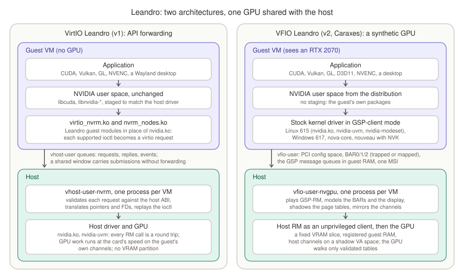
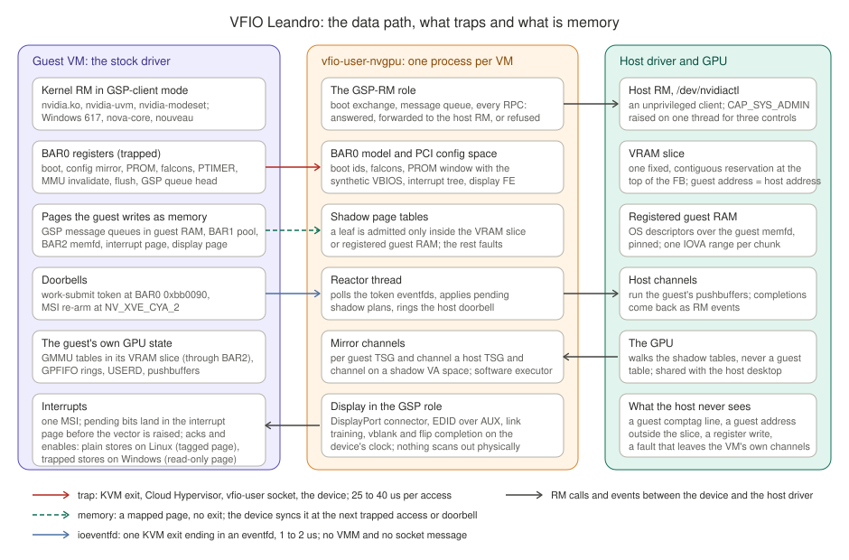

<!-- SPDX-License-Identifier: MIT -->
<!-- SPDX-FileCopyrightText: 2026 Silas Müller <github@silasmueller.de> -->
# Leandro: one NVIDIA GPU, several virtual machines, two architectures

Leandro shares one consumer NVIDIA GPU among virtual machines on a host that keeps using
the card itself. Two architectures exist. **VirtIO Leandro** (v1) runs a Leandro guest
module whose Resource Manager (RM) calls travel over vhost-user to a per-VM host backend
that replays them on the host driver. **VFIO Leandro** (v2, code name Caraxes) presents a
synthetic NVIDIA PCI device over vfio-user to the guest's stock driver; the device plays
the GPU System Processor firmware (GSP-RM), models the PCI BARs, and executes the guest's
work on the physical GPU as a client of the host RM through mirror channels and shadow page
tables. This document describes both, the driver structures they rest on, what each can and
cannot do, and closes with the ranked weaknesses and the work that removes them by
Christmas 2026. Every concept has a page in the [wiki](wiki/README.md); every number comes
from a record cited in the [research notes](research/README.md) or the design documents
under [docs/caraxes](caraxes/README.md). Driver references name the open kernel modules
615.71.09 by path and function.

## 1. The problem

- One GPU, several guests. A desktop or a small lab has one card; NVIDIA's vGPU product
  needs a data-center part, a licence and a host driver package the open modules do not ship.
- Stock drivers. A guest installs its distribution's NVIDIA packages, or the Windows driver
  package, and nothing else; CUDA, Vulkan, D3D, NVENC and a desktop work as on bare metal.
- Isolation. A guest may write any byte it wants; the host desktop and the other guests must
  not see its memory, and a guest fault must stay a guest fault.
- Performance near native. GPU-bound work runs at the card's speed; the cost of the layer
  sits in setup, not in the submission path.
- The card is shared, not partitioned: the host's own desktop runs on it during every
  measurement in this project.

## 2. The two architectures

### 2.1 VirtIO Leandro (v1)

- The guest runs the NVIDIA user-space libraries unchanged and a Leandro kernel module,
  `virtio_nvrm.ko`, in place of `nvidia.ko`. The module owns `/dev/nvidia*` and forwards
  each supported ioctl as a request on a virtio queue.
- A per-VM host process, `vhost-user-nvrm`, validates each request against the host
  driver's ABI, translates pointers and file descriptors, and calls the host RM.
- GPU command buffers and submission registers are mapped into the guest through a
  shared-memory window, so submissions cost no forwarding; RM calls, mappings and
  synchronisation do.
- The guest's display is NVIDIA's displayless class with a generated EDID and guest
  timers for vblank ([DISPLAY.md](DISPLAY.md)).
- Details: [ARCHITECTURE.md](ARCHITECTURE.md), [SECURITY.md](SECURITY.md).

### 2.2 VFIO Leandro (v2, Caraxes)

- The guest runs a stock driver in GSP-client mode: the Linux 615.71.09 open modules, the
  Windows 617.14 driver, nova-core, or nouveau with NVK. One device binary serves all four
  and reads the guest's ABI at its GSP boot ([wiki: guest drivers and ABIs](wiki/guest-drivers-and-abis.md)).
- A per-VM host process, `vfio-user-nvgpu`, is the whole device: PCI configuration space,
  BAR0 registers, the GSP boot exchange, the GSP message queue, every RPC, control and
  event the guest's kernel RM sends to what it believes is firmware.
- The device owns a fixed slice of the card's VRAM for the VM, registers the guest's RAM
  with the host RM, shadows the guest's GPU page tables, and runs the guest's channels on
  host channels it creates as an ordinary RM client.
- The guest's display is an emulated DisplayPort monitor served in the GSP role: EDID over
  AUX, DPCD, link training, vblank and flips on the device's clock.
- Details: [caraxes/architecture.md](caraxes/architecture.md), the [decisions](caraxes/decisions.md),
  the research notes, the wiki.

### 2.3 Side by side

| Aspect | VirtIO Leandro (v1) | VFIO Leandro (v2) |
|---|---|---|
| Trust boundary | the VM; the backend validates ioctl envelopes, pointer spans and FD tokens; hostile guests not established ([SECURITY.md](SECURITY.md)) | the VM; the device validates every GPU address through shadow tables (D17, D18), every VRAM address against the slice (D11) and refuses compression state it does not own (D16, D16b); malicious guests untested ([wiki: isolation rules](wiki/isolation-rules.md)) |
| Guest changes | a Leandro kernel module replaces `nvidia.ko`; matching NVIDIA user space staged by hand | none to the driver; a Linux guest carries two registry keys (`RmDisableGlobalCeUtils=1`, `RmRcWatchdog=0`) until the device serves those channels; no guest module |
| Driver versions | host and guest user space must match one compiled ABI entry | the guest's version is independent of the host's; the device carries per-version generated tables (615 baseline, 610 and 570 kept) and selects the host ABI at run time |
| What crosses the boundary | about 290 ioctl shapes; every RM call is a round trip | 14 RPC functions and 2 GMCAPI commands carrying 844 routed controls; RM calls stay in the guest kernel where the stock driver keeps them |
| Performance shape | native on GPU-bound work; 13 to 35 us per forwarded RM call; 100 ms per blocking sync; startup 0.19 s | native on GPU-bound work; 0 traps per submission; 3200 to 8600 traps per second in 3D workloads and streams (14 to 24 % of a vCPU); setup paths 1.8x (context create) to 12.5x (free) of native; startup about 3.4 s |
| Isolation of memory | host-side accounting of registrations and a VRAM ledger; no partition of the card | a fixed VRAM slice per VM, registered guest RAM only, shadowed and filtered page tables, host scrub on free proven, cross-VM pattern test 0 hits |
| Display | displayless class, generated EDID, guest hrtimer vblank | emulated DisplayPort SST connector, device-paced vblank and flips, hotplug, cursor; Windows and Linux desktops present on it |
| What breaks | a driver whose ioctl layouts changed needs a new ABI entry; refused controls stop debugging, P2P, MIG, profiling paths | a change in the stable transport layer (a baseline break); user space that stops on a refused control; a chip identity outside the Turing family for execution |
| What scales | VMs up to the host's pin budget and VRAM ledger | VMs up to the VRAM slots (2 GiB slots on an 8 GiB card beside the desktop), the 256 MiB host BAR1 and one device process per VM; one GPU VM at a time in the gates until host VRAM pressure is budgeted |
| Host driver changes | none | none |
| Hypervisor | Cloud Hypervisor with patches 0001 to 0003 (vhost-user shared memory) | Cloud Hypervisor with patches 0005 to 0008 (vfio-user region I/O fds, read-only mmap areas) |

## 3. The NVIDIA driver as seen from a virtual GPU

Wiki: [rm-resource-model](wiki/rm-resource-model.md), [rm-controls](wiki/rm-controls.md),
[kernel-rm-hal-and-registry](wiki/kernel-rm-hal-and-registry.md),
[guest-drivers-and-abis](wiki/guest-drivers-and-abis.md). Evidence:
[research/driver-structure.md](research/driver-structure.md).

- **Two halves.** The open kernel modules hold the kernel RM (`src/nvidia`), the OS layer
  (`kernel-open/nvidia`), UVM (`kernel-open/nvidia-uvm`), modeset and DRM. On every chip
  from Turing on, the physical half of the RM runs as firmware on the GPU System Processor
  (GSP-RM), and the kernel RM is its client. The open tree has no physical engine code for
  a non-GSP mode.
- **The resource model.** Everything is an object under a client: `NV01_ROOT` (client),
  `NV01_DEVICE_0`, `NV20_SUBDEVICE_0`, memory objects, VA spaces, TSGs, channels, engine
  objects, events. Objects are allocated by class id with a parameter struct
  (`NV_ESC_RM_ALLOC`), driven by controls (`NV_ESC_RM_CONTROL`, a 32-bit command id plus a
  parameter struct), duplicated across clients (`DUP_OBJECT`) and freed. The resource server
  in `src/nvidia/src/libraries/resserv` keeps the tree.
- **Controls.** 1397 exported control ids in 615.71.09. Each carries flags in the generated
  export tables (`src/nvidia/generated/g_*_nvoc.c`): privilege, `ROUTE_TO_PHYSICAL` (answered
  by GSP-RM), `INTERNAL` (sent only by the kernel RM itself), `CACHEABLE`. 844 route to GSP.
  The kernel RM answers the rest itself, which is why a virtual device in the GSP role never
  sees a `GET_WORK_SUBMIT_TOKEN` or a `GET_NAME_STRING`.
- **HAL selection by boot registers.** `gpumgrGetGpuHalFactor` (`gpu_mgr.c`) and
  `rm_is_supported_device` (`osapi.c`) read `NV_PMC_BOOT_0`, `NV_PMC_BOOT_42` and
  `NV_PMC_BOOT_1` through BAR0 and pick the chip HAL and the runtime variant from them. No
  PCI device id enters that choice. The vGPU guest variant is dead on Turing because its RPC
  infrastructure needs the SR-IOV plugin offload (`initRpcInfrastructure_VGPU`, `rpc.c`), so
  the only variant a Turing identity can run is the GSP client (`PF_KERNEL_ONLY`).
  `osHandleGpuLost` rereads `BOOT_0` and declares the GPU lost when it changes, so an
  emulated value is fixed for the life of the device.
- **The registry.** Module options (`NVreg_*`) and `NVreg_RegistryDwords` keys reach the
  kernel RM through `nvrm_registry.h`; in 615 they also travel to GSP-RM inside
  `GMCAPI_CMD_GSP_INIT`. Two keys make the stock Linux driver skip work the device does not
  serve yet: `RmDisableGlobalCeUtils=1` (no copy-engine self-test on a channel the device
  never learns the VA space of) and `RmRcWatchdog=0` (no watchdog GR channel);
  `RMDisableScrubOnFree=1` is set only without compression, because the compressed slice
  needs the guest's scrubber.
- **Other clients of the same firmware interface.** The Windows 617 KMD boots the same GSP
  model with its own registry (`EnableGpuFirmware`) and its own controls (the deferred API
  objects, `RUSD`); nova-core and nouveau boot GSP-RM 570 with the pre-610 element framing
  and nouveau allocates bare channels without a TSG. The device tells them apart at the boot
  and serves each from its version tables.
- **Class list and engines.** The per-chip class database (`g_gpu_class_list.c`) names what
  a chip can allocate; the engine list and the FIFO device-info table
  (`kfifoGetHostDeviceInfoTable_KERNEL`) name the engines and their fault ids. A stock TU106
  Linux stack allocates 36 of the 48 GSP-bound classes the chip has.
- **NVML on top.** `nvidia-smi` and NVML use the same controls as any client; the `nvml` gate
  compares the guest's `nvidia-smi -q` with the host's over 11 checks. Identity answers are
  device-owned, telemetry is forwarded from the card.
- **What v1 forwards and v2 does not.** v1 replays the ioctl layer and must translate every
  embedded pointer and FD; v2 sits one layer lower, where the kernel RM has already resolved
  handles and the payload is inline, but where the kernel RM also sends internal controls
  that an unprivileged host client can never forward as they are. The GSP boundary is not
  smaller than the ioctl boundary; it wraps the same alloc and control vocabulary.

## 4. The GSP and its emulation

Wiki: [gsp-rm](wiki/gsp-rm.md), [gsp-boot-exchange](wiki/gsp-boot-exchange.md),
[gsp-message-queue](wiki/gsp-message-queue.md), [gsp-rpc-and-events](wiki/gsp-rpc-and-events.md),
[gsp-control-categories](wiki/gsp-control-categories.md),
[gsp-transport-classes](wiki/gsp-transport-classes.md), [gsp-abi-615](wiki/gsp-abi-615.md).
Evidence: [research/gsp-transport.md](research/gsp-transport.md),
[research/gsp-surface.md](research/gsp-surface.md),
[research/gsp-rpc-events-classes.md](research/gsp-rpc-events-classes.md),
[research/abi-baseline.md](research/abi-baseline.md),
[research/one-abi-binary-2026-09-28.md](research/one-abi-binary-2026-09-28.md).

### 4.1 What GSP-RM does on real hardware

- GSP-RM is the physical RM compiled for the GSP's RISC-V core: it owns the engines, the MMU
  fault buffers, the BAR1 and BAR2 bind registers, clocks, power, display hardware and the
  compression policy. The kernel RM never writes `NV_PBUS_BAR1_BLOCK` or `NV_PBUS_BAR2_BLOCK`
  and never programs fault buffers; those HALs are stubs in the kernel-only variant.
- The kernel RM boots it (FWSEC from the VBIOS into the GSP falcon, Booter into SEC2, then
  the RISC-V image), links a message queue and from then on sends every physical operation
  as an RPC. A stand-in must produce the CPU-visible side effects of the boot and answer the
  RPCs; it never executes firmware.

### 4.2 The boot exchange (Turing, 615)

1. The CPU creates the command queue in guest RAM (`msgqTxCreate`, `msgq.c`) and writes
   `NV_PGSP_QUEUE_HEAD(0) = 0` while the falcon is halted.
2. FWSEC-FRTS runs in the model, the falcon is "reset into RISC-V", and the libos-argument
   page address lands in the falcon mailboxes.
3. Booter Load on SEC2 carries the WPR meta; the device links its status queue here, because
   the next step comes without a doorbell.
4. `GspStatusQueueInit` polls `msgqRxLink` for the device's queue header, then writes
   `NV_PGSP_MSGQ_TAIL(0) = 0`.
5. `GMCAPI_CMD_GSP_INIT` goes out with the system information and every registry entry as
   NVKV words; its response is the static configuration (GPU name, GID, FB length and
   regions, BAR PDE bases, engine mask, feature words) and the init completion. In 610 this
   was four RPCs and a `GSP_INIT_DONE` event; nova and nouveau still use that form.
6. `INIT_GSP_TRACE_CRASH_BUFFER`, the internal client allocations, the first
   `GSP_RM_CONTROL`s, `UPDATE_BAR_PDE` and the event import's `ALLOC_MEMORY` follow;
   `RmInitAdapter succeeded` ends the boot. A 615 boot carries 272 RPCs.

### 4.3 The message queue and its elements

- msgq v2: each side owns one 32-byte `msgqTxHeader` at the start of its transmit queue
  (`msgq.c`); the four pointers live in BAR0 registers `NV_PGSP_QUEUE_HEAD/TAIL(0)` and
  `NV_PGSP_MSGQ_HEAD/TAIL(0)` (`dev_gsp.h`), monotonic counters modulo 63 slots of 4 KiB.
- An element is 24 bytes of MCTP framing (magic `MCTP`, payload size, MCTP header, NVDM type
  0x2510DE7E for RM RPC or 0x2610DE7E for GMCAPI) followed by the RPC header and payload;
  no checksum, no sequence number in the element (610 had both). A consumed element's magic
  is overwritten with `SEEN`. An RPC above 65512 bytes travels as `CONTINUATION_RECORD`s.
- The doorbell: the sender fences and writes `QUEUE_HEAD`, which raises the GSP interrupt on
  real hardware and is the one trapped register that carries work in the device. One RPC is
  four trapped accesses; the device's own work behind it is 3 us to 1.5 ms depending on the
  control ([research/trap-census-2026-09-30.md](research/trap-census-2026-09-30.md)).

### 4.4 RPC functions, events, controls

- A 615 GSP client on TU106 uses 14 of the 232 RPC functions (`rpc_global_enums.h`) plus the
  GMCAPI commands `GSP_INIT` and `GSP_SUSPEND`; the device answers all of them.
  `GSP_RM_CONTROL` and `GSP_RM_ALLOC` carry the RM vocabulary; `ALLOC_MEMORY` registers
  guest pages; `UPDATE_BAR_PDE` hands the kernel's BAR2 root; `DUP_OBJECT`, `FREE`,
  `IDLE_CHANNELS`, `GPU_EXEC_REG_OPS` (never forwarded), `DUMP_PROTOBUF_COMPONENT` (empty),
  `ECC_NOTIFIER_WRITE_ACK`.
- Events: 45 defined, 36 dispatched by the kernel, 4 sent by the device (`POST_EVENT` for
  display hotplug and the event import, `RC_TRIGGERED` and `OS_ERROR_LOG` from a guest
  channel's error notifier, `GSP_INIT_DONE` on the 610 transport only). Events that panic or
  stop the guest (`TRIGGER_BUGCHECK`, `GSP_LOCKDOWN_NOTICE`, `FORCED_DRIVER_SHUTDOWN`) are
  never sent.
- Controls: of 844 routed, the device answers 777 (host-forwarded 69, synthesized 80,
  guest-derived 75, echo 65, refused 488) and 67 are unhandled, most of them static chip data
  waiting for a capture. Categories: A pure chip data (per-chip tables), B host-forwardable
  public getters (filtered by a deny list), C guest-state derived (channel registry), D device
  model (rule table REFUSE, DENY, ACK, MODEL, MIRROR, TABLE), E feature families the chip lacks
  (28 families, 302 controls).
- Classes: 143 GSP-bound classes a client can put on the wire, 48 in TU106's database, 36
  allocated by a stock stack; a class outside the database is refused with GSP-RM's own codes
  (`NV_ERR_NOT_SUPPORTED`, under a channel `NV_ERR_INVALID_CLASS`), so no phantom object exists.

### 4.5 What a stand-in must answer, what it must refuse, and why

- Answer: everything a stock client sends at boot and in the CUDA, NVML, Vulkan, D3D and
  display paths; a refusal there is an assertion the kernel tolerates or a wall in user
  space. Windows showed the second kind twice: a refused remap component reset the GPU, and a
  refused deferred channel migration hung the application ([research/windows-findings.md](research/windows-findings.md),
  steps 21 and 23).
- Refuse because the feature is absent: NVLink, MIG, confidential computing, C2C, HDMI FRL, DP
  2.x and 22 more families on TU106, labelled `refused (feature absent on this chip)`; the
  same answer the card would give.
- Refuse because of isolation: profiler classes, register access, bus and power setters,
  anything whose effect reaches shared host hardware or another VM's state, labelled as an
  isolation refusal with `NV_ERR_INSUFFICIENT_PERMISSIONS` or `NV_ERR_NOT_SUPPORTED`.
- A gap (unhandled) also answers `NV_ERR_NOT_SUPPORTED`, from the dispatcher's unanswered arm;
  a refusal differs from a gap by being deliberate and labelled (decision D9: every answer
  carries its provenance).

### 4.6 Stability: the 615 ABI and later versions as deltas

- From 615.71.09 NVIDIA tags the transport and boot layer `NV_ABI_STABLE` (`nvtypes.h`,
  `gspifpub.h`): 12 structs (`msgqTxHeader`, `GSP_MSG_QUEUE_ELEMENT`, `GMCAPI_HEADER`, the boot
  arguments, the `GSP_FMC_*` parameters) and 5 enums, growing only into reserved space.
- The RM RPC layer is an opt-in "unstable interface" (`NVGMC_SI_UNSTABLE_INTERFACE_SUPPORT`,
  `gmcapi_system_info.h`); the 615 kernel opts in with both bits. Every control and alloc
  layout, RPC number and internal handle stays per version.
- Decision D20: 615.71.09 is the recorded baseline (`caraxes/abi/gsp-615.71.09/`, nine TSVs
  and a MANIFEST); a new driver is snapshotted and diffed (`gsp-abi.py diff`), and the
  per-version tables are regenerated from the delta. The 610-to-615 delta was 185 driver-side
  changes in 34 groups, 26 touching what the device implements; the 570-to-610 delta gave
  nova and nouveau their tables. A change in the stable layer is a baseline break that needs
  a decision.
- One binary: the guest's ABI is read at the GSP boot from the RMARGS magic and the first
  element's frame (570 pre-610 framing, 610, 615; Windows 617 on the 615 model); a pin with
  `--guest-abi` is optional and fails closed.

### 4.7 Transport classes

Every routed control was classified by its structure (call, data, pointers, handles, side
effects) into what could leave the trapped path: ZT-PAGE 101 (static getters a page could
publish), ZT-QUEUE 155 (device-only answers on a polled queue), HOST 103 (a host RM round
trip: static, telemetry, GSS-legacy), TRAP 32 (addresses, handles, window order, host TSG
state), REFUSE 490. Controls are lifecycle traffic: 187 RPCs per CUDA process, 101 per
`nvidia-smi -q`, 1352 per GNOME start, 0 per frame and 0 per submission; the GSP RPC rate
in a running workload is 5 to 45 per second ([caraxes/gsp-transport-classes.md](caraxes/gsp-transport-classes.md),
[research/trap-census-2026-09-30.md](research/trap-census-2026-09-30.md)).

## 5. PCI, BARs and memory

Wiki: [pci-config-and-identity](wiki/pci-config-and-identity.md),
[bar0-registers](wiki/bar0-registers.md), [bar1-vram-window](wiki/bar1-vram-window.md),
[bar2-page-tables-and-userd](wiki/bar2-page-tables-and-userd.md),
[sysmem-and-dma](wiki/sysmem-and-dma.md), [page-tables-and-shadow](wiki/page-tables-and-shadow.md),
[traps-and-fast-paths](wiki/traps-and-fast-paths.md).
Evidence: [research/memory-model.md](research/memory-model.md),
[research/windows-and-traps.md](research/windows-and-traps.md),
[research/trap-census-2026-09-30.md](research/trap-census-2026-09-30.md).

| BAR | TU106 | Role for the driver | In the device |
|---|---|---|---|
| config space | 4 KiB, PM, MSI, PCIe capabilities | ids, BAR sizes, MSI enable; the RM reads it through the BAR0 mirror `NV_PCFG` at 0x88000 | seeded from the captured `lspci -xxxx`; the Turing RM reads link registers at fixed XVE offsets, so the layout stays Turing's |
| BAR0 | 16 MiB registers | boot ids, config mirror, PROM window (VBIOS at 0x300000), the GSP and SEC2 falcons, interrupt tree at 0xb80000, MMU invalidate, usermode doorbell 0xbb0090, display FE | trapped; the interrupt pages, the display page and the display kick page offered as memory; the doorbell and the MSI re-arm as ioeventfds |
| BAR1 | 256 MiB, fixed | the CPU's window onto VRAM through GMMU tables: GPFIFO entries, USERD GPPut, Vulkan host-visible memory, the console | a private pool `[0, 32 MiB)` as a dma-buf area (default with host execution) so submissions trap 0 times; the rest trapped through the device's two 16 MiB host BAR1 windows |
| BAR2 (PCI BAR3) | 32 MiB | the RM's virtual aperture for page tables, instance blocks and scrubs; bootstrapped through PRAMIN, verified by `kbusVerifyBar2_GM107` | a sealed memfd with one trapped flush page (opt-in, on for Linux; a Windows A/B is open), synced at the RM's flush reads, MMU invalidates, BAR2 binds and GSP doorbells; without it every BAR2 write traps (0.9 M per Windows boot) |
| ROM | 512 KiB | the PCI image chain to the FWSEC image | captured two images plus a constructed third one (D8); nothing executes |

- **Which BAR0 registers a driver really touches.** Besides the GSP boot: `NV_PMC_BOOT_*`,
  `NV_PCFG` (config reads, MSI re-arm at `NV_XVE_CYA_2`), `NV_PBUS_BAR0_WINDOW` and PRAMIN,
  the interrupt tree (leaves, enables, top, trigger), `NV_PFB_PRI_MMU_INVALIDATE`, the flush
  registers, `NV_PTIMER`, the usermode page (`TIME_0/1` reads, the doorbell), the display FE
  interrupt page. The kernel RM's interrupt-enable toggles at every RM lock acquire and
  release are why the interrupt page exists.
- **VRAM: a fixed slice.** Guest FB address X is host VRAM address X. The device reserves
  `[B, E)` at the top of the host FB heap as one `NV01_MEMORY_LOCAL_USER` allocation,
  FIXED_ADDRESS, CONTIGUOUS; slot n lies n profile sizes below the top, and a reservation
  that would leave the host under its floor (1024 MiB) is refused. The guest is told the
  card's full address space so that its fake WPR lands in the host's reserved top.
  Compression: by default no guest comptag line reaches the host (D16); with
  `CARAXES_COMPRESSION=slice` the reservation is allocated compressed with comptags that
  belong to its physical pages, as vGPU and MIG do (D16b; on for the Linux gates, off on
  Windows pending an A/B).
- **Sysmem: registered guest RAM.** Each 1 GiB chunk of guest RAM is one
  `NV01_MEMORY_SYSTEM_OS_DESCRIPTOR` over the device's mapping of the guest memfd, pinned
  with `FOLL_LONGTERM` (`os-mlock.c`), and gets one contiguous IOVA range. The guest writes
  guest physical addresses; the device translates them (the D13 guest module is no longer
  loaded). Registration is refused when the host would be left under 4 GiB available.
- **The swiotlb alias.** A GSP-client guest refuses to initialise when its sysmem flush
  buffer's DMA address lies at or above 2^40 (`kern_mem_sys_gm107.c`); the launcher aliases
  the guest's swiotlb pool below that bound in the guest's table only, and the device follows
  the alias from the registered descriptor.
- **Page tables and the shadow.** The guest writes GMMU v2 tables in its VRAM slice as on
  bare metal (`kern_gmmu.c` places PDEs and PTEs in `ADDR_FBMEM`; UVM in `UVM_APERTURE_VID`).
  The device keeps a walk cache per guest root, patches it write-through on trapped or synced
  table writes, and admits a leaf only if it lies in this VM's reservation or in one
  registered guest-RAM descriptor, carries a permitted kind and is not in a device-reserved
  range (`resolve_leaf`). Admitted leaves become host RM mappings (coalesced, gathered for
  scattered sysmem, freed by region, gather descriptors cached across frees) on a shadow VA
  space the host channels run on. A guest entry the filter refuses is counted and faults on
  the guest's own channel; the GPU never walks an unfiltered guest table.
- **Fast paths.** Interrupt page, display page and kick page, BAR1 pool, BAR2 memfd, doorbell
  token pool and guest tokens, MSI re-arm ioeventfd, posted doorbell, fast reads, held
  invalidate: each with a stated sync point at the last trapped access before a guest store
  can reach the GPU. The interrupt page, the pool, the hybrid reactor and GPA DMA are
  defaults with host execution since the flag consolidation of 2026-09-30; BAR2 memfd,
  tokens, the re-arm ioeventfd and the display page are switches the Linux gates set.

## 6. Submission and interrupts

Wiki: [channels-and-submission](wiki/channels-and-submission.md),
[channel-migration-and-deferred-api](wiki/channel-migration-and-deferred-api.md),
[interrupts](wiki/interrupts.md). Evidence: [research/trap-census-2026-09-30.md](research/trap-census-2026-09-30.md),
[research/windows-findings.md](research/windows-findings.md).

- **Channels.** A GPFIFO channel (`TURING_CHANNEL_GPFIFO_A` 0xC46F on TU106) has a GPFIFO ring
  of pushbuffer pointers and a USERD page holding GPPut; a TSG groups channels on one
  runlist. The guest's kernel RM allocates them through `GSP_RM_ALLOC`; the device constructs
  them under the guest's handles and mirrors each eligible one on a host channel in the
  guest's slice ([wiki: execution mirror](wiki/execution-mirror.md)).
- **A submission is four writes.** Two dwords of the GPFIFO entry and GPPut through BAR1, then
  the work-submit token to the usermode doorbell `NVC361_NOTIFY_CHANNEL_PENDING` at BAR0
  0xbb0090. The token is `runlist << 16 | ChID`, generated by
  `kfifoGenerateWorkSubmitTokenHal_TU102` (`kernel_fifo_tu102.c`) and written into the
  channel's notifier entry by the kernel RM itself; GSP-RM never sees `GET_WORK_SUBMIT_TOKEN`.
- **Zero-trap submission.** The BAR1 pool makes the three BAR1 writes plain memory writes. The
  device hands out its own tokens from a pool outside every RM encoding (64 by default) and
  registers the guest's own tokens for ChIDs below 48 on the hot runlists (144 on Linux, 240
  on Windows); each token is one KVM datamatch ioeventfd on the doorbell register (Cloud
  Hypervisor patches 0005 and 0006, 253 fds per reply). A ring is then one KVM exit ending in
  an eventfd (1.3 to 1.9 us) with no VMM and no vfio-user message. A reactor thread polls the
  eventfds (hybrid mode by default) and rings the host doorbell after the pending shadow
  plans are applied. Linux glmark2 rings 8674 times per second this way with about 0 trapped
  doorbells; Windows Heaven still traps 500 doorbells per second for ChIDs outside the set.
- **Ring migration.** WDDM grows a busy channel's ring under contention: a deferred
  `NV2080_CTRL_CMD_FIFO_UPDATE_CHANNEL_INFO` moves the channel to a 65536-entry GPFIFO and a
  new USERD, sent as the old ring's last entry through the deferred API object
  (`ctrl5080.h`, `deferred_api.c`). The device registers it with the host RM, which migrates
  the host channel in its own stream; every migration switched exactly at the old ring's
  end in the validation runs.
- **Interrupts.** The Turing interrupt tree (`NV_CTRL` at 0xb80000: leaves, leaf enables, top,
  top enables, trigger; `intr_tu102.c`) plus `NV_PMC_INTR_EN_SET/CLEAR` on page 0 take about
  60 trapped accesses per interrupt in the trapped model. The interrupt page offers both pages
  as memory areas of a memfd; the device writes pending bits before it signals the MSI, and the
  reactor applies the guest's stores (write-1-to-clear, enables, trigger) with tag bits and a
  retrigger watchdog. Linux runs the page in this tagged mode with 0 traps per interrupt.
  Windows runs it in exact mode (the page mapped read-only by patch 0007, stores trap and are
  applied at once) because the tagged page gave TDRs at the first D3D11 device; its 9 tree
  stores per interrupt are the largest trap source on Windows (about 5300 per second in
  Heaven).
- **MSI.** One vector; the RM re-arms it by writing `NV_XVE_CYA_2` through the config mirror
  once per interrupt (`kernel_bif_gm107.c`); an ioeventfd without datamatch takes that trap
  to 0 on Linux. After a Windows FLR the host subdevice kept the old mirror's notifier action
  and no completion reached the guest until the mirror disarms its notifiers at teardown
  ([research/flr-host-events-2026-09-29.md](research/flr-host-events-2026-09-29.md)).
- **The cost of a trap.** A trapped access with no device work: 23 to 27 us p50 on a quiet
  host, 35 to 40 us beside two VMs; a datamatch ioeventfd 1.28 us (1.91 us inside a read-only
  slot); a read of a mapped page about 1 ns. Per workload: Linux glmark2 3206 traps per second
  (flush reads, `TIME` reads, MMU invalidates), a Moonlight stream 4300 (23 % of a vCPU),
  Windows Heaven about 8600 (tree stores, BAR2 writes, PTIMER, doorbells). The plan takes
  Heaven to about 250 and Linux to about 190 per second, in the order posted writes, BAR2
  memfd on Windows, the tagged tree page on Windows, the clock pages, the remaining doorbells,
  the GSP queue head as an ioeventfd, the invalidate and flush pages.

## 7. Execution on the host

Wiki: [execution-mirror](wiki/execution-mirror.md), [software-executor](wiki/software-executor.md),
[isolation-rules](wiki/isolation-rules.md). Evidence:
[research/isolation-and-xids.md](research/isolation-and-xids.md),
[research/lockfree-2026-09-29.md](research/lockfree-2026-09-29.md),
[research/gr-preemption-2026-09-29.md](research/gr-preemption-2026-09-29.md),
[caraxes/execution.md](caraxes/execution.md).

- **The host RM as a client.** The device opens `/dev/nvidiactl` as an unprivileged client
  (D10) and builds, per guest root, one shadow VA space; per guest TSG one host TSG; per
  eligible guest channel one host channel whose USERD lies in the guest's slice or pool page,
  with the same engine objects (CE, GR compute, 3D, NVENC, NVDEC). The physical GPU walks the
  shadow tables, which name only admitted leaves; GR context buffers the host RM builds are
  mapped into the shadow, never into the guest's root.
- **Mirror or software executor.** Channels whose work the GPU must run get a host mirror.
  The paging and copy channels of the kernel RM and the Windows KMD run in the device's
  software executor, which interprets the copy-engine methods and moves the data itself,
  or on a device-owned host CE; a root process's copy channels are mirrored too since
  2026-09-30 (a 16 MiB copy 1.4 ms against 21.7 to 68 ms in software, native 1.31 ms).
- **Privilege (D12).** The process runs as an ordinary user with `CAP_SYS_ADMIN` permitted but
  not effective and raises it on one thread only around the controls the RM guards with
  `osIsAdministrator()` (`escape.c`, `control.c`): `GET_SURFACE_PHYS_ATTR`,
  `DMA_SET_PAGE_DIRECTORY`, `GPU_PROMOTE_CTX`, and the privileged `MEM_OP` of the TLB
  invalidator channel. Narrower than v1's `LEA_ADMIN_PRIV=1`, which keeps it effective.
- **The device lock.** Long holders of the device lock were the cause of Windows' VSync
  timeouts and Linux' loading stalls: held rings, mirror builds and page-table walks under
  the lock. Mirror builds and shadow work moved to the worker, the display got its own lock,
  and the MMU invalidate is held only for the invalidated root's own plans.
- **Preemption.** SotTR's host Xid 109 came from a host GR context in graphics WFI mode
  while the driver asked for compute CTA/CILP; the mirrored GR TSG now gets an owned GFXP
  buffer in the VM's slice (6.63 MiB per GR TSG).
- **The isolation rules.** D11: a fixed slice, refused when the host would run short. D16: no
  guest comptag line reaches the host, by policy in every answer, by a PTE filter and by an
  audit after each gate; D16b: real compression whose comptags belong to the slice's own
  pages. D17: shadow tables are the DMA route and the guest stays bare metal. D18: the GPU
  may reach only this VM's slice and registered guest RAM through validated shadows.
- **What a guest can never do.** Map VRAM outside its slice or RAM it did not get registered;
  use a compression state it does not own; ring a channel that is not its own; read the
  host's registers (`GPU_EXEC_REG_OPS` answers `NOACCESS` for everything but the three boot
  ids); reach GSP-RM's bus, power, clock, ECC, NVLink or profiler paths; change the boot
  identity; see another VM's pattern (0 hits in both directions in the pattern test).
- **Faults stay with the VM.** Every host Xid line names the device process's pid and lands on
  that VM's own mirror channels; the catalogue of every Xid recorded (32 PBENTRY, 38 on a
  host-built GR context, 31 FAULT_PDE/PTE from mapping order, 13 kind and class mismatches,
  109 on a kill -9 and on the WFI context, 45 on a refused remap) records cause and fix, and
  the fixes went into the mapping and ordering paths, never into a host reset.
- **Teardown and reconnect.** Fail closed: mirror objects, descriptors, reservation, client,
  stopping at the first failure and leaving the reservation pinned rather than reused; the
  host's scrub on free clears the slice before the next owner (23 to 38 ms for 2 GiB). A guest
  reboot under Cloud Hypervisor drops and re-creates the vfio-user client; the device keeps
  its socket, resets to power-on state for the next client and releases the old client's
  memory and IRQ eventfds; validated in C119 and the gate's Windows leg
  ([research/windows-findings.md](research/windows-findings.md), step 23).
- **What has no quota.** Host BAR1 (256 MiB host-wide) is budgeted per device (two 16 MiB
  windows plus the pool, a host floor of 64 or 96 MiB); host VRAM has a floor for the host
  desktop; GPU time, channel count and RM work are not budgeted, and the shadow's own page
  tables live in host VRAM outside the slice, so a second VM can push a mapping into
  NO_MEMORY.

## 8. Display

Wiki: [display-and-kms](wiki/display-and-kms.md),
[display-flips-and-reserve](wiki/display-flips-and-reserve.md),
[video-engines](wiki/video-engines.md). Evidence:
[research/windows-findings.md](research/windows-findings.md) (steps 13 to 18),
[research/vblank-path-2026-09-29.md](research/vblank-path-2026-09-29.md),
[research/display-reserve-2026-09-29.md](research/display-reserve-2026-09-29.md),
`caraxes/runs/codec-2026-09-30/matrix.md`.

- **v1.** The displayless class (`NVA083_GRID_DISPLAYLESS`) with a generated EDID, guest
  hrtimers for vblank, RM events for fence wake-ups; GNOME on Wayland with KMS capture and
  NVENC through Sunshine passed a client-frame check on 2026-09-19. Two concurrent Shadow of
  the Tomb Raider guests at 720p completed on one card
  ([measurements/sottr-4q](measurements/sottr-4q/README.md)).
- **v2.** The device declares heads, windows, SORs and one DisplayPort SST connector per head
  (D15), answers the NV0073 display controls, serves EDID over AUX and a DPCD model from the
  `dp-sink` crate, completes link training, paces vblank and flip completion on its own timer
  (`AWAKEN` and `LAST_DATA` on the core channel, `NV9010_VBLANK_CALLBACK` in nvkms), reports
  hotplug through `POST_EVENT`, and scans out nothing physically. The stock `nvidia-modeset`,
  `nvidia-drm` and the Windows KMD see an ordinary monitor.
- **Flips.** A flip's notifier reads NOT_BEGUN until the latch at the blank's start, BEGUN
  with the latch's time, and FINISHED when the next presentation displaces it; the Windows KMD
  checks the notifier about 0.6 ms after programming a flip and declared a VSync timeout when
  it read FINISHED there. With this model the Windows desktop is stable through hours of
  benchmarks and streams.
- **Rendering.** Linux: the guest's EGL, GL and Vulkan stack renders on the physical GPU
  through the shadow GR path; the display gate passes 11 of 11; Mutter presents at 60 Hz;
  glmark2 4410 and vkmark 3922 at 1280x720 on Linux B. Windows: the D3D11 stages pass 12 of
  12; Heaven 1080p High 152 to 158 fps; Superposition 1080p Medium 12160 to 12247 (a desktop
  RTX 2070 scores about 12 to 13 thousand). SotTR on Linux ran to completion at 15.4 fps
  average with the loading stall fixed and is open for a rendering fault
  ([known issues](caraxes/KNOWN-ISSUES.md)).
- **Capture, streaming, video.** KMS capture reads the block-linear scanout correctly.
  NVENC and NVDEC run through mirrored video channels: on Linux 615 H.264 420 fps and HEVC
  333 fps encode, H.264 650, HEVC 1310 and VP9 900 fps decode, all bit-exact against software
  decode; on Windows 315 and 184 fps encode, 587, 636 and 584 fps decode. Sunshine on Linux
  with NVENC streams at 60 fps with 5.9 ms host latency against 18.3 ms with x264, at 24 %
  of a guest core instead of 142 %. AV1 fails cleanly on both: TU106 has no AV1 engine.
- **VRAM for the display.** A full 4 GiB Linux guest refused NVKMS its scanout memory when a
  game had taken the rest; v1's display balloon exists for 615 as an RM patch loaded only for
  game tests, and a dmem cgroup cap was evaluated and parked.
- **Wayland is the goal.** X11 was a stepping stone in v1; in v2 the compositor runs on KMS
  with a stable vblank and page-flip cadence that the device controls.

## 9. Identity

Wiki: [identity-and-costume](wiki/identity-and-costume.md),
[feature-families-and-chips](wiki/feature-families-and-chips.md). Evidence:
[research/identity-and-costume.md](research/identity-and-costume.md),
[research/feature-families.md](research/feature-families.md),
[research/blackwell-and-hopper.md](research/blackwell-and-hopper.md).

- **Profiles and names.** The guest sees `Leandro <Transport> <Personality>-<Profile>`
  (`Leandro VFIO RTX 2070-4G`, `Leandro VirtIO RTX 2070-4G`) from one naming module
  (`nvrm_abi::naming`, [NAMING.md](NAMING.md)); the profile is the guest framebuffer size.
  In v2 the name, FB length, regions, GID and engine mask are keys of the `GSP_INIT`
  response, so nothing is rewritten on the way back from the host; in v1 selected replies
  are rewritten.
- **Three axes (D14).** Chip (boot model, registers, engines, classes, families, in
  `chips/<chip>/`), board (PCI ids, BAR sizes, name, display connector, in `boards/*.toml`),
  driver version (generated RPC, control and static-info layouts per version). TU106 with the
  RTX 2070 board is the first implementation; GB206 with the RTX 5060 Ti board is the second
  chip, in pure emulation.
- **Costumes.** A presented chip is a base chip's tables plus a TOML overlay, so the overlay
  is the complete list of lies. PCI ids, subsystem, name and BAR sizes lie freely; the config
  space layout cannot (the whole GB206 space on the TU106 made nvidia-smi report link width
  25x); boot identity can lie within the HAL family (TU104 on TU106 boots and passes the nvml
  gate and 10 of 12 CUDA tests) and across families only in emulation.
- **The limits.** Compute capability follows the chip identity, not GR info. Class ids live
  in the pushbuffer: libcuda's `SET_OBJECT 0xC7C0` against TU106 engines raised host Xid 13
  "Class Mismatch", so a costume from another family cannot execute on the RTX 2070 without
  rewriting method streams. The GMMU format is per family (v3 from Hopper on). The Turing
  family is the costume's reach for execution.
- **Blackwell and Hopper in emulation.** The GB206 identity from the lab capture boots the
  610 guest to `RmInitAdapter succeeded` and the first channel allocation (N4) on the FSP
  Chain-of-Trust boot model (`kern_fsp_gb202.c`) with a GMMU v3 walker for BAR2, and
  nvidia-smi reports compute capability 12.0; GH100 reuses the FSP model with a boot overlay
  and reports 9.0. Neither can execute on the TU106.

## 10. Performance

Wiki: [performance-shape](wiki/performance-shape.md). Evidence:
[research/performance-facts.md](research/performance-facts.md),
[research/ctxcreate-2026-09-29.md](research/ctxcreate-2026-09-29.md),
[research/trap-census-2026-09-30.md](research/trap-census-2026-09-30.md),
[research/windows-findings.md](research/windows-findings.md) (step 23),
`caraxes/runs/codec-2026-09-30/matrix.md`, [caraxes/benchmark.md](caraxes/benchmark.md).

Ratios are v2 over native on the RTX 2070 (host 615.71.09, 615 guest); above 1 is slower
for times, below 1 is slower for rates. The first block is the 2026-09-25 matrix on a quiet
host (n=5); the second block holds the later measurements that replaced a row or added one.

| Metric | native | v1 (610 closing) | v2 | v2 / native | record |
|---|---|---|---|---|---|
| short kernel, ms per launch | 0.006 | 0.009 | 0.015 | 2.5 | matrix 2026-09-25 |
| 30M-cycle kernel, ms | 16.3 | 16.0 | 17.3 | 1.06 | matrix 2026-09-25 |
| h2d pinned 256 MiB, GB/s | 13.1 | 13.1 | 13.1 | 1.00 | matrix 2026-09-25 |
| h2d pinned 1 MiB, GB/s | 12.1 | 12.2 | 6.08 | 0.50 | matrix 2026-09-25 |
| cuInit, ms | 106 | 35.2 | 14.8 | 0.14 | matrix 2026-09-25 |
| cuMemAlloc 1 MiB, us | 35.8 | 93.4 | 201 | 5.6 | matrix 2026-09-25 |
| cuMemFree 1 MiB, us | 27.1 | 52.5 | 339 | 12.5 | matrix 2026-09-25 |
| PPO CartPole, steps/s | 107663 | | 75070 | 0.67 | matrix 2026-09-25 |
| llama.cpp pp512 / tg128, tokens/s (2 GiB) | 8475 / 295 | | 8150 / 272 | 0.96 / 0.92 | workload gate 2026-09-25 |
| transformer training, tokens/s | 103760 | | 104754 | 1.01 | workload gate 2026-09-25 |
| ResNet-18 training, images/s | 506 | | 526 | 1.04 | workload gate 2026-09-25 |
| cuCtxCreate, ms | 130 | 165 | 240 to 256 (beside another VM) | 1.8 to 2.0 | train A/B 2026-09-30 |
| root process copy 16 MiB, ms | 1.31 | | 1.41 to 1.51 | 1.1 | train A/B 2026-09-30 |
| NVENC H.264 / HEVC 1080p, fps (Linux) | | | 420 / 333 | | codec matrix 2026-09-30 |
| NVDEC H.264 / HEVC / VP9 1080p, fps (Linux) | | | 650 / 1310 / 900 | | codec matrix 2026-09-30 |
| Sunshine NVENC stream, host latency, ms (Linux) | | | 5.9 (x264: 18.3) | | codec matrix 2026-09-30 |
| Heaven 1080p High, fps (Windows) | | | 152 to 158 | | windows-findings step 23 |
| Superposition 1080p Medium, points (Windows) | about 12 to 13 thousand | | 12160 to 12247 | about 1.0 | windows-findings steps 21, 23 |

- **What runs at native speed.** Long kernels, bulk transfers, device-bound training and
  inference, 3D benchmarks whose frame is GPU-bound: the GPU does the work on the guest's own
  tables and channels, and the device is not on that path.
- **What costs.** Submission-bound loops (PPO at 0.67: the per-ring work of the reactor and
  the shadow barrier), allocation and free (the guest RM's MMU invalidate and flush traps and
  the BAR2 sync they carry), context creation (the first plan's gather descriptors, now
  cached, the host channel builds, the BAR2 syncs), small pinned copies (bimodal with the
  card's PCIe link state), and the trap rate of 3D workloads (14 to 24 % of a vCPU, most of
  it the exit and the socket round trip rather than device work).
- **Where the remaining time goes.** Per trapped access 35 to 40 us of round trip beside
  other VMs against a few microseconds of device work; per RPC 108 us of trap protocol against
  3 us of device work; per Windows interrupt 9 trapped tree stores; per Linux frame about 23
  flush reads and 10 invalidate accesses.
- **v1's shape.** Native on GPU-bound work, 13 to 35 us per forwarded RM call, a flat 100 ms
  per blocking synchronisation, a pinned-page retention until guest restart; v1 is faster on
  allocation paths and startup, v2 on submission latency, and both are native on bulk work.
- **The ReBAR outlook.** TU106's BAR1 is 256 MiB and its resizable-BAR capability offers only
  64, 128 and 256 MiB, so the pool copies pages in and out and the device reaches its slice
  through two 16 MiB windows. On a card whose BAR1 covers its VRAM, the pool can cover all of
  guest BAR1 and the device maps its slice once.

## 11. Verification

Wiki: [verification-methods](wiki/verification-methods.md),
[captured-cards](wiki/captured-cards.md), [contributing-a-capture](wiki/contributing-a-capture.md).
Evidence: [research/methods.md](research/methods.md), [caraxes/testing.md](caraxes/testing.md),
[TESTING.md](TESTING.md), `caraxes/runs/gate-2026-09-30/README.md`.

- **Gates.** v1's gates (`nvml`, `cuda`, `gpu`, `vdisplay`, `display`) run unchanged against v2
  with the same verdict rules (one JSON line, exit 0/1/2, skip only for a missing
  precondition, binary verdicts), so a green gate means what it meant in v1. Current: nvml
  pass, cuda 10 of 12 scored (cuda-managed and cuda-gdb open), display 11 of 11; v1 on the
  615 image: smi pass, cuda 14 of 14.
- **The four-guest gate.** Before a merge every v2 change runs the Linux 615 kick-smoke (the
  desktop, a stream, NVENC), the nova-core probe series (5 probes and 4 unloads in pure
  emulation), the nouveau plus NVK ladder R1 to R8 on vm10 (probe, kernel channels, the NVK
  device, an offscreen clear and triangle, Weston with vkcube, glmark2 and vkmark), and a
  Windows session (D3D11 stages, Heaven, Superposition) on one binary. A rendering check
  compares a game frame with a reference by colour statistics, because a frame can be
  presented at full rate and still be wrong.
- **Census and profile.** One driver-API operation at a time, bracketed by scratch-register
  markers, gives the traps per operation by page and register, the RPCs, the shadow plans and
  the doorbells; `CARAXES_PROFILE=1` aggregates count, device time and status per trapped
  access, RPC, control, host RM call and window hit, per device and per guest client; the
  trap census of 2026-09-30 is built from these rows.
- **Coverage.** 29 workload windows with LLVM function coverage reached 208 of 829 routed
  controls and 931 of 1464 device functions; a guest control sweep issues every user-callable
  getter once through the stock ioctl path.
- **ABI drift.** `tools/check.sh` renders the snapshot against the tables document and diffs
  it against a found 615 tree; an emu-boot step boots the synthetic GPU without a host RM or
  a GPU and checks `RmInitAdapter succeeded` and `nvidia-smi`.
- **Codec matrix.** NVENC and NVDEC per codec on Linux and Windows against the host's
  software decode as framemd5, plus the negative AV1 case, in one script per guest.
- **The lab kit and captured cards.** A self-contained pack captures a card the project has
  no host for, redacts every identifier and refuses to pack when one remains; the operator
  runs it, never an agent. Two cards are captured: the RTX 2070 (TU106) and the RTX 5060 Ti
  (GB206, 615.71.09, 2026-09-24).

## 12. Strengths, weaknesses and the road to Christmas 2026

### 12.1 Per architecture

| | VirtIO Leandro (v1) | VFIO Leandro (v2) |
|---|---|---|
| Strengths | native on GPU-bound work; allocation and context paths near native; startup 0.19 s; 14 of 14 CUDA tests on the 615 image; two SotTR guests ran on one card; a small, reviewable wire schema; no firmware model | stock drivers on four guests (Linux, Windows, nova, nouveau) with one binary; guest driver version independent of the host; isolation by construction (slice, registered RAM, filtered shadows, owned compression) with a pattern test and an Xid catalogue; 0 traps per submission; a Windows desktop and 3D benchmarks near native; NVENC and NVDEC bit-exact; display with a device-paced cadence on Wayland and WDDM; the GSP surface recorded as a diffable ABI baseline; three-axis identity for other chips and versions |
| Weaknesses | a guest kernel module in place of the driver, staged user space; every RM call a round trip (13 to 35 us), 100 ms per blocking sync, a pinned-page retention; refused controls for debugging, P2P, MIG, profiling; hostile-guest isolation not established; display through the displayless class with guest timers; Linux only | 3200 to 8600 traps per second in 3D and streams; setup paths 1.8x to 12.5x of native; 4 GiB of pinned host RAM per VM until D18; host VRAM pressure from a second VM reaches the guest as a fault; managed memory and cuda-gdb open; one open rendering fault each on Linux (SotTR) and Windows (DX12 3DMark); a 256 MiB host BAR1 shared with the desktop; no QoS for time, channels or RM work; execution honest only for Turing identities on the RTX 2070; malicious guests untested; 67 controls unhandled, 50 of them waiting for a capture |

### 12.2 Weaknesses ranked by what they cost the goals

Goals: isolation, stock drivers, performance near native, more chips, more guests per card.
Each row: the mechanism, the evidence, the mitigation and what it takes.

| # | Weakness | Goal hit | Mechanism | Evidence | Mitigation and what it takes |
|---|---|---|---|---|---|
| 1 | Traps in 3D workloads and streams (v2) | performance | every trapped access is a KVM exit, the VMM and a socket round trip of 25 to 40 us; Windows' interrupt-tree stores (exact mode), BAR2 writes and clock reads; Linux' flush reads, `TIME` reads and MMU invalidates | Heaven about 8600/s (24 % of a vCPU), glmark2 3206/s, a Moonlight stream 4300/s ([trap census](research/trap-census-2026-09-30.md)) | the ranked plan: posted writes in Cloud Hypervisor's vfio-user client (a small patch, every write), the BAR2 memfd on Windows (an A/B), the tagged tree page on Windows (its TDR needs a cause), the clock pages read-only, more doorbell tokens, the GSP queue head as an ioeventfd, the invalidate and flush pages; expected about 250/s (Heaven) and 190/s (Linux) |
| 2 | Whole-RAM registration (v2) | isolation depth, more guests | guest RAM is pinned in 1 GiB chunks at start; a filter bug exposes all of guest RAM, and each VM pins its whole RAM on the host | 4 GiB pinned per VM; registration refused under 4 GiB host headroom ([research/memory-model.md](research/memory-model.md)) | D18 sparse, demand-driven registration: the device pins 2 MiB regions when a validated entry first names them; a model change in the device, no driver change |
| 3 | Host VRAM pressure reaches the guest (v2) | more guests, isolation | the shadow's page tables and host objects live in host VRAM outside the slice; under pressure a shadow map is refused, the leaf stays unmapped and the guest's channel faults (Xid 31, then a TDR or RC) | Linux B beside the Windows VM in the codec run; two pools once exhausted host BAR1 ([known issues](caraxes/KNOWN-ISSUES.md)) | budget the shadow tables inside the VM's slice; a failed map must not leave a runnable channel (stall the ring instead); until then one GPU VM at a time in the gates |
| 4 | Managed memory and cuda-gdb (v2) | stock drivers | `cudaMallocManaged` needs replayable faults the device does not forward; the debugger needs controls the device refuses | host Xid 31 on managed memory; cuda 10 of 12 ([research/uvm-faults-2026-09-28.md](research/uvm-faults-2026-09-28.md)) | fault forwarding from the host RM to the guest's nvidia-uvm (the replayable shadow-fault proof of concept exists on its own branch), or managed memory pinned in guest RAM; a design decision first |
| 5 | Setup-path cost (v2) | performance | the guest RM's MMU invalidate and flush accesses trap, the BAR2 sync rides on them, the first plan builds gathers, 20 host channels are built serially | cuMemAlloc 1 MiB 5.6x, cuMemFree 12.5x (2026-09-25); cuCtxCreate 240 to 256 ms against 130 ms native with the gather cache ([research/ctxcreate-2026-09-29.md](research/ctxcreate-2026-09-29.md)) | the invalidate and flush pages as memory with a cheap sync (row 1's plan), the shadow prefetch re-ported to the worker, warm spare channels (saves at most 10 ms per GR build) |
| 6 | Two open rendering faults (v2) | stock drivers | Windows: a constant-cache read at VA 0 in 3DMark DX12, then a TDR, and exclusive fullscreen unavailable; Linux: SotTR frames with surfaces read in the wrong format on the newest binary, hangs and crashes in half of the evening runs | [known issues](caraxes/KNOWN-ISSUES.md) 1 and 2 | a native run of 3DMark to tell a missed mapping from a guest fault; a bisect of the SotTR frame with the rendering check in the gate; the display reserve patch for NVKMS on a full guest |
| 7 | No QoS between guests (both) | more guests, isolation | budgets exist for BAR1 and host VRAM floors only; GPU time, channel count and RM work of one VM can stall the host's `nvidia-smi` without any Xid | a VA teardown timed out host `nvidia-smi` for 20 s ([research/isolation-and-xids.md](research/isolation-and-xids.md)) | per-device budgets for mappings, RM calls per second and channel count; host TSG timeslice and priority for mirrored TSGs; Turing has no per-VM interrupt routing or SM partitioning, so time-slicing the card stays the host RM's scheduler |
| 8 | Malicious guests untested (both) | isolation | every isolation run used a stock driver; the rules are enforced by the device, but no adversarial guest has tried to break them | [caraxes/parallel.md](caraxes/parallel.md); v1 SECURITY.md "remaining risks" | a fuzzing guest against the GSP dispatcher and the shadow filter, a hostile page-table writer, a doorbell storm; a test-suite item, no design change expected; v1 needs the source-object ownership policy across DUP and UVM imports |
| 9 | Execution only for Turing identities on the RTX 2070 (v2) | more chips | class ids live in the pushbuffer and compute capability follows the chip identity; the GMMU format is per family | GA106 costume: host Xid 13 on libcuda's first push; GB206 stops past N4 | a structural limit for one host card: a chip runs only on a host card of its family; the path is more host cards and the three-axis tables; the GB206 device needs the CA6F/CAB5 method subset and full KGR static info, then a host of its own |
| 10 | 67 unhandled controls, 50 waiting for a capture (v2) | stock drivers | static chip data the open tree does not hold can only come from the card | [research/gsp-surface.md](research/gsp-surface.md); the real TU106 `GSP_INIT` response is unmeasured | one passthrough capture of the RTX 2070 with the prepared procedure, or the lab kit with `--priv` on the workplace card; a capture, not a design change |
| 11 | Two registry keys in a Linux guest (v2) | stock drivers | the device does not serve the CeUtils self-test channel and the watchdog channel the kernel RM creates on its own VA space | the kick-smoke records carry `RmDisableGlobalCeUtils=1;RmRcWatchdog=0` | serve both channels through the mirror (their VA space comes from the same `GSP_RM_ALLOC` stream); then a plain `apt install nvidia-driver-open` guest needs no modprobe file |
| 12 | BAR1 of 256 MiB shared with the desktop (v2) | performance, more guests | the pool copies pages in and out behind a barrier and the device reaches its slice through two 16 MiB windows | pool moves per CUDA process; two pools broke the host's Vulkan once | resizable BAR on a newer card; zero-copy moves need a VMM patch that re-points one page of a sparse area; on Turing a structural limit |
| 13 | Startup 3 to 4 s (v2) | performance | the stock driver's boot exchange (272 RPCs), the BAR2 page-table bootstrap and the first context's channels run through trapped paths; Windows boots with about 1 M trapped BAR2 writes | about 75 k traps per Linux boot, about 1 M per Windows boot ([trap census](research/trap-census-2026-09-30.md)) | the BAR2 memfd from the first access, the PROM window as read-only memory, posted boot writes; the boot stays slower than v1's 0.19 s because the stock driver boots firmware it believes in |
| 14 | Host driver coupling (both) | stock drivers | v1's ABI entries must match the running host driver exactly; v2's host-side layouts (`hostabi.rs`, GSS-legacy sizes) are hand-kept per host version | the 610-to-615 delta needed one `hostabi.rs` row per changed host call | v2: the ABI drift check and the per-version workflow keep it a reviewed diff; v1: an `abi.toml` entry plus validation per version; a maintenance cost, not a limit |
| 15 | Windows NVENC stream latency (v2) | performance | Sunshine's NVENC path shows 31 to 70 ms of host processing latency against 12 to 14 ms with x264 on a static desktop; the Windows-only FIFO control 0x20801111 is only acknowledged | `caraxes/runs/codec-2026-09-30/NOTE.md` | a 60 fps measurement first, then the control's semantics; the Linux path shows the hardware encoder is not the limit |
| 16 | v1's per-call and sync cost and pinned-page retention | performance | every RM call crosses the VM boundary; a blocking wait falls back to a 100 ms poll; forwarded OS descriptors stay charged after release | 13 to 35 us per call, 100 ms per blocking sync, restart per rep needed | a structural property of API forwarding for the per-call cost; the sync and the retention are v1 bugs if v1 stays a reference path |

### 12.3 The road to Christmas 2026

- **Isolation.** Shadow tables budgeted inside the slice and a stalled ring instead of a
  runnable channel on a failed map (row 3); D18 sparse registration (row 2), then the vanilla
  gate: stock Cloud Hypervisor patches only, no guest module, no registry keys (row 11).
  Adversarial guest tests (row 8). A capture of the real `GSP_INIT` response (row 10).
- **Stock drivers.** Managed memory and cuda-gdb (row 4); the two rendering faults (row 6);
  the 50 A rows from a capture; the display reserve for a full Linux guest; a second driver
  version through the delta workflow when the distributions ship one.
- **Performance near native.** Row 1 in its order, then row 5 and row 13; the targets are
  allocation under 100 us, PPO above 0.8 of native, Heaven and SotTR within 10 % of native on
  both guests, and a Sunshine stream on Windows as cheap as on Linux (row 15).
- **More chips.** The GB206 device past N4 on the workplace card's captures; a 615 N gate; the
  Hopper overlay; the SR-IOV middleman on Ada and later where a VF gives hardware isolation
  and the device keeps the GSP role.
- **More guests per card.** QoS budgets (row 7), the reservation policy as configuration,
  timeslices for mirrored TSGs, and the ReBAR path on a newer card (row 12).
- **The decision.** v1 stays the reference for allocation-heavy work until row 5 closes; v2 is
  the product path for stock drivers, Windows, isolation and display. The SotTR benchmark
  over Sunshine and Moonlight, one guest and then two, on Linux and on Windows, decides the
  product question once row 6 is closed.
