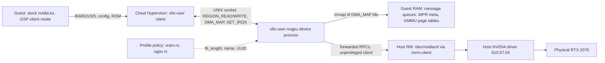

<!-- SPDX-License-Identifier: MIT -->
# Architecture

Caraxes serves an unmodified NVIDIA guest driver a synthetic Turing GPU over
vfio-user. One Rust process, `vfio-user-nvgpu`, is the whole device: it answers PCI,
BAR0, the GSP boot sequence and the GSP RPC stream, forwarding what needs the
physical card to the host driver through Leandro's own client libraries. Background
and the source surveys behind every claim here: [README.md](../history/caraxes-record-2026-09-28.md).

## Component diagram

The guest never learns any of this exists: everything it sees is PCI config space,
BAR0 registers and a shared-memory RPC channel to what it believes is firmware.
Cloud Hypervisor is an ordinary vfio-user client; nothing in it is Caraxes-specific
([vfio-user.md](vfio-user.md)).

## The device process

One `vfio-user-nvgpu` process serves one VM. Its modules:

| Module | Role |
|---|---|
| `config.rs` | PCI config space, seeded from the captured `lspci -xxxx` dump; BARs, ROM BAR, command and MSI registers are writable per PCI rules |
| `bar0.rs` | the 16 MiB register window: boot IDs, the config-space mirror, the PROM window, and dispatch into the boot model; unmodeled offsets latch what was written and read zero otherwise |
| `boot.rs` | the GFW, fuse, FB-size and WPR2 registers: the CPU-visible side effects of a GSP/FWSEC/Booter boot that never actually runs firmware |
| `falcon.rs` | one falcon register block (reset, IMEM/DMEM ports, `BOOTVEC`, `CPUCTL`, mailboxes), instantiated twice: GSP at `0x110000`, SEC2 at `0x840000` |
| `fb.rs` | the fake framebuffer: the PRAMIN window, and a GMMU walk of the guest's own page tables for BAR1/BAR3 |
| `guestmem.rs` | mmaps guest RAM behind the fds Cloud Hypervisor hands over in `DMA_MAP` |
| `msgq.rs` | the GSP message-queue layout in guest RAM: headers, checksums, sequence numbers |
| `rpc.rs` | the RPC header codec, the init handshake (`GSP_INIT_DONE`, `SET_GUEST_SYSTEM_INFO`, `GET_GSP_STATIC_INFO`) and `GspStaticConfigInfo`, built from the profile |
| `ctrl.rs` | the phase-5 dispatcher: one handler per `GSP_RM_ALLOC`/`GSP_RM_CONTROL` row, each labelled with its answer's source |
| `kgr.rs` | `KernelGraphics` static-info controls |
| `nvml.rs` | the controls `nvidia-smi` and `nvidia-smi -q` send |
| `intr.rs` | the CPU interrupt tree and the one MSI vector |
| `hostrm.rs` | the device's own host RM client (decision D10) |
| `trace.rs` | the access log |
| `device.rs`, `main.rs` | the `ServerBackend` wiring and the CLI (`--socket`, `--trace`, `--config`, `--rom`, `--vbios`, `--boot-model`, `--fb-mib`, `--board`, `--host-rm`, `--selftest`) |

## Data paths

### BAR0 register model

BAR0 is a 16 MiB trapped region; every access is logged. `NV_PMC_BOOT_0/1/42`
identify the chip and the runtime variant the driver will pick
([driver-modes.md](driver-modes.md)); `NV_PCFG` at `0x88000` mirrors PCI config
space, which the kernel RM reads instead of issuing real config cycles. From there
`boot.rs` and `falcon.rs` take over the GFW/fuse/WPR2 registers and the two falcon
blocks. An offset without a model latches what was written and reads zero otherwise,
so a new register shows up as a trace line rather than a silent gap;
[registers-turing.md](registers-turing.md) is the running map.

### PROM window

`NV_PROM_DATA` at BAR0 `0x300000` is a 1 MiB window onto a VBIOS image. The driver
walks the PCI ROM image chain through it to find the FWSEC extension image. A plain
sysfs capture of the card's ROM (`rom.bin`) has only two of the three images;
`caraxes/tools/synth-vbios.py` appends a constructed third image that satisfies
every parser check without a passthrough capture (decision D8). Nothing in the image
executes; the kernel RM only parses it.

### Falcon boot side effects

`falcon.rs` models the register sequence a real GSP or SEC2 falcon boot produces:
engine reset, IMEM/DMEM loads, `BOOTVEC`, `CPUCTL` start followed by an immediate
halt. `boot.rs` drives two such blocks (GSP, SEC2) and derives the values the CPU
actually checks afterward — the WPR2 registers — from the FRTS command the CPU
itself wrote into the FWSEC data buffer in guest RAM, so the reported offset always
matches what the CPU asked for. No firmware image runs anywhere in this path
([gsp-boot-turing.md](gsp-boot-turing.md)).

### Message queues in guest RAM

After the falcon sequence, the CPU hands the device two guest-RAM addresses through
the falcon mailboxes: the libos args page and the WPR meta page. `msgq.rs` follows
`RMARGS` to the 0x81000-byte shared queue buffer (a page table, a 256 KiB command
queue at `+0x1000`, a 256 KiB status queue at `+0x41000`), validates the CPU's
command-queue header and writes a status header the CPU accepts. Every message
carries an MCTP/NVDM header, a self-checksum and an incrementing sequence number
([gsp-rpc-protocol.md](../history/caraxes-gsp-rpc-protocol-610.md)).

### RPC dispatch and provenance labels

`rpc.rs` answers the three init RPCs, filling `GspStaticConfigInfo` from the
profile. `ctrl.rs` then dispatches the phase-5 stream — 98 `GSP_RM_ALLOC`/
`GSP_RM_CONTROL` calls in the milestone-1 baseline — by function and control id, one
handler per row ([phase5-rpcs.md](../history/caraxes-phase5-rpcs-610.md)); `kgr.rs` and `nvml.rs` extend it
for graphics static info and telemetry. Object lookups key on `(hClient, hObject)`,
because guest clients reuse handle numbers. Every answer carries a label naming its
source (decision D9): `host` (forwarded through `hostrm.rs`), `profile`, `card`
(captured from the physical GPU), `guest` (derived from what the guest itself
wrote), or `synthesized`. The rule for the first implementation is to forward
generously and label everything; a minimal, per-VM-isolated set is cut down from
those labels afterward ([nvml.md](nvml.md) has the first such cut).

### The fake framebuffer

`fb.rs` backs the whole advertised FB address space with sparse host memory. PRAMIN
accesses (BAR0 `0x700000` plus `NV_PBUS_BAR0_WINDOW`) land in it directly. BAR3 (the
BAR2 aperture) and BAR1 are trapped and translated by walking the guest's own GMMU
page tables — the 610.57.04 49-bit format, dual PDE at PD0 — which live in that same
fake FB, because a GSP-client guest never hands the device a page-table root to
program: `bar2PdeBase` and `bar1PdeBase` are addresses the device itself reports in
`GspStaticConfigInfo`. This is what lets `kbusVerifyBar2` — a PRAMIN/BAR2/L2-evict
round trip the driver runs during init — pass with no real GPU memory behind it
([fb-model.md](fb-model.md)).

### Interrupts

`intr.rs` models the CPU interrupt tree at BAR0 `0xB81000`: 8 leaf registers of 32
vectors each, leaf enables, and one top register summarizing pending subtrees. When
an enabled vector goes pending, the device raises the single MSI vector Cloud
Hypervisor negotiated (the driver switches from INTx to MSI before `RmInitAdapter`).
The driver's own environment self-test exercises this path by firing vector 129 and
expecting the MSI.

### Host forwarding

`hostrm.rs` opens `/dev/nvidiactl` as an ordinary unprivileged client through
`nvrm-client` (decision D10), allocating its own root, device and subdevice —
independent from, and not requiring, a running `vhost-user-nvrm`. Only public
controls are forwarded, routed by the guest object's class (device, subdevice or a
`NV2081_BINAPI` object). `nvml.rs` uses this path for telemetry; `ctrl.rs` uses it
for the phase-5 controls that have a public host equivalent.

## Version-bound versus architecture-bound

| Version-bound (610.57.04) | Architecture-bound (TU106/Turing) |
|---|---|
| RPC function numbers and struct layouts (`rpc_gsp_rm_alloc/control_v03_00`, `GspStaticConfigInfo`, `GspSystemInfo`) | The boot register sequence: BAR0 offsets, falcon bases `0x110000`/`0x840000` |
| The phase-5 inventory (98 RPCs) and its order | The GMMU format: 49-bit VA, dual PDE at PD0, the PRAMIN/BAR2 translation scheme |
| Message-queue sizes (`0x40000` each queue) and page-table layout | The PCI identity and BAR layout |
| FWSEC/Booter ucode image sizes and offsets ([gsp-abi-610.md](../history/caraxes-gsp-abi-610.md)) | |
| Registry key names (`RmDisableGlobalCeUtils`, and so on) | |

[other-architectures.md](other-architectures.md)'s finding: the RPC vocabulary and
structs are one ABI shared by every chip on a given driver version; only the boot
register sequence is per-architecture. A second chip identity (Ampere GA10x is the
least-work candidate) would reuse `rpc.rs` and `ctrl.rs` unchanged and need new
values only in `boot.rs`/`falcon.rs`. Moving to a newer vendored driver tag
(615.71.09 exists upstream) means re-deriving the version-bound column with the
method in [gsp-abi-610.md](../history/caraxes-gsp-abi-610.md).

## Differences from Leandro v1

| | Leandro v1 | Caraxes |
|---|---|---|
| Guest driver | patched (`virtio_nvrm.ko`) | stock, unmodified |
| Guest-side transport | a virtio device plus vhost-user | none: no guest module, no vhost-user device attached to the VM |
| Where the frontend lives | guest module in the VM, `vhost-user-nvrm` on the host | one host process, `vfio-user-nvgpu` |
| Identity | rewritten in RM replies after allocation (`rewrite_fb_info`, `rewrite_gpu_name`, `vram.rs`/`session.rs`) | native at the device level: the profile feeds `GspStaticConfigInfo` and BAR0 before any guest software runs (D6); no reply is rewritten |
| RM vocabulary at the boundary | about 120 ioctl shapes (NVOS64/54 envelopes) | 2 RPCs (`GSP_RM_ALLOC`/`GSP_RM_CONTROL`) carrying the same RM alloc/control vocabulary inline |
| Reused from v1 | is v1 | `Session::prepare`/`execute`, `host_pool`, `mirror`, the `vram.rs` profile policy and the `nvrm-abi` translation tables, used as libraries ([leandro-reuse.md](leandro-reuse.md)) |

Leandro v1 stays untouched and working; Caraxes only adds code.

## Decisions

| # | Decision |
|---|---|
| D1 | GSP-client mode (`PF_KERNEL_ONLY`), TU106 identity |
| D2 | No Ada+ identity: class lists, MMU/fault formats and SASS targets would mismatch the physical TU106 |
| D3 | vfio-user server in Rust (rust-vmm `vfio_user`); Cloud Hypervisor v53 `--user-device` is the client; QEMU only for reference capture |
| D4 | Vendor driver pinned at 610.57.04, matching the host |
| D5 | First experiment is a logging-only device |
| D6 | The card presents as `Leandro <board>-<size>`, from the existing profile policy, at the device level |
| D7 | Crate `crates/vfio-user-nvgpu`, depending on the crates.io `vfio_user` release |
| D8 | E1 uses a synthetic VBIOS instead of a passthrough capture |
| D9 | Every value handed to the guest carries a provenance label; forward host data generously first, minimize later |
| D10 | One device process; it opens the host RM itself; the vhost-user device and its guest module are not part of a Caraxes VM |

Full rationale for each: [README.md](../history/caraxes-record-2026-09-28.md).

## Milestone ladder

| Step | State |
|---|---|
| E0: identity-only device | done — probe binds, PROM walk fails at the missing third ROM image |
| E1: PROM window, synthetic VBIOS | done — VBIOS parses, driver times out in the GFW wait |
| E2: falcon state machines, boot status registers | done — WPR2 comes up, driver stops at the status-queue timeout |
| E3: message queue, init handshake | done — static info accepted, driver stops at the first phase-5 RPC |
| E4: phase-5 RPCs from the host RM | done — milestone 1: `RmInitAdapter` succeeds, `nvidia-smi` prints the Leandro name |
| nvidia-smi complete | done — `tools/caraxes-gate.sh nvml` passes, no control left unanswered |
| E5: CUDA path | next — design in [cuda-path.md](cuda-path.md), not implemented |

Current position: after nvidia-smi completion, before E5. Full detail and evidence
per step: [experiments.md](../history/caraxes-experiments-2026-09-29.md).
