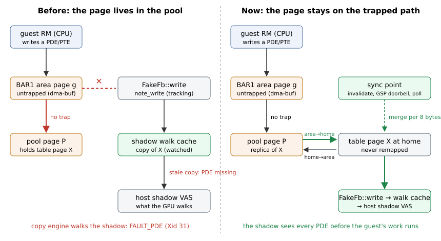

<!-- SPDX-License-Identifier: MIT -->
# P21 design H: the BAR1 pool

Written 2026-09-24. This is the target design of [bar1-passthrough.md](bar1-passthrough.md) §4 H,
built behind `CARAXES_BAR1_PASSTHROUGH=pool`. The prototype G (`CARAXES_BAR1_PASSTHROUGH=1`) is
unchanged. Code:
- `crates/vfio-user-nvgpu/src/bar1pool.rs`: the remap table, the poll and the barrier;
- `fb.rs`: the one translation, `FakeFb::remap`;
- small hooks in `shadow.rs`, `mirror.rs`, `main.rs`, `device.rs` and `rpc.rs`.

It builds clean, the unit tests pass, and clippy is clean with the flags of `tools/check.sh`. It
has not run on a VM or on the host GPU. The measurement plan is in §6.

## 1. Design in five sentences

1. The device carves a private pool of `CARAXES_BAR1_POOL_MIB` (default 64) from the top of the
   VM's reservation, right below the carve-out, and takes it out of the guest's usable FB.
   It exports the pool as the dma-buf that backs one sparse mmap area of the guest's BAR1,
   `[0, pool)`, so a guest CPU access of area page `g` always reaches pool page `P = pool0 + g`
   without a trap.
2. After every trapped BAR0 write (where the guest flushes and invalidates after it changes a BAR1
   mapping), the device walks the guest's BAR1 tables over the area. It walks only the 2 MiB
   units whose table pages were written. For each area page `g` that the guest maps to one of its
   FB pages `X`, it copies `X` to `P` and records `X -> P`.
3. From then on, every translation the device performs treats `X` as living at `P`:
   - the FB store, and with it BAR2, PRAMIN, the BAR aperture TLB's targets, the table walks, the
     watched dwords, the display and the software executor;
   - the shadow's leaves, split to 4 KiB where a 64 KiB or 2 MiB leaf covers a moved page;
   - the USERD address that a host channel is created with.
4. When the guest unmaps `g` or maps it elsewhere, the device copies `P` back to `X` and drops
   the remap.
5. A page the GPU may be using when its remap changes is moved only behind a barrier:
   - the host channels of the affected shadow roots are idle and their TSGs are preempted with
     wait;
   - then the copy, the re-sync of those shadows, and the wait for the shadow worker.

   A page that cannot be moved safely is refused and retried. The device's view of it stays
   where it was (fail closed).

## 2. How the guest is told, and the bounds

**How the guest is told.** The pool is `[E - 2 MiB - pool, E - 2 MiB)`, where `E` is the
reservation end. It lies below the carve-out that holds the BAR roots and the invalidator
(`fb.rs:88` `FbLayout::with_pool`, `:104` `pool_range`). `FbLayout::usable` (`fb.rs:119`) ends
below the pool, so `fbRegionInfoParams` gives:
- region 0, usable: `[B, E - 2 MiB - pool)`;
- region 1, reserved: from there up to the top of the FB address space.

Example: the 4 GiB profile with a 64 MiB pool ends region 0 at 0x1e4dfffff instead of
0x1e8dfffff (test `rpc::tests::static_info_with_a_reservation`, `rpc.rs:775`). The BAR roots
stay where they were. `fb_length`, which is what `nvidia-smi` shows as the total, stays the
profile. The guest's heap therefore never hands out a pool page. Its reserved figure grows by
the pool.

**Bounds** (`bar1pool.rs:79` `check_size`, checked in `main.rs:473` before the static info is
built):
- the pool is an even number of MiB, from 2 to 128;
- at most half of the guest's BAR1. The guest RM keeps the upper half for its own mappings: the
  RM-owned USERD is mapped top-down (`kernel_fifo_tu102.c:487-531`), and CPU mappings get
  allocator-chosen BAR1 addresses (`kern_bus_gm107.c:2984` `kbusMapFbAperture_GM107`,
  `:3378-3401`);
- the pool plus the device's BAR1 window budget (2 x 32 MiB by default) is at most 192 MiB of
  the host's shared 256 MiB BAR1. The dma-buf maps the whole pool into host BAR1
  (`nv-dmabuf.c:1359-1370`);
- at most a quarter of the usable FB.

With two VMs up, `CARAXES_BAR1_POOL_MIB=32` keeps the P20 budget (parallel.md §2).

**Refusals at start.** The device refuses to start with the pool when:
- `--reserve-vram` or host execution is missing;
- a host channel could walk the guest's own tables: every channel must be on a shadow VA space,
  so `CARAXES_MIRROR_GR_SHADOW=1` is required, and `CARAXES_CE_SHADOW=0` and
  `CARAXES_MIRROR_GR=1` are refused (`main.rs:364-378`);
- `CARAXES_DOORBELL_IOEVENTFD=1` is set. That has the same reason as for G: GPPut writes through
  the area never reach the device. The token pool is the doorbell to use.

## 3. The remap rules

The remap table (`bar1pool.rs` `RemapTable`) maps each guest FB page `X` to an area offset `g`,
and back. `P = pool0 + g`.

1. **One translation.** `FakeFb::remap(pa)` (`fb.rs:1445`) is the only translation.
   - `FakeFb::read` and `write` apply it page by page (`fb.rs:971`, `:987`). The table's
     `for_each_piece` merges contiguous pieces.
   - `shadow.rs` calls `fb.remap_leaves` on the leaves of every unit it plans (`shadow.rs:446`).
   - `mirror.rs` calls `fb.remap` on the USERD it hands to a host channel (`mirror.rs:652` shadow
     channel, `:1287` CE channel).
   - The BAR aperture TLB caches guest targets and the remap applies after it, so a remap change
     needs no TLB flush.
   - `channel.rs` needs no change: the software executor's GPFIFO and USERD reads go through
     `FakeFb::read`. Its GPPut scan (`channel.rs:354` `gp_put_of`) goes through
     `FakeFb::watched_dword`, which never keeps a copy of a pooled page (`fb.rs:746`), because
     guest writes through the area bypass `note_write`.
2. **Install** (the guest maps `g` to `X`). Allowed only when all of these hold (`bar1pool.rs:210`
   `check`):
   - `X` is page aligned and inside the usable FB. That excludes the pool itself, the carve-out
     and anything outside the reservation;
   - `g` holds no other page;
   - `X` is not in the pool already through another area page (aliasing).

   Then the device copies `X` to `P` in the store, past the remap (`fb.rs:1490`
   `copy_page_raw`), records the remap and drops the watched dwords of `X`.
3. **Release** (the guest unmaps `g`, or maps something else there). The device copies `P` back
   to `X` and drops the remap. Releases run before installs in the same poll, so a page can move
   from one area page to another in a single change (`bar1pool.rs:791`).
4. **Dirtiness is not known, so the device copies always.** The guest writes through the area and
   the GPU writes through the shadow, and the device sees neither. Every install copies 4 KiB in
   and every release copies 4 KiB out. The exit summary line counts the KiB and the microseconds
   (`bar1 pool: ... copied N KiB in, M KiB back in T us`). Copies happen once per mapping change,
   not per access.
5. **Granularity is 4 KiB.** A 64 KiB or 2 MiB guest BAR1 page moves page by page. A 64 KiB or
   2 MiB GPU leaf over a moved page is split into 4 KiB leaves (`bar1pool.rs:267` `split_leaf`),
   and the shadow coalesces the contiguous rest into runs, one RM mapping each. A 2 MiB unit
   that becomes small pages changes its region class, and the shadow already handles that
   (`shadow.rs` `apply`, the `stale` region).
6. **What the area cannot serve.** An area page that the guest maps to guest RAM is counted
   (`sysmem`) and logged. The area holds VRAM only, so the guest's CPU accesses of that page
   reach the pool page.
7. **When to walk.** A guest write to a BAR1 table page marks the units whose walk read that page
   (`fb.rs:843` `note_table_write`). The poll after the next trapped BAR0 write walks only those
   units. With nothing marked and nothing to retry, the poll costs two borrow checks. Since §11
   a write to a directory page (shared by every unit) reads each unit's path first and walks
   only the units whose path changed.
8. **Function-level reset.** The pool and its counters carry over to the fresh model, and the
   remaps are dropped without a copy back (`bar1pool.rs:371` `after_reset`). The guest
   re-initializes its FB after a reset, and the old mirror's channels and shadows go with the
   old model.

## 4. The hard case: a page the GPU is using

**What "in use" means** (`bar1pool.rs` `MirrorGpu`, `:521` `refs`):
- A **leaf reference**: a cached walk of a shadow root has a leaf on the page. The device first
  waits for the shadow worker (`shadow_barrier`), so that the cached walks are what the shadows
  hold.
- A **USERD reference**: the page is the USERD of a mirrored channel. The host channel object
  holds the page's address from its creation until it is freed, and nothing can re-point it.
- A **direct walker**: a mirrored channel on an externally-owned VA space walks the guest's
  tables directly. This is refused at start (§2) and checked again here (`:506` `blocked`).

**Rules:**
- **Cold** (no reference). The page moves at once, while the guest's vCPU is still inside the
  trapped BAR0 write, so the guest cannot use the new mapping before the move is done.
- **USERD.** The page is refused.
  - For an install: the channel was created with `X`, so moving it would split GPGet between
    `X` and `P`.
  - For a release: the channel was created with `P`, so the page stays in the pool, consistent,
    until the channel is freed. Only area page `g` stays busy; a new page the guest maps at `g`
    waits.
- **Leaf, the warm case.** The barrier (`bar1pool.rs:551` `quiesce`, `:594` `resync`):
  1. Every mirrored channel on the affected shadow roots has GPGet equal to GPPut, read from its
     USERD in the device's view.
  2. Each of their host TSGs gets `NVA06C_CTRL_CMD_PREEMPT` with `bWait`
     (`ctrla06c.h:203-211`; non-privileged, flags 0x10248; `mirror.rs:421` `preempt_tsg`).
  3. GPGet equal to GPPut is checked again. A guest CPU write of GPPut through the area may have
     come in the meantime.
  4. The copy and the table change.
  5. The affected roots are marked for a re-diff (`fb.take_pool_rediff`, `shadow.rs:400` and
     `:427`), `shadow_resync` runs on each root, and the device waits for the worker
     (`shadow_barrier`) before the poll returns.

  This is the doorbell ordering rule of the mirror (`mirror.rs:472`): nothing is forwarded to
  the GPU before the worker has applied every plan submitted so far. No doorbell can be forwarded
  during the barrier, because the poll runs on the device's thread with the model held.
- **Fail closed.** When the barrier fails (a busy channel, a refused preempt, or
  `CARAXES_BAR1_POOL_WARM=refuse`):
  - the remap is not made. `X` stays where the GPU and every device path find it;
  - the refusal is logged once (`ERROR: bar1 pool: ... remap refused`) and counted;
  - it is retried at the next trapped BAR0 write, at most every millisecond.

  The area itself cannot be withdrawn (bar1-passthrough.md §2). Until the retry succeeds, the
  guest's CPU accesses of area page `g` reach only its pool page `P`, a page of its own
  reservation that no GPU mapping and no device path names. That is wrong for the guest, which
  sees stale bytes, but it never exposes anything outside its reservation. A refused release is
  harmless: the page stays consistent in the pool. Every refused barrier is logged with the wall
  time (`bar1 pool: at T barrier N refused for ...`); §9 shows the refused barriers of the
  morning matrix to be a consequence of a GPU fault, not its cause.

**What the barrier does not prove.** GPGet equal to GPPut means that the PBDMA fetched every
entry. It does not mean that the last pushbuffer segment has finished: a copy or a semaphore
acquire may still be running. The waited preempt takes the TSG off the engines.

If the scheduler brings a TSG back while the move is running (work left in its PBDMA state), a
GPU write to `X` inside that window is lost. Work that runs after the re-sync uses the new
mapping, which is consistent. The device has no user-space view of PBDMA state that could close
this window.

The exposure is the guest's own data only. The expected case is harmless: libcuda maps a buffer
into BAR1 right after allocating it, and the channel buffers before creating the channel
(bar1-passthrough.md §4 H). `installs_warm` and `barriers` in the exit summary show how often
the barrier was taken. `CARAXES_BAR1_POOL_WARM=refuse` turns every warm move into a refusal, for
an A/B check.

## 5. Isolation

1. The pool is inside the VM's reservation, below the carve-out (`fb.rs:104`). The dma-buf
   export checks the range against the reservation again (`hostmem.rs:1152`). The area maps only
   the pool, `[0, pool)` of guest BAR1 onto `[pool0, pool0 + pool)`.
2. The dma-buf holds the pool's VRAM and its host BAR1 mapping for as long as Cloud Hypervisor
   maps it, whatever order the processes die in (bar1-passthrough.md §4 B).
3. A remap only ever moves a page of the guest's usable FB to a pool page of the same
   reservation. Both ends are inside the reservation (`bar1pool.rs:210`).
4. The shadow still validates every GPU leaf after the remap: `resolve_leaf` (`shadow.rs:94`)
   checks the pool page against the reservation and refuses compressible kinds.
5. A guest page-table page never lives in the pool, and a page the guest maps twice is never
   served by a pool page nobody reads (§10).

## 6. Measurement plan (for the coordinator; not run here)

vm2 at slot 0 with the 2 GiB profile, the closing-series configuration (benchmark.md "Closing
series"): token pool 64, spin reactor, Cloud Hypervisor 0001-0006. Two passes on the same
binary:
- A: the 1 MiB area of G (`CARAXES_BAR1_PASSTHROUGH=1`);
- B: the 64 MiB pool (`CARAXES_BAR1_PASSTHROUGH=pool`).

```sh
R=/home/silas/git/Caraxes                     # the tree with this branch merged
cd "$R" && CARGO_TARGET_DIR=target/poolh cargo build --release -p vfio-user-nvgpu
B=/mnt/vmstore/caraxes/vfio-user-nvgpu-poolh-$(git rev-parse --short HEAD); cp target/poolh/release/vfio-user-nvgpu "$B"
M=$R/caraxes/runs/bar1-pool-$(date +%F); mkdir -p "$M"
source "$R/caraxes/runs/mapping-2026-09-24/env.sh"
export CARAXES_SERVER=$B LEA_CH=/mnt/vmstore/caraxes/vm1/ch-0006-v.sh
export CARAXES_DOORBELL_TOKENS=64 CARAXES_DOORBELL_POLL=spin CARAXES_BAR1_POOL_MIB=64
unset CARAXES_DOORBELL_IOEVENTFD CARAXES_BAR1_POOL_WARM
for mode in 1 pool; do
  export CARAXES_BAR1_PASSTHROUGH=$mode; D=$M/$mode; mkdir -p "$D"
  caraxes/tools/bench-hostwatch.sh start "$D"
  nvidia-smi -q -d MEMORY | grep -A3 BAR1 > "$D/host-bar1-before.txt"
  caraxes/tools/bench-run.sh v2-restart > "$D/up.txt" 2>&1
  grep -E 'bar1 (passthrough|pool)' /mnt/vmstore/caraxes/vm2/gpu.log | cut -c1-400 > "$D/device-start.txt"
  nvidia-smi -q -d MEMORY | grep -A3 BAR1 > "$D/host-bar1-up.txt"
  caraxes/tools/bench-run.sh stage v2 >> "$D/up.txt" 2>&1
  tools/caraxes-vm.sh ssh 'cat > ~/bench/bench-trap.c' < caraxes/tools/bench-trap.c
  tools/caraxes-vm.sh ssh 'cd ~/bench && gcc -O2 -o bench-trap bench-trap.c &&
    sudo ./bench-trap /sys/bus/pci/devices/0000:00:05.0/resource1 20000 none 0x80000 &&
    sudo ./bench-trap /sys/bus/pci/devices/0000:00:05.0/resource1 20000 none 0x2000000 &&
    sudo ./bench-trap /sys/bus/pci/devices/0000:00:05.0/resource1 20000 none 0x8000000' > "$D/trap.txt"
  V2_RESTART=1 caraxes/tools/bench-run.sh series --targets v2 --reps 5 --metrics "copy rl short-auto" --out "$D"
  PPO_SECONDS=60 caraxes/tools/bench-run.sh series --targets v2 --reps 2 --metrics ppo --out "$D/ppo"
  caraxes/tools/bench-hostwatch.sh stop "$D"
  tools/caraxes-vm.sh down
  grep -E 'bar1 (passthrough|pool)|ERROR: bar1' /mnt/vmstore/caraxes/vm2/gpu.log | cut -c1-600 > "$D/device-summary.txt"
  grep -c ' bar1 0x0[0-3][0-9a-f]\{6\} ' /mnt/vmstore/caraxes/vm2/gpu-trace.log > "$D/bar1-trapped-in-first-64MiB.txt"
  nvidia-smi -q -d MEMORY | grep -A3 BAR1 > "$D/host-bar1-after.txt"
done
journalctl -k --since "-3h" --no-pager -g Xid > "$M/host-xid.txt" 2>/dev/null
python3 caraxes/tools/bench-summary.py "$M/1/v2" "$M/pool/v2" > "$M/summary.md"
python3 caraxes/tools/bench-summary.py "$M/1/ppo/v2" "$M/pool/ppo/v2" > "$M/summary-ppo.md"
```

**What to read.**
- **Startup.** `pool/device-start.txt` shows the pool line: the usable end and the dma-buf. In
  `pool/up.txt`, a `Could not mmap sparse area` means that the export or the host BAR1 was
  refused.
- **The P21 checks.**
  - `pool/trap.txt`: the reads at 0x80000 and 0x2000000 (inside the 64 MiB area) at a few
    microseconds; 0x8000000 (outside) still trapped at about 45 us. In A only 0x80000 is fast.
  - `bar1-trapped-in-first-64MiB.txt` should be close to 0 for B.
  - `pool/device-summary.txt`:
    - `in the pool now`: the pages moved;
    - `refused`, which must be 0 or explained by the `ERROR: bar1 pool` lines;
    - `behind the barrier`: how often the warm case happened;
    - `page-table hazard(s)`, which must be 0;
    - the copy KiB and microseconds.
- **Expected against A** (closing series, benchmark.md):
  - pageable and pinned copies below 16 MiB move from about 0.5 to 0.6 of native towards
    native. Native: h2d pinned 1 MiB 12.1 GB/s, pageable 1 MiB 7.25 GB/s;
  - PPO environment steps per second rise from 0.61 of native towards native (native about
    110k/s);
  - rlprobe transfers per second move from 1340 towards 2350;
  - short-auto is unchanged (about 0.015 ms).

  If the copies stay flat, libcuda's small copies do not use BAR1 mappings inside the first
  64 MiB, and the trace of B will show where they go.
- **Isolation.**
  - host BAR1 rises by the pool (64 MiB) while vm2 is up and falls back after;
  - the host watch shows no host VRAM or desktop change beyond that;
  - `host-xid.txt` shows 0 Xid.
- **A/B of the barrier.** If `behind the barrier` is above 0, a third pass with
  `CARAXES_BAR1_POOL_WARM=refuse` shows whether those moves matter. If refusals then appear and
  results stay correct, the guest did not need those pages through the area.

## 7. Tests

`cargo test -p vfio-user-nvgpu`: 168 unit tests plus 2. The new ones:
- `bar1pool::tests::the_remap_table_installs_translates_and_releases`: translate, every refusal,
  pieces across a moved page, leaf splitting, release.
- `bar1pool::tests::size_and_layout_bounds`: the usable end, the pool range, the BAR roots
  unchanged, `check_size`.
- `bar1pool::tests::a_mapped_page_moves_into_the_pool_for_every_path_and_back_on_unmap`: the
  copy-in, guest writes through the area seen by every device read and by the watched dword, a
  device write landing in the pool, a BAR2 access through the aperture TLB, shadow leaves, the
  copy-back at unmap, a move between area pages in one poll, carry across a reset.
- `bar1pool::tests::big_pages_move_page_by_page_and_refusals_fail_closed`: a 64 KiB BAR1 page;
  aliasing, the pool, the carve-out and guest RAM refused and logged once; release of all 16
  pages.
- `bar1pool::tests::a_page_the_gpu_maps_moves_only_behind_the_barrier`: barrier failure (page
  stays, pending, retry after `RETRY_EVERY`), barrier success (shadow re-diff and re-sync), a
  USERD page that cannot move back and blocks its area page until the channel goes, a direct
  walker blocking everything.
- `bar1pool::tests::only_units_whose_tables_changed_are_walked_again`.
- `shadow::tests::a_leaf_on_a_bar1_pool_page_is_mirrored_to_the_pool_page`: the plan maps a leaf
  on a moved page at its pool offset, splits a 64 KiB leaf and coalesces the rest, and re-diffs
  on the pool's request alone.
- `rpc::tests::static_info_with_a_reservation`: the region table with a pool.

The `MirrorGpu` side (preempt, the USERD reads, the RM calls) needs the host RM and is exercised
only by the measurement.

## 8. Known limits

- The barrier's residual window (§4).
- A pending install leaves the guest with a wrong view of that area page until the retry
  succeeds. Retries happen only at trapped BAR0 writes, which are rare with the token pool.
- The guest RM's preserved console mapping, when there is one, is created at BAR1
  initialization (`kern_bus_gm107.c:1084`). If it lands in the area on an FB page outside the
  usable FB, it is refused and logged.
- The mapping budget: a split 2 MiB leaf costs up to three RM mappings instead of one.
- The untrapped-GPPut rule (§9) makes every guest MMU invalidate of a CUDA context wait for its
  plan while the context's USERDs live in the pool: the lazy plans of `CARAXES_ALLOC_LAZY=1`
  apply to those roots only as far as the invalidate itself.

## 9. The Xid 31 of the morning matrix (2026-09-25)

Records: `caraxes/runs/xid31-pool-2026-09-25/` (scripts `loop.sh`, `gate.sh`, `bench.sh`, `vm.sh`,
`allocburn.py`; one directory per run).

**The case.** Three host Xid 31 on the 615 guest with the recommended configuration and main
fbe4dfb, all GPC `FAULT_PDE` `ACCESS_TYPE_VIRT_WRITE` in a cuDNN training step, all on the
device's pid (benchmark.md "Morning matrix"; `matrix-2026-09-25/gates-615/xid31-note.txt`,
`workload-615/xid31-note.txt`), and the night's one before them
(`workload-2026-09-24/night/gate/host-xid.txt`, pool on, `CARAXES_ALLOC_LAZY` off). The faulting
gate run's pool summary was the only one with refused barriers (14 of 293), 532 refused moves
and 512 pages moved back cold.

**Not the cause: the refused barrier.** The pool never moves a page whose barrier failed:
`poll` turns every warm op into a refusal when `quiesce` fails (`bar1pool.rs:802-806`), the
remap stays, no root gets a re-diff, and a release refused this way keeps the page consistent in
the pool until a later poll finds no shadow leaf on it (then it moves cold, which is correct).
The numbers of the faulting run fit a consequence, not a cause: 532 = 492 + 40, and 492 is the
number of pages of one CUDA context's 2 MiB BAR1 block that the GPU maps (an earlier context
of the same run moved them in one batch: "492 page(s) the GPU maps moved behind the barrier",
`gates-615/pool-log.txt:2`); 512 = 492 + the 20 USERD pages of that context. That is one context's
teardown meeting its own channel stuck after a fault (GPGet never reaches GPPut again), retried
14 times, then moved back cold once its shadow was gone. The reproduction below shows the order
with wall times: the fault first, then 17 refused barriers for 492 to 499 pages of the same
root, `chid 2 busy (GPGet 794, GPPut 818)`. The alternative (a PDE replaced under a running
channel by a pool move) needs a successful barrier and a re-diff; a re-diff touches only the
region of the moved page (test below), and none of the refused-barrier paths re-diffs.

**The cause: a GPPut store that does not trap.** libcuda maps each channel's USERD into BAR1
before it creates the channel. In the pool that page is installed cold (no channel, no GPU leaf
yet), so the host channel is created on the pool page (`mirror.rs:1002-1005`). From then on the
guest's GPPut store goes through the pool area straight into the host channel's USERD, without
a trap. The mirror's ordering rule (nothing reaches the GPU before the worker applied every
plan) is enforced at the doorbell and at a trapped GPPut store (`boot.rs:788`,
display-e.md §9), so a store through the area escapes it. The guest's order is page tables,
MMU invalidate, GPFIFO entry, GPPut, doorbell. A host channel that is still loaded fetches the
new GPPut from its USERD before the doorbell (measured: 674 doorbells of 20 convburn runs and
123052 of 20 gate-order rounds found their host channel already past the last forwarded GPPut).
With `CARAXES_ALLOC_LAZY=1` the invalidate's plan is not even made until that doorbell; without
it (the night) the plan is in the worker. A kernel that writes a freshly allocated 2 MiB region
then meets a shadow with no PDE there: `FAULT_PDE` on a GR write, on the device's own pid
(isolation holds; the host channel runs on the shadow of this VM only). cuDNN's first steps
allocate workspaces and launch into them at once, which is why the faults sit there.

It is not specific to the 615 guest. Both guests put their USERDs in the pool (the 20 "USERD of
mirrored channel" lines appear in both matrix summaries), both show ran-ahead doorbells, and
the 610 guest faults the same way under the stress below (`before-hold0-allocburn-610`). The
matrix saw it on 615 only by chance: the Xid came in one of two 615 gate runs and one of three
convnet reps, in workloads that allocate and launch at once.

**Reproduction.** `loop.sh LABEL 0 20 stop` on vm5-615 (1 GiB, slot 2, tap caraxes5, the matrix
configuration, pool 32 MiB) with `CARAXES_SHADOW_UNTRAPPED_HOLD=0` (the rule off: the device as
on fbe4dfb, plus the counters). The builds are this branch's v615 and 610 builds (`setup.txt`
of each run has the hash): 528a2b4 for `before-hold0`, f75ea66 for `before-hold0-gateorder`,
4d4306e for every later run; the rule is the same in all three, only the counters grew.
- `before-hold0`: 20 convburn runs, 0 Xid, 0 refused barriers; 674 doorbells ahead, none with a
  plan pending (convburn allocates once and then only launches).
- `before-hold0-gateorder`: 20 rounds of cuda-torch, rlprobe, convburn, robustness, 0 Xid, 0
  refused barriers; 123052 doorbells ahead, none with a plan pending.
- `before-hold0-allocburn`: convburn plus `allocburn.py` (fresh cudaMalloc'd 2 to 14 MiB buffers
  written by kernels while a convolution keeps the GR channel loaded, the cache emptied every
  round): **Xid 31 at iteration 1**, `GPC0 GPCCLIENT_T1_6 FAULT_PDE ACCESS_TYPE_VIRT_WRITE @
  0x100_1d870000`, device pid 2861668, 06:54:57.059. One second before it (06:54:56.081) the
  device logged `chid 2's host channel ran ahead of its doorbell (GPGet 896, forwarded up to 895,
  GPPut 899) with plans pending (lazy true ...); USERD untrapped true`; after it, the host RC
  event and 17 refused barriers (06:54:57.457 to .493) for 492 to 499 pages of root
  0x129800000: the morning matrix's pattern.
- `before-hold0-allocburn-610`: the same on the 610 guest (vm3, slot 5, the 610 build): **Xid 31
  at iteration 1**, `GPC0 GPCCLIENT_T1_2 FAULT_PDE ACCESS_TYPE_VIRT_WRITE @ 0x100_1d806000`,
  device pid 2951267, 07:22:27, then the host RC event and 13 refused barriers for the context's
  492 pages. Its ran-ahead counter stayed at 0 with plans pending: the counter sees a channel
  only at its next doorbell, and a channel that faults first may never ring again, so it is
  evidence when it fires, not a detector.

Every host Xid of these runs was on the device's own pid; the host watch saw no other kernel
line.

**The fix (fail closed).** The invalidate is the last point the device sees before such a host
channel may run the guest's next work, so the barrier moves there (`untrapped.rs`):
- `Mirror::untrapped_roots` (`mirror.rs:639`): the shadow roots of mirrored channels whose USERD
  lives in the BAR1 pool (`fb.remap(userd) != userd`) or in guest RAM.
- `Mirror::shadow_invalidated` (`mirror.rs:564`): an invalidate that names such a root (or every
  root, `ALL_PDB`, while there is one, `untrapped.rs:53` `must_hold`) plans that root now,
  together with everything lazy mode deferred, and returns to the guest only after the worker
  applied it. The guest's GPPut store therefore always meets a mirror that holds the invalidate's
  mappings.
- The trapped GPPut store (`boot.rs:788` `gp_put_barrier`) plans the lazily deferred invalidates
  before it waits (before, it only waited for plans already in the worker, so under
  `CARAXES_ALLOC_LAZY=1` it held nothing).
- `CARAXES_SHADOW_UNTRAPPED_HOLD=0` turns the rule off, for the A/B only; a malformed value keeps
  it on.
- Evidence counters in the mirror's exit line and in a per-context line (`at T pool empty: ...`,
  `bar1pool.rs:644`): invalidates held and their wait, doorbells whose host channel ran ahead
  (`untrapped.rs:63` `ran_ahead`), and of those the ones with plans pending or submitted without
  a wait since the channel's last forward (`mirror.rs:672`).
- Hardening in the pool: a shadow root without a cached walk counts as mapping every page, so a
  move is never cold for a missing walk (`bar1pool.rs:536`); every refused barrier is logged with
  the wall time (`bar1pool.rs:894`).

Cost: the held invalidates wait for their plan's apply. `bench.sh` (record `bench-615`, the
matrix series' churn, init and short-auto metrics, 3 reps, a fresh device per pass, the rule off
then on, 0 Xid): cuMemAlloc 64 x 1 MiB 175 to 200 us, cuMemFree 282 to 312 us; cuMemAlloc
8 x 64 MiB 511 to 2277 us, cuMemFree 791 to 2402 us; cuCtxCreate 395 to 486 ms; cuInit 13.6 to
16.3 ms; the short-kernel launch unchanged (0.019 to 0.020 ms). Large allocations pay the apply
time of their mappings that lazy mode used to hide. A cheaper variant that stays fail closed:
hold only plans that map something new (an unmap may stay deferred, the guest issues no work on
a VA it freed, and a stale shadow mapping still points into this VM's reservation); not built.

Tests (`cargo test -p vfio-user-nvgpu`, 349 plus 2):
- `untrapped::tests::an_invalidate_of_a_root_with_an_untrapped_userd_is_held`,
  `a_channel_ran_ahead_when_gpget_passed_the_last_forward`, `the_switch_is_on_unless_turned_off`,
  `only_the_first_pending_cases_are_logged`;
- `bar1pool::tests::a_page_whose_barrier_is_refused_never_moves_while_the_gpu_maps_it`
  (`bar1pool.rs:1377`): 15 refused barriers, the page stays at its pool page with its bytes, no
  re-diff, the next page for that area page waits; it moves back cold once no shadow maps it;
- `shadow::tests::a_pool_rediff_touches_only_the_region_of_the_moved_page` (`shadow.rs:2113`):
  a re-diff with nothing moved makes no host call; a page moved inside one 2 MiB leaf touches
  only that region, the other region's object, mapping and PDE stay.

**After the fix** (build 4d4306e, the rule on, 0 host Xid in every run, host watch 0 alerts):
- `after-hold1-allocburn` (615 guest, vm5-615): 20 of 20 iterations of convburn plus allocburn
  pass, 0 Xid, 0 refused barriers; 181500 invalidates held until applied, 70.5 s in total (0.39
  ms on average, longest 102 ms); 5735 ran-ahead doorbells, none with plans pending; allocburn
  9.8 s per run on average (it faulted in its first run without the rule).
- `after-hold1-allocburn-610` (610 guest, vm3): 20 of 20 pass, 0 Xid, 0 refused barriers; 181500
  held, 71.2 s (longest 49 ms); 5904 ran-ahead doorbells, none with plans pending.
- `gate-615` (vm5-615): nvml pass; cuda 10 of 11 (10 of the 11 scored rows; the gate script counts the same result as 10 of 12, with the declared-unsupported cuda-gdb row in the 12, testing.md section 3, cuda) scored pass, only the known
  cuda-managed 801; convburn passes; 829 invalidates held (1.2 s in total); pool: 10240 pages
  in cold, back behind the barrier, 281 barriers, 0 refused, 40 refused moves, as in the clean matrix runs.
- `gate-610` (vm3, the gate610 environment): nvml pass but the known power-number; cuda 10 of 11
  (cuda-managed 801); convburn passes; 829 invalidates held (1.2 s); pool as on 615.

## 10. Page-table pages and aliased pages in the area (2026-09-25)

Record: the black Sunshine stream of the 615 game VM,
`caraxes/runs/sottr-2026-09-24/session-615-20260925-112443/` (device log excerpts; the full trace is
lost).



**The hazard.**
- The 615 guest RM maps page-table pages into BAR1, inside the pool's area, some of them twice:
  - area 0x400000 and 0x401000 on the page tables 0x136b60000 and 0x136b61000 (the old
    `page-table hazard` ERROR);
  - area 0x490000 on 0x136bf0000, the PD0 of guest root 0x136b3d000, which another area page
    held already (one of 25 `Refusal::Aliased` lines).
- The 610 guest writes its tables through BAR2 only (`gmmu_walk.c:773` `memmgrMemWrite`, mapped
  by `kbusMapBar2Aperture`, `mem_desc.c:2137`), so it never hit this.
- A table page in the pool took the guest's writes on its pool page, past `FakeFb::write`: the
  shadow's walk cache kept its old copy.
- An aliased area page was left on a pool page nobody reads: the guest's writes there reached
  neither the device, the shadow nor the GPU. The refusal was fail closed for isolation, not for
  the guest's tables.
- Either way the shadow of root 0x136b3d000 missed PDEs. When Sunshine's KMS capture started, a
  copy engine read an unmapped PDE: host Xid 31 `CE0 FAULT_PDE`, the RC killed the channel, and
  every later frame failed.

**What the device does now** (`bar1pool.rs`).
- A *table page* is a page a shadow's cached walk or the pool's own BAR1 walk reads
  (`tracked_table_page`).
- **Never admitted.** A table page the guest maps into the area is refused
  (`Refusal::TablePage`) and stays on the trapped path at its own address.
- **Evicted.** A pooled page that becomes a table page is moved back out at the next poll:
  cold, or behind the barrier of §4 when the GPU maps it. The walk caches re-read it.
- **Until the eviction** (the poll comes after the trapped write, or a barrier refuses it),
  every sync point marks the page changed, so the next walk re-reads it from its pool page.
- **Replicas.** A refused table page, and an aliased page, is served by its area page as a
  replica: the pool page holds a copy, and every sync point merges the two per 8 bytes.
  - Words the guest changed through the area go to the page as `FakeFb::write` (the walk caches,
    the BAR TLB, the pool's walk and the BAR2 memfd see them like a trapped write).
  - Words changed at home (a device write, BAR2, the other mapping) go to the area.
  - A word changed on both sides takes the area's value (counted as a conflict).
  - When the guest unmaps the area page, the last merge runs and the replica goes. When the
    page may move in again (no longer a table page, the alias gone), it does.
- **Sync points** (`sync_untracked`): the MMU invalidate before its shadow re-sync, the GSP
  queue doorbell, the trapped BAR2 flush read, and every poll (every trapped BAR0 write the
  model takes; since 356dd4e4 not a write that lands in the config-space mirror, whose MSI
  re-arm orders nothing and held the device lock 570 times a second, sottr-stage.md §11; since
  §11 the poll merges only after a flush point, the other polls only mark). The
  guest orders its table writes before the invalidate, so the shadow always walks the merged
  page. Doorbells are not sync points (cost); data written only through an aliased mapping
  reaches the GPU at the guest's next flush or invalidate.
- **Design G** (`CARAXES_BAR1_PASSTHROUGH=1`) cannot move a page: at the same sync points it marks
  every table page its area reaches as changed (`FakeFb::bar1_pt_resync`).
- `CARAXES_SHADOW_ALWAYS_RESYNC` is no longer the advice for either.

**Counters** (the exit summary and the `pool empty` line):
- `N page-table hazard(s) (E evicted, R refused, M re-read(s) while pooled)`;
- `N replica(s) made, K now, S merge(s) at sync points, H page merge(s) to home, A to the area,
  C conflicting word(s)`;
- design G: `table re-read(s)`.

**Log lines** (the first 32 findings):
- `... a page-table page the shadow watches: moved out of the pool back to the trapped path
  [behind the barrier] (fail closed); the shadow re-reads the page, and area page ... mirrors it
  as a replica merged at every sync point`;
- `ERROR: ... remap refused (the page is a guest page-table page the device tracks ...); the page
  stays on the trapped path (fail closed) and area page ... mirrors it as a replica ...`;
- `ERROR: ... remap refused (the page lives in the pool already through another area page (the
  guest maps it twice)); the page stays where it is (fail closed) and area page ... mirrors it
  ...`;
- `ERROR: ... a page-table page the shadow watches, but the page cannot move back out of its pool
  page ... yet: ...`: an eviction the barrier refused; retried.

**The invalidate trace line.** Every `mmu invalidate` of the black session said `no mirror VA
space rooted there`, also for mirrored roots (0x136b3d000 lived as a shadow VAS from 292 s to
the end, 2545 syncs). `Mirror::invalidate_tlb` (`mirror.rs:1951`) counts only host VA spaces the
guest's tables are forwarded to (`Mirror::vas`, `mirror.rs:1382` and `:1524`), which the pool
forbids. The shadow roots are re-synced right after (`mirror_shadow_resync`), so this was a
misleading line, not a missed VA space. It now says `-> the shadow VA space(s) re-synced` for a
shadow root. BAR1 (0x1e9601000), BAR2 (0x1e9600000) and the guest RM's own VA spaces in the
carve-out (0x1e5552000 and others) have no shadow, as expected.

**Tests.**
- `bar1pool::tests::a_table_page_the_shadow_watches_is_refused_and_served_by_a_replica`;
- `bar1pool::tests::a_pooled_page_that_becomes_a_table_page_is_evicted_to_the_trapped_path`
  (the barrier refused, then held; the page back in the pool once no walk reads it);
- `bar1pool::tests::big_pages_move_page_by_page_and_refusals_fail_closed` (the aliased page's
  replica, both ways);
- `fb::tests::bar1_passthrough_check_follows_the_guest_bar1_tables` (design G's re-read).

**GPU check (not run here).** The game VM with the frozen v615 build: the stream stays live
through the capture start; no host Xid; `page-table hazard(s)` above 0 with `evicted` or
`refused`, `replica(s) made` above 0, and `merge(s) at sync points` growing.

## 11. The incremental poll (2026-09-25)

Record: vm4-615 (GNOME idle, Sunshine with NVENC), the live trace of the frozen v615-68838c54
before the fix, 17:31 to 17:52 (the trace was overwritten by the next device start; the numbers
below are from the analysis made while it ran).

**What held the lock.**
- 7927 polls over 2 ms in 1160 s of trace (mean about 3 ms, longest 62.7 ms), 3 % of the
  about 250000 trapped BAR0 writes.
- Spread over every register, not over the ones that publish a BAR1 change: the MMU
  invalidate's PDB (2175), upper PDB (1856) and trigger (1831) writes, the usermode doorbell
  (about 1700), the GSP registers (about 290), the display kick (55). The upper-PDB and trigger
  polls come about 50 us after the PDB poll with no flush read, invalidate or table write in
  between, and take as long (2.9 ms each in a row): the time went to work that no guest table
  write had asked for.
- The cause (code at 68838c54):
  - `FakeFb::walk_update` re-armed the pool's table-page check (`hazard_dirty`) whenever a
    shadow walk's number of table pages changed. Sunshine maps and unmaps its capture buffer
    every frame, so most shadow syncs did that (inferred from the code; the old trace has no
    breakdown).
  - A re-armed poll recomputed `want` over every unit and `releases` over every pooled page.
    The session had a USERD page whose release was refused (`chid 11`, `chid 14` in `gpu.log`),
    so every such poll had an op.
  - An op made the poll call `PoolGpu::refs`: `shadow_barrier` (a wait for the worker, which
    had just been given the invalidate's plan) and a scan of every leaf of every shadow root,
    only to refuse the same USERD again.
  - Scans that grew with the pool or the guest's tables at every sync point:
    `pooled_table_pages` (every walk's table pages once more than 256 pages were pooled), and
    a clone of the remap table per working poll.
- The new trace event gives the breakdown per slow poll (below); the first GPU run with the
  new binary replaces this inference with numbers.

**The poll now** (`bar1pool.rs` `poll_at`, `sync_inner`, `Bar1Pool::set_unit`,
`note_new_table_pages`).
- **Walks.** A unit whose page table was written is walked. A unit where only a directory page
  was written (root, PD2, PD1, PD0) gets a path read (five qwords, `FakeFb::area_walk_path`) and
  is walked only if its directory pages or its PD0 entry changed.
- **Decisions.** `want` is kept unit by unit. Only area pages whose wanted mapping changed are
  decided, plus the paced retries (`pending`, and `waiting`: the refused releases, a set instead
  of a flag) and the replicas (their admission check is a few lookups).
- **Table pages.** `WalkCache::update` reports the pages a walk started to read
  (`Update::added`) and whether it dropped one. A pooled page among them goes into
  `pooled_tables` and is evicted at the next poll. Nothing scans the walks. A dropped page lets
  the replicas be checked again.
- **USERD first.** `PoolGpu::userd_refs` (the channel registry, no wait) refuses a USERD page
  before `refs` runs. `refs` (the worker wait and the leaf scan) runs only for pages that may
  really move.
- **Static check.** `RemapTable::check_after` checks against the releases of the same poll
  without cloning the table.
- **Merge only at flush points** (`BootModel::pool_merge_after`). The poll merges the replicas
  after every BAR0 write except these:
  - the MMU invalidate's PDB and upper-PDB writes: they only latch a value, and the trigger
    follows;
  - the invalidate trigger: its handler merged just before the re-sync;
  - the usermode doorbell: not a sync point (§10), and its handler forwards before the poll;
  - the PTIMER time registers: the write is dropped.

  The L2 flushes and invalidates, the display, the GSP registers and unknown writes still merge.
  The pooled table pages are marked at every poll (a few lookups).
- **A hole closed.** An eviction refused again always records its page as seen (`hazards`).
  Before, a page whose release had been refused and logged earlier (a USERD) was never
  recorded, and it re-armed the poll at every sync point.

**Cost per sync point, expected (not measured on a GPU).**
- Nothing changed (the steady state of the desktop and the game): the marks plus four borrow
  checks, a few microseconds. Before, about 3 % of the polls took 2 to 60 ms.
- A shadow walk that adds table pages outside the pool: one lookup per added page, no poll
  work.
- A guest BAR1 mapping change in the area: the walk of the units written (one 4 KiB and one
  256-byte table read each, RAM speed with the BAR2 memfd) plus the moves. `refs` (the worker
  wait and the leaf scan) and the barrier run only when a page actually moves or its warm move
  is retried (paced, 1 to 64 ms). That is the price of a real move, as before.
- A PD0 write: 32 path reads for a 64 MiB pool (five qwords each), not 32 unit walks.
- The flush points still merge every replica: two 4 KiB reads per replica, one of them from the
  pool's VRAM. That grows with the guest's aliases and mapped table pages, not with the pool.
- Target: under 200 us typical. The bound is the moves and the replica merges, which follow
  what the guest does, not the pool's size or its page tables.

**Trace and counters.**
- The slow-poll event (over 2 ms) names the register and the breakdown: `bar1 pool: the poll
  after a BAR0 write at 0x... held the device N us: sync S us (R replica(s) merged, T pooled
  table page(s) marked); walk W us (U unit(s) walked, P path-only); decide D us (C
  candidate(s), O op(s)[, retry][, table-page eviction]); userd X us; refs F us (N page(s));
  barrier B us; moves M us (K page(s)); resync Y us; total Z us`.
- `PoolStats::units_path_only`, `polls_unmerged` (in the struct; the summary line is
  unchanged).

**Tests.**
- `bar1pool::tests::a_waiting_userd_release_and_growing_walks_keep_the_poll_cheap`: the
  live-trace case. Shadow walks that add table pages leave the poll idle. The paced retry
  refuses the USERD without `refs`. The page moves back once the channel goes.
- `bar1pool::tests::a_directory_write_walks_only_the_units_whose_path_changed`.
- `bar1pool::tests::a_poll_without_merge_leaves_the_replicas_to_the_next_flush_point`.
- `device::tests::the_pool_poll_merges_only_after_a_flush_point`.
- All earlier pool tests pass unchanged: the eviction, the replicas, the barrier and its
  refusal, the backoff, the BAR2 memfd.

**GPU check (not run here).** vm4-615 with the new binary, the desktop idle and Sunshine
streaming:
- `grep -c 'held the device' gpu-trace.log` near 0; each remaining event's breakdown names the
  part.
- The mouse is usable, and Sunshine's frame processing latency is back near 16 ms.
- The pool summary shows `refused` and `pending` as before, and no new `page-table hazard`
  without an eviction.
