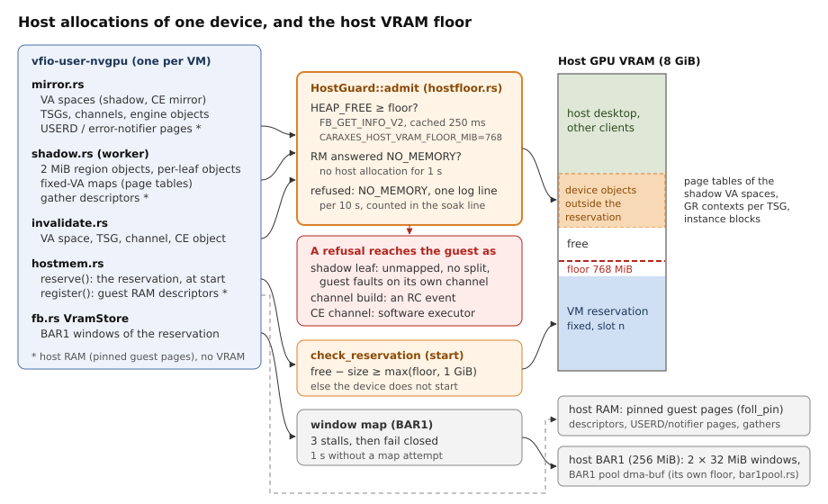

<!-- SPDX-License-Identifier: MIT -->
<!-- SPDX-FileCopyrightText: 2026 Silas Müller <github@silasmueller.de> -->
<!-- SPDX-FileCopyrightText: 2026 Universität Stuttgart, IKR -->
# Host resources: the VRAM floor, no retry storms, the leak audit, the soak line, the BAR1 budget

Written 2026-09-25 after the host froze with two VMs up (game VM 3 GiB, vm2 1 GiB, desktop
2.1 GiB on the 8 GiB RTX 2070):
- 11:42: 431 MiB of host VRAM free, about 1.1 GiB more used than the reservations and the
  desktop.
- 11439 host log lines in three bursts of refused `NV50_MEMORY_VIRTUAL` allocations
  (`virtmemAllocResources: VA Space alloc failed! Status Code: 0x51`, 64 MiB, then the same
  range in halves down to 2 MiB).
- `nvidia-smi` took 14-23 s per call; the operator rebooted.
- Over the game VM's 17 min session, host VRAM outside the reservations crept up by about
  270 MiB.

Code: `hostfloor.rs` (new), `soak.rs` (new), `hostmem.rs`, `shadow.rs`, `mirror.rs`, `fb.rs`,
`rc.rs`, `ctrl.rs`, `boot.rs`, `device.rs`, `main.rs` in `crates/vfio-user-nvgpu/src`; the watch
script is `caraxes/tools/soak-watch.sh`.



## 1. The host VRAM floor

- **One gate.** `HostGuard::admit` (hostfloor.rs) runs before every host allocation outside
  the reservation:
  - `HostMemory::alloc_object` and `alloc_object_admin` (hostmem.rs:778, :819): VA spaces,
    virtual objects, TSGs, channels, engine objects. Event and usermode objects hold no VRAM
    and pass (`admit_class`, hostmem.rs:861).
  - `HostMemory::map_dma_fixed` (hostmem.rs:1046): a shadow map can allocate page tables.
- **The check.** `HEAP_FREE` of `NV2080_CTRL_CMD_FB_GET_INFO_V2` (read-only; the query the
  reservation rule already made) against `CARAXES_HOST_VRAM_FLOOR_MIB`:
  - default 768 MiB; `0` turns the floor off;
  - the free size is cached for 250 ms, so the check is a clock read per allocation;
  - an unreadable free size refuses (fail closed).
- **Back-off.** An RM answer of `NV_ERR_NO_MEMORY` to an allocation or map stops every host
  allocation of the device for 1 s, without an RM call, and drops the cached free size.
- **Refusal.** The call returns `NV_ERR_NO_MEMORY` (0x51). One log line, then at most one per
  10 s with the count since; all refusals are counted (`floor_refused`, `no_memory` in the soak
  line).
- **At start.** `HostGuard::check_reservation` (hostmem.rs:1476): the reservation must leave
  the host `max(floor, 1 GiB headroom)` free, by `min(HEAP_FREE, nvidia-smi free)`, or the
  device does not start.

What the guest sees when the floor refuses:

| Operation | Guest-visible result |
|---|---|
| shadow leaf (map or region object) | not mapped; the rest of that sync is skipped; the guest's access faults on its own channel, an RC through the error notifier |
| GR shadow channel build (VAS, TSG, channel, engine object) | RC of the channel, `ROBUST_CHANNEL_PREEMPTIVE_REMOVAL`, once per channel (`RcState::host_refused`, rc.rs:454; ctrl.rs:432) |
| CE channel mirror | `mirror: REFUSED`, the doorbell runs on the software executor (as before) |
| BAR1 window of the reservation | see §2: the access fails closed after three stalls |
| reservation at start | the device exits with the refusal line |

## 2. No retry storms

Every path that allocates a fixed-range VA or maps on the host and retries or splits:

| Path | Before | Now |
|---|---|---|
| shadow: region object refused (shadow.rs:1302) | one per-leaf object per leaf, up to 512 refused calls per region per sync | NO_MEMORY: no per-leaf fallback, the rest of the sync is skipped (`exhausted`). Other statuses (a VA collision answers 0x1A): per-leaf, at most 4 refused per region per sync (`LEAF_OBJECT_FAILURES_PER_REGION`, shadow.rs:105) |
| shadow: coalesced map refused | retried leaf by leaf, up to 512 calls | NO_MEMORY: the run and the rest of the sync fail, no leaf-by-leaf retry |
| shadow: failed leaves | retried when the guest changes them | unchanged: never retried blindly |
| VRAM store: BAR1 window refused (fb.rs:478) | halve 32 to 2 MiB (once per session), then stall and retry every 1 ms for ever: about 1000 refused maps per second | halving unchanged; then 3 stalls (`STALL_TRIES`, fb.rs:333) and the access fails closed: reads all-ones, writes dropped, counted; no map for 1 s (`WINDOW_COOLDOWN`, fb.rs:337); one line per 10 s |
| CE channel alloc (mirror.rs:1837), invalidator channel | 4 attempts on `INVALID_ADDRESS` only (a page-table race) | unchanged: bounded, not a memory status |
| invalidator, shadow build: rebuilt at the next doorbell after a refusal | one RM attempt per doorbell | the floor and the back-off answer without an RM call; the channel is RC'd once |

The unit tests: `hostfloor::tests` (floor with a mocked free size, TTL, back-off, one log
line), `shadow::tests::a_region_refused_for_memory_makes_no_per_leaf_calls_and_stops_the_sync`,
`per_leaf_objects_stop_after_a_few_refusals_in_a_region`,
`a_coalesced_map_refused_for_memory_is_not_retried_leaf_by_leaf`,
`fb::tests::a_refused_window_evicts_our_own_then_fails_closed_and_cools_down`.

**The 0x2_1aa0_0000 split pattern is not main's device.**
- The RM makes one `vaspaceAlloc` per `NV50_MEMORY_VIRTUAL` and logs each failure once
  (virtual_mem.c:815-835 of 610.57.04); a 64-to-2 MiB halving is a client's loop.
- Main's device never asks for a virtual object above 2 MiB: region objects are `REGION`
  (2 MiB, shadow.rs), per-leaf objects are one leaf.
- The loop was the NVENC mirror experiment on vm2's device (another branch): it reserved every
  free VA of [4.5 GiB, 1 TiB) in the shadow VAS, halving refused ranges down to 64 KiB, 3576
  reservations per channel build; the host RM's page tables for that VA ate the host VRAM.
  That code is deleted on its branch. The floor and the once-only rule above would have
  stopped it after one refusal.

## 3. Leak audit

Every host-side allocation with its owner and its free path. "Soak key" names the counter in
the soak line (§4). Rows marked **fixed** leaked before this change.

| Allocation | Owner | Freed when | Soak key |
|---|---|---|---|
| VRAM reservation | `HostMemory::reserve`, hostmem.rs:1427 | exit teardown, after every descriptor (`free_reservation`, hostmem.rs:2174) | (host `vram_used_mib`) |
| guest RAM descriptors (pinned) | `register`, hostmem.rs:1711 | guest DMA_UNMAP (`release_region`, :2040) or exit (`free_last_descriptor`, :2155) | `pinned_chunks`, `pinned_mib`, `foll_pin` |
| hole fillers (memfd, pinned) | `register_linear`, hostmem.rs:1763 | exit | `pinned_chunks` |
| gather descriptors (pinned) | `gather`, hostmem.rs:1580 | last mapping gone (`free_idle_gathers`, shadow.rs:1092), VAS teardown | `gathers` |
| shadow VAS (page directories in VRAM) | `ShadowVas::new`, shadow.rs:813, per guest root | last channel and TSG of the root gone: worker teardown (`reap_shadows`, mirror.rs:820; `teardown_step`, shadow.rs:1669) | `vas`, `shadow_vas` |
| shadow VAS after a failed build | mirror.rs:945 | **fixed**: was never reaped when the TSG or channel was refused (the root kept its channel and TSG key); now `abandon_shadow_build`, mirror.rs:499 | `shadow_vas` |
| region and per-leaf virtual objects | shadow.rs:1302, :1376 | region emptied or class changed (`free_virtual`, :892), whole-region free (:905), teardown; at most 64 pooled per VAS (`REGION_POOL_MAX`) | `virtual` |
| shadow mappings (page tables in VRAM) | `map_dma_fixed` | guest change (unmap), teardown; at most 32768 live (`CARAXES_MAP_BUDGET`) | (host `vram_used_mib`) |
| CE mirror VAS | `ensure_vas`, mirror.rs:1426 | guest frees the VAS, root moves, reset (`drop_vas`, :2400) | `vas`, `ce_vas` |
| host TSG (GR context in VRAM) | `ensure_tsg`, mirror.rs:1664; shadow build, :1032 | guest frees the TSG or its client, reset (`free_tsg`, :2368) | `tsg`, `tsgs` |
| host channel, engine objects | `ensure_channel`, mirror.rs:1712; shadow build, :1067 | guest frees the channel or its client, reset (`free_channel`, :2333); engine objects with their channel | `channel`, `engine`, `channels` |
| shadow channel after a failed build | mirror.rs:1067 | **fixed**: a channel whose engine objects, `GPFIFO_SCHEDULE` or token failed stayed until exit, and the next doorbell built another one; now freed newest first on every failure | `channel` |
| USERD and error-notifier objects over guest RAM (pinned) | `guest_page_object`, hostmem.rs:1200, per mirrored channel | **fixed**: were freed only on a failed CE build and otherwise at exit (children of the device, not of the channel); now held in `HostChannel::pages` and freed after the channel (mirror.rs:2333) | `guest_page`, `foll_pin` |
| invalidator (VAS, TSG, channel, CE object, usermode) | `Invalidator::new`, invalidate.rs:122 | reset (`Invalidator::free`, :365) | one each |
| doorbell usermode object | `map_doorbell`, hostmem.rs:1316 | reset | `event` |
| OS events (one per engine and RC) | `os_event`, hostmem.rs:1328 | reset, event thread joined (mirror.rs:2607) | `event` |
| BAR1 windows of the reservation | `VramStore`, fb.rs:431 | LRU eviction, at most `CARAXES_BAR1_WINDOWS` (2); dropped with the FB | `vram_windows`, `vram_failed` |
| BAR1 dma-buf (P21 area or pool) | `export_bar1_passthrough`, hostmem.rs:1297 | process exit (one per device) | (host `bar1_used_mib`) |
| BAR2 memfd | `Bar2Area::create`, bar2area.rs:683 | process exit (one per device) | `rss_kib` |
| cached page-table walks (device RAM, up to 4M leaves per root) | `FakeFb::walks`, fb.rs:748 | **fixed**: `reap_shadows` never had the FB, so every root that ever ran kept its walk; now dropped at the next shadow doorbell or guest FREE (`take_reaped_roots`, ctrl.rs:428, boot.rs:1642) | `walk_caches`, `rss_kib` |
| host object list (`HostMemory::live`) | hostmem.rs:778 | **fixed**: a free forgot only direct children; grandchildren stayed listed and the exit teardown freed handles the RM no longer had (`forget_subtree`, hostmem.rs:631) | `host_objects` |
| forward cache | fwdcache.rs | bounded: 1024 answers, 4 MiB | `rss_kib` |
| RC journal | rc.rs | bounded: 256 records | `rss_kib` |

Not attributed yet: the 270 MiB creep of the game session. None of the fixed rows allocate
VRAM in a steady game session (one context, no channel churn). The candidates are host RM
page tables of the shadow VAS for a growing guest VA footprint (freed only with the VAS) and
the host's own clients. The soak line separates them: object counts flat while
`vram_used_mib` grows points at page tables or other clients.

## 4. The soak line and the watch script

- **In the device.** Every `CARAXES_SOAK_SECS` (default 60, `0` off) while the guest runs,
  once at exit before the teardown, and once after it:

  ```
  vfio-user-nvgpu: soak 60s: rss_kib=… vram_used_mib=… vram_free_mib=… bar1_used_mib=… bar1_free_mib=… foll_pin=… pinned_chunks=… pinned_mib=… host_objects=… vas=… virtual=… tsg=… channel=… engine=… guest_page=… event=… other=… gathers=… floor_refused=… no_memory=… shadow_vas=… ce_vas=… tsgs=… channels=… vram_windows=… vram_failed=… walk_caches=…
  ```
  - `foll_pin` is host-wide (other VMs move it); `pinned_*` is this device's own.
  - The `after teardown` line must show `host_objects=0`, `pinned_chunks=0`, `gathers=0`.
- **From outside.** `caraxes/tools/soak-watch.sh <csv> [SECONDS]` samples at 1 Hz: host VRAM
  and BAR1 used/free (one `nvidia-smi -q -d MEMORY`), the RSS of every `vfio-user-nvgpu`
  process, `foll_pin`, `MemAvailable`, and the query's latency. `--summary <csv>` prints the
  means of the first and the last minute and the deltas. VM starts and stops move VRAM in
  reservation-sized steps: read the rows around them.

## 5. The GPU run (coordinator)

- Binaries: `/mnt/vmstore/caraxes/vfio-user-nvgpu-main-floor-<sha>` (610 guest) and
  `vfio-user-nvgpu-v615-floor-<sha>` (615 guest), `CARAXES_SERVER=<path>`.
- Game VM only (the BAR1 floor rule: no second pool beside it), the SotTR stage's env as is;
  `CARAXES_HOST_VRAM_FLOOR_MIB` unset (768).
- On the host, before the VM: `caraxes/tools/soak-watch.sh /mnt/vmstore/caraxes/soak-<date>.csv`.
- A 20-30 min session; then stop the VM, `soak-watch.sh --summary`, and grep the device log for
  `soak `, `host VRAM`, `fail closed`, `refused by the host`.
- Pass:
  - the device starts (the reservation check logs the floor);
  - `floor_refused=0 no_memory=0 vram_failed=0` while the host has more than 768 MiB free;
  - the object counts and `walk_caches` flat across the session's soak lines; `rss_kib` flat
    after the first minutes;
  - the `after teardown` line at zero; 0 host log bursts, 0 Xid.
- Optional negative test (only with the operator): `CARAXES_HOST_VRAM_FLOOR_MIB` set above
  the host's free VRAM before a CUDA context starts in the guest: expect one refusal line, an
  RC in the guest (the context errors out), no host log burst, the desktop responsive.

## 6. BAR1 budget

The host's 256 MiB BAR1 ran out four times on 2026-09-25 (host dmesg `dmaAllocMapping_GM107:
can't alloc VA space for mapping`, NO_MEMORY from mapping_reuse.c:273):
- **11:35:** two pools, the game VM's and vm0's (the BAR1 floor at start, ebbbf627, came from
  this one).
- **12:16:** a second VM started beside the pooled game VM.
- **12:26:** the NVENC probe VM beside the game VM without a pool.
- **13:22:29:** the game's `vkCreateDevice` failed with -1 (`VK_ERROR_OUT_OF_HOST_MEMORY`) on
  vm4-615 at the same second. That was the pool (64 MiB) plus 2 x 32 MiB windows, the desktop
  at about 90 MiB, and Moonlight's software decoder drawing through the host GPU. The soak
  line a minute before read `bar1_used_mib=157`, so the spike was transient.

What in the device consumes host BAR1:
- **The VRAM store's windows.** They are the only dynamic consumer. Each window is one
  `RM_MAP_MEMORY` of the reservation (hostmem.rs:189 `map_window`, called from fb.rs:511
  `window_for`). The RM maps vidmem for the CPU through BAR1 (mapping_cpu.c:516, then
  `kbusMapFbAperture`, kern_bus_gm107.c:3110-3155). Unmapping happens in `Window::drop`
  (hostmem.rs:162).
- **The pool or the P21 area.** One dma-buf (hostmem.rs:329 `export_dmabuf`) that holds its
  BAR1 mapping for the VMM's life: fixed, and checked at start.
- **Not BAR1:**
  - Host channels: the USERD is the client's own (`bClientAllocatedUserD`, so the RM makes no
    BAR1 mapping, kernel_channel_tu102.c:288). The error notifier is in guest sysmem.
  - TSGs, GR contexts, shadow VA spaces and maps: VRAM and GPU VA only.
  - The doorbell page is in BAR0. `scan_reservation` runs only with `CARAXES_P20_SCAN=1`.
- **The RM's reuse database** (mapping_reuse.c) shares one BAR1 range between identical
  mappings of one memdesc, by refcount. It unmaps at refcount 0 (mapping_reuse.c:120-131) and
  keeps nothing cached. The :273 failure is its map callback not finding contiguous BAR1 VA
  for a new range.

What could take about 100 MiB within seconds:
- **The device's window switch** mapped the new window before it evicted the old one, so every
  switch held 3 x 32 MiB for a moment.
  - The 12:29-13:25 session made 348408 window maps and 348406 evictions, about 100 switches
    per second, and more while a Vulkan device with many queues is created (24 channels, up to
    1340 host objects in that minute, all touching the reservation through the windows).
  - Each switch was a 32 MiB peak above the device's steady 128 MiB (pool 64 + 2 x 32). It
    also churned the RM's BAR1 VA and fragmented it: a 32 MiB window needs one contiguous range.
- **The rest was not the device.** Its 348408 maps were never refused (`0 refused` in the
  session summary), so the refused mapping at 13:22:29 was another client's: the desktop's
  Vulkan and Moonlight's texture uploads. The device's peak (160 MiB) plus a desktop that
  reached 90 MiB leaves about 6 MiB of 256.

Now:
- **Evict before map** (fb.rs:539): the device never holds more windows than its budget, so
  its peak is its steady 128 MiB.
- **One gate for every window.** `ReservationMapper::map` (hostmem.rs:261) admits each window
  with a `HostGuard` for BAR1 (hostfloor.rs `bar1_from_env`):
  - `BAR1_AVAIL_SIZE` (`FB_GET_INFO_V2`, read-only, hostmem.rs:284), cached for 250 ms;
  - the window's size is debited on admission and credited back on eviction;
  - the free size minus the window must stay at `CARAXES_HOST_BAR1_FLOOR_MIB` (default 96);
  - an RM NO_MEMORY backs off for 1 s.
- **A refused window** goes through the VRAM store's fail-closed path (§2): the store gives
  back its own least recently used window and retries, halves down to 2 MiB, stalls 3 times,
  then fails the access (all-ones or dropped) and cools down for 1 s.
- **Visible:** one log line per 10 s, `bar1_refused` in the soak line, host `bar1_used_mib`
  and `bar1_free_mib` in every soak line. `soak-watch.sh --summary` prints the run's BAR1 peak
  and its lowest free.

Rule for operators until the dynamic check has run on the GPU:
- one pooled VM, or two VMs without pools;
- never a second device beside a pooled game VM, and no NVENC or other probe VM beside the game
  VM.

## 7. Open

- A shadow build refused for another reason than memory still leaves the guest channel
  waiting (no RC); only memory refusals RC.
- A VRAM-store access that fails closed returns all-ones: the guest driver treats that as a
  lost GPU. Correct for the host, fatal for the guest session.
- A TSG built for a channel whose build then failed stays until the guest frees its TSG.
- The floor is a free-VRAM floor, not a per-device budget: a device can still take all VRAM
  above the floor. A per-device budget of host VRAM outside the reservation needs the host's
  per-object sizes (the GR context is the large one).
- The 270 MiB creep (§3, last paragraph) waits for a soak run.
