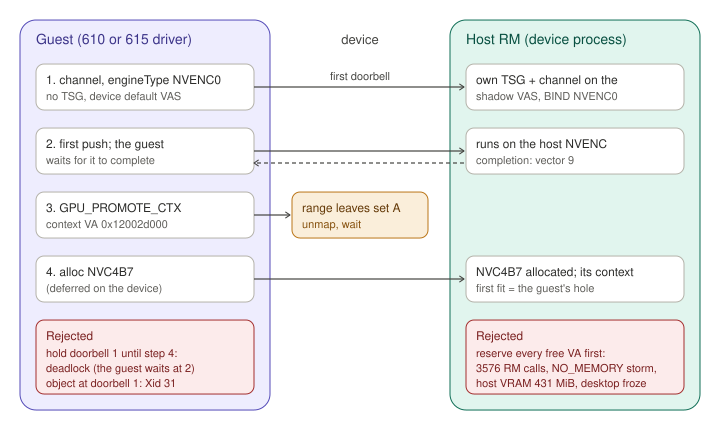

<!-- SPDX-License-Identifier: MIT -->
<!-- SPDX-FileCopyrightText: 2026 Silas Müller <github@silasmueller.de> -->
<!-- SPDX-FileCopyrightText: 2026 Universität Stuttgart, IKR -->
# Video engines: NVENC and NVDEC through the mirror

Status (2026-09-25, `probe-layout610`): the 610 guest encodes through the mirror. 300 frames
of 1080p H.264 were encoded at 104.8 fps, with a median latency of 5.5 ms (p99 25.1 ms). The
stream passes the header check, and the host logged no NVRM line and no Xid. NVDEC does not
work yet (§5). The design is the video layout (§3).

- Records: `caraxes/runs/nvenc-2026-09-25/`.
- Probe: `caraxes/tools/nvenc-probe.c`.
- Citations: the 615.71.09 tree.

## 1. The probe

- It uses the NVENC API and cuvid directly, through FFmpeg's nv-codec-headers (MIT, SDK 13.1).
  The headers are fetched without any identifier into `target/nvenc/ffnvcodec`. The
  libraries are loaded at run time, so the guest needs no CUDA toolkit.
- Steps:
  1. Open a CUDA context and an NVENC session.
  2. Encode N frames of a moving pattern to H.264 (P1, ultra-low latency, CBR).
  3. Check the Annex-B stream: SPS, PPS and IDR are present, and the SPS picture size is
     the one requested.
  4. Decode the stream with NVDEC and compare the luma (PSNR).
- Output: an `ENC` line (fps, latency), `BITSTREAM`, `DEC`, `RESULT PASS|FAIL`.
- Native run on the host (`native/`): 300 frames at 1080p, 160.7 fps, 2.9 ms median
  latency, 8.4 Mbit/s at 60 fps. Decode minimum 63.4 dB. Result: PASS.
- The 610 image has `libnvidia-encode.so.1` and `libnvcuvid.so.1` in `/opt/nvrm/lib`.

## 2. What the guest sends (610 guest)

| Step | Guest RPC | Device before | Device now |
|---|---|---|---|
| open session | GSS legacy `0x20808165`, `0x2080A028`, `0x20808163`; `0x20808164` at close; NV_OK natively (`matrix/traces/610.57.04/nvenc.jsonl:2059-2205`, `:6325`) | unanswered: `NV_ENC_ERR_INCOMPATIBLE_CLIENT_KEY` (21) | forwarded to the host (`ver/v610.rs` `LEGACY`) |
| caps | `NVENC_GET_CAPS_V2`, `NVDEC_GET_CAPS_V2` | chip table | unchanged |
| VAS | `FERMI_VASPACE_A` with index GPU_DEVICE, `COPY_SERVER_RESERVED_PDES`, FREE (`gpu_vaspace.c:3877-3921`) | root forgotten with the handle | root kept under `(hClient, hDevice)` |
| channel | `TURING_CHANNEL_GPFIFO_A` under the device, engineType 0x1b, no TSG, no VAS; BIND; SCHEDULE | software executor; `nvEncInitializeEncoder` status 20 | host channel in its own TSG on the shadow VAS, bound to NVENC0 |
| first push | a doorbell before any engine object; the guest waits for it | — | runs on the host engine |
| context | `GPU_PROMOTE_CTX` with entryCount 0 and a top-level `virtAddress`/`size`: 0x12002d000 + 0x1000 (`falcon/kernel_falcon.c:184-276`) | ignored | recorded; kept out of set A |
| object | `NVC4B7_VIDEO_ENCODER` under the channel, no params | recorded | deferred, then allocated on the host (§3) |

## 3. The video layout

- The guest's context VA does not matter to the host engine:
  - The guest's `GPU_PROMOTE_CTX` reaches only this device.
  - The host kernel RM allocates the channel's own falcon context when the object is
    allocated (`kflcnAllocContext`, `kernel_falcon.c:279-298`). It maps that context first
    fit (`kchannelMapEngineCtxBuf`, `kernel_channel.c:3848-3870`) and binds it to the engine
    at that VA.
  - A promote sent to the host before the object cannot steer this. From user space it goes
    to GSP (flags 0x10244, no kernel-RM handler), and the kernel RM then promotes its own VA.
- Where the host's first fit lands:
  - Both RMs place their buffers at the lowest free VA at or above max(4 GiB, the VAS base)
    (`vaspace.c:111-118`, `virt_mem_allocator_gm107.c:2768-2773`).
  - That lowest VA must lie outside the range the RM reserves for GSP-RM
    (`SPLIT_VAS_SERVER_RM_MANAGED_VA_START`, [4 GiB, 4.5 GiB), `gpu_vaspace.c:410-417`).
  - With the default VAS base, both first fits are 0x120000000, so the host's context took a
    VA that the guest filled next (§4).
  - Checked in `probe-merged610` and `probe-layout610`:
    - 0x12002d000 appears in the device trace only in the guest's promote.
    - No CE method (the memsets at 0x120400000 and 0x1205fe000) targets it.
    - The NVENC pushes run on the host and are not decoded. But the page stays unmapped in
      the shadow, and 300 frames ran with no fault, so the engine never touched it.
- The layout (shadow.rs `Layout::video`, chosen when a root's shadow VAS is first built for
  a video channel):
  - The shadow `FERMI_VASPACE_A` gets `vaBase` 0x11C000000, 64 MiB below the guest's RM
    base. The host's first fit is then the host-only area [0x11C000000, 0x120000000).
  - The host area lies inside the guest's own GSP-RM range, which the guest never maps.
  - The price: the host's GSP-RM range moves to [0x21C000000, 0x23C000000). Guest leaves
    there, or below the base (32-bit pointer allocations), are refused by the filter by name,
    so no fixed allocation ever collides with a host buffer. `probe-layout610` refused none.
  - The RM reports the base it took; a VAS that did not honour the base is refused.
- Why the per-2 MiB region objects stay: the shadow maps set A dynamically. Region objects
  of fixed size are freed and pooled one region at a time, and they keep a partial unmap
  from splitting a live run (shadow.rs header). One VA reservation over the whole guest range
  (option b) would lose that. It could not be made either once guest pages are mirrored.
  So the host area goes below the guest range (option a).
- Placement (`Mirror::place_video_object`):
  1. A 4 KiB non-fixed probe allocation shows the host's first fit. If it is outside the host
     area, the object is refused.
  2. The host object is allocated.
  3. A second probe shows whether the context took that first fit.
  - The object is kept only when both checks pass (`context_verdict`). Otherwise it is freed
    before the guest maps anything else, and the guest's allocation gets
    `NV_ERR_NOT_SUPPORTED`, logged in one line.
  - A video object on a root whose shadow VAS was built for GR or CE first (default layout)
    is refused before it is recorded. So is every video object under
    `CARAXES_MIRROR_VIDEO_OBJECT=0`.
- Ownership:
  - The host object is a child of the mirrored channel, in the host TSG the mirror created
    for it. There is no implicit channel group.
  - `free_channel` frees the channel, the RM frees the object and its context
    (`kflcnFreeContext`), and the host TSG follows.
  - `probe-layout610`, at exit: 0 channels, 0 engine objects, 0 TSGs left.
  - At a signal exit, `HostMemory` answers every RM call made after its teardown without an
    ioctl. The 13 `Object handle is not valid` lines of `probe-hole610` were a shadow worker
    unmapping after the RM client was freed.
- Eligibility:
  - A video channel (engineType NVENCn or NVDECn) is mirrored in a host TSG of its own.
  - Its objects must be video classes of the chip's class database (`..B7`, `..B0`).
  - At the first doorbell the host channel is bound to its engine and scheduled, so the
    guest's first push runs before the object exists.
- Completion: NVDEC0 and NVENC0 have non-stall vectors 8 and 9 (`chips/tu106/interrupts.toml`).
  Host OS events on notifiers 14 and 38 raise them.

## 4. Failure modes found

| Run | Design | What happened |
|---|---|---|
| `probe-mirror1` | object allocated when the guest allocates it, before the guest's context left the shadow | the host context took a free VA that the guest filled later (a 2 MiB leaf at 0x120400000 was refused in the shadow); Xid 31 FAULT_PTE on NVENC0 at 0x1205fe000, pid 121037 |
| `probe-mirror2`: the VA reservation storm | object at doorbell 1, after reserving every free VA of [4.5 GiB, 1 TiB), split recursively down to 64 KiB | 3576 fixed reservations per build (48 s); 11435 host `virtmemAllocResources ... NO_MEMORY` lines; host VRAM down to 431 MiB; NVENC0 FAULT_PDE at VA 0 (twice, pid 196394); the desktop froze and the host was rebooted at 11:44. The code is removed, and no mirror path reserves VA speculatively or retries by splitting |
| `probe-hold`: the doorbell-hold deadlock | doorbell 1 held until the object | the guest waits for its first push before it allocates the object; it stayed held for 10 s, then `nvEncInitializeEncoder` status 20. No Xid, no host NVRM line, host VRAM 3749 MiB free after |
| `probe-merged610` | deferred object; the guest's page unmapped first | the unmapped page was no VA hole: the shadow's 2 MiB region object still reserved it. The host context took 0x120400000, and the guest's 2 MiB page there collided (`VA Space alloc failed`, no Xid) |
| `probe-hole610` | the region split around the guest's page | the host context took the hole at 4 KiB alignment, but the split objects were refused (0x1a) and the fallback collided with the host context (3 NVRM lines, no Xid). Replaced by the video layout |
| `probe-defer`, `probe-defer2` | the deferred-object design | both stopped at host BAR1 exhaustion during the probe step's driver reload, before any CUDA or NVENC call; no result. The second time the game VM had no pool, and more than 130 MiB were taken within a second, which exceeds vm2's 96 MiB budget; the source is open (`probe-defer2/README.md`). `run.sh` now samples host BAR1 every 0.5 s |

## 5. Results

- `probe-layout610` (binary 050ddf56, 610 guest on vm2, host alone):
  - [x] `nvEncInitializeEncoder` succeeds (216 ms).
  - [x] 300 frames at 1080p: 104.8 fps, median latency 5.5 ms, p99 25.1 ms, max 30.5 ms,
    8.4 Mbit/s at 60 fps. Natively: 160.7 fps, 2.9 ms.
  - [x] Header check: SPS 1920x1080, profile 100, level 4.2, 3 IDR, no bad start code.
  - [x] Device: `host video object class 0xc4b7 ...: its context at 0x11c000000, in the
    host-only area`, 0 leaves refused by the layout.
  - [x] Host: no NVRM line, no Xid.
  - [ ] `nvidia-smi encodersessions` did not list the session (the probe's encode lasts 3 s,
    and the one sample in that window listed none).
  - [ ] NVDEC: `cuvidCreateDecoder` returned CUDA error 2 (out of memory), 0 frames, no PSNR.
    - The NVDEC0 object was placed like NVENC's, its context at 0x11c000000.
    - The guest then opened an NVDEC1 channel and freed everything 0.3 ms after that
      channel's first doorbell, before any NVDEC1 promote or object.
    - The device answered no call with an error in that window, so the failure is on the
      guest's side. Open.
- 615 guest:
  - `probe-layout615` and `probe-layout615b` had no result: the wrong userspace, then the
    vm2-615 image lacks `libnvidia-encode`.
  - `probe-vm4-615` (the game VM, NVIDIA's 615 packages):
    - `nvEncOpenEncodeSessionEx` returned `NV_ENC_ERR_UNSUPPORTED_DEVICE` (2), and Sunshine
      fell back to libx264.
    - The 615 library stops after `GPU_GET_INFO_V2`: no caps query, no session open, no
      video channel. So the mirror is not reached.
    - Untested: the 615 userspace or the 3 GiB profile. Open.

## 6. Limits

- One video object per channel, and only TU106's NVC4B7 and NVC4B0 so far.
- A root whose shadow VAS was built for GR or CE first has no host area; video objects on
  it are refused.
- The host area is 64 MiB. A host context that does not fit there, or lands elsewhere, is
  refused, not placed.
- The NVENC engine is shared with the host desktop's encoder sessions and the game VM's.
