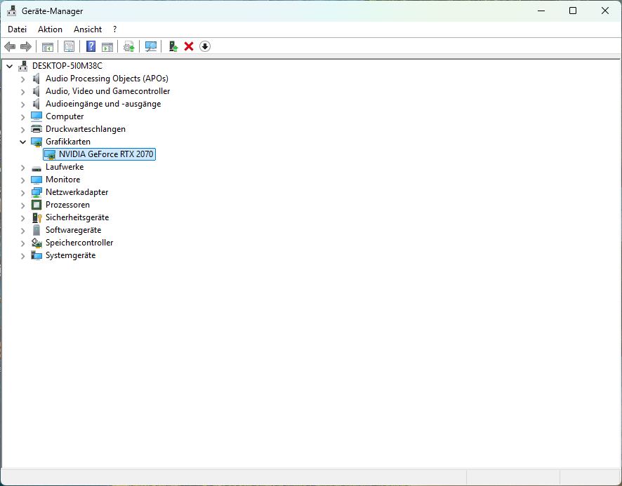
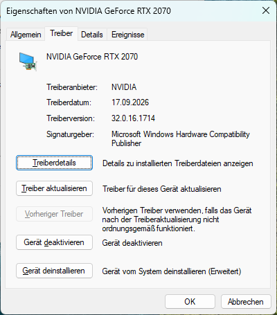
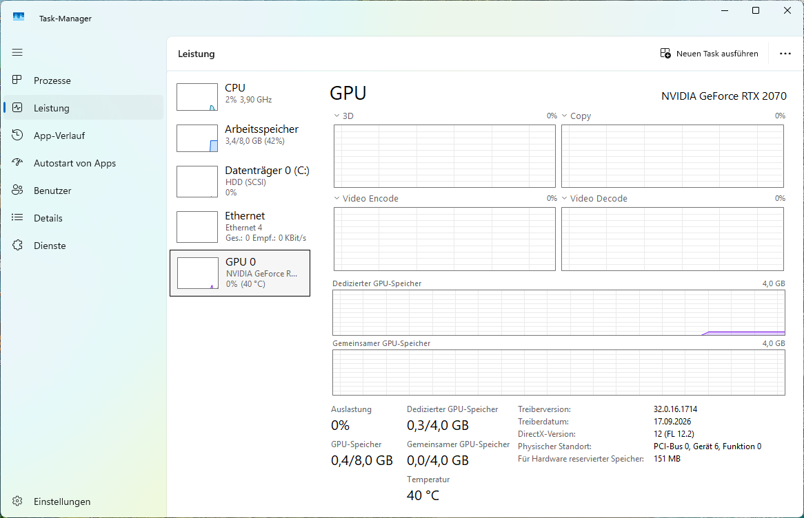
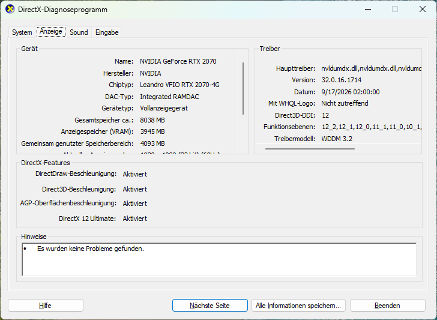
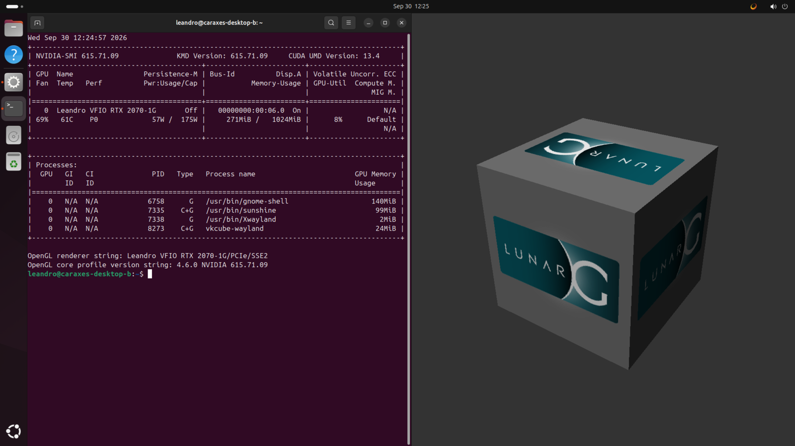

<!-- SPDX-License-Identifier: MIT -->
# Showcase

The stock NVIDIA driver on one synthetic TU106 (RTX 2070), under Windows 11 and Ubuntu 24.04,
served by one device binary (the dev merge of 2026-09-30, stack ffec4d49).

## Windows 11, driver 617.14

The guest's user interface is German. The VM has 4 GiB of VRAM.



Device Manager: the GPU under Display adapters (Grafikkarten), on NVIDIA's own driver.



The driver tab: NVIDIA 32.0.16.1714 (617.14), signed by the Windows Hardware Compatibility Publisher.



Task Manager: 4.0 GB dedicated memory, driver 32.0.16.1714, DirectX 12 (FL 12.2), PCI bus 0, device 6.



dxdiag: chip type "Leandro VFIO RTX 2070-4G", DirectX 12 Ultimate, WDDM 3.2, no problems found.

`nvidia-smi` in the same guest (benchmark run of 2026-09-30):

```text
Wed Sep 30 12:36:35 2026
+-----------------------------------------------------------------------------------------+
| NVIDIA-SMI 617.14                 KMD Version: 617.14        CUDA UMD Version: 13.4     |
+-----------------------------------------+------------------------+----------------------+
| GPU  Name                  Driver-Model | Bus-Id          Disp.A | Volatile Uncorr. ECC |
| Fan  Temp   Perf          Pwr:Usage/Cap |           Memory-Usage | GPU-Util  Compute M. |
|                                         |                        |               MIG M. |
|=========================================+========================+======================|
|   0  Leandro VFIO RTX 2070-4G     WDDM  |   00000000:00:06.0  On |                  N/A |
| 68%   40C    P0             57W /  175W |     191MiB /   4096MiB |      0%      Default |
|                                         |                        |                  N/A |
+-----------------------------------------+------------------------+----------------------+
```

## Ubuntu 24.04, driver 615.71.09

Linux B, the Ubuntu desktop guest, with a 1 GiB VRAM profile.



GNOME on Wayland: `nvidia-smi` lists gnome-shell, Xwayland, Sunshine and vkcube-wayland; vkcube renders on the right.

`nvidia-smi`:

```text
Wed Sep 30 12:26:57 2026
+-----------------------------------------------------------------------------------------+
| NVIDIA-SMI 615.71.09              KMD Version: 615.71.09     CUDA UMD Version: 13.4     |
+-----------------------------------------+------------------------+----------------------+
| GPU  Name                 Persistence-M | Bus-Id          Disp.A | Volatile Uncorr. ECC |
| Fan  Temp   Perf          Pwr:Usage/Cap |           Memory-Usage | GPU-Util  Compute M. |
|                                         |                        |               MIG M. |
|=========================================+========================+======================|
|   0  Leandro VFIO RTX 2070-1G       Off |   00000000:00:06.0  On |                  N/A |
| 69%   61C    P0             57W /  175W |     283MiB /   1024MiB |      9%      Default |
|                                         |                        |                  N/A |
+-----------------------------------------+------------------------+----------------------+

+-----------------------------------------------------------------------------------------+
| Processes:                                                                              |
|  GPU   GI   CI              PID   Type   Process name                        GPU Memory |
|        ID   ID                                                               Usage      |
|=========================================================================================|
|    0   N/A  N/A            6758      G   /usr/bin/gnome-shell                    152MiB |
|    0   N/A  N/A            7335    C+G   /usr/bin/sunshine                        99MiB |
|    0   N/A  N/A            7338      G   /usr/bin/Xwayland                         2MiB |
|    0   N/A  N/A            8273    C+G   vkcube-wayland                           24MiB |
+-----------------------------------------------------------------------------------------+
```

`lspci -nnk`, the GPU:

```text
00:06.0 VGA compatible controller [0300]: NVIDIA Corporation TU106 [GeForce RTX 2070] [10de:1f02] (rev a1)
	Subsystem: Gigabyte Technology Co., Ltd TU106 [GeForce RTX 2070] [1458:4011]
	Kernel driver in use: nvidia
	Kernel modules: nvidiafb, nouveau, nvidia_drm, nvidia
```

`glxinfo -B` in the GNOME session:

```text
name of display: :0
display: :0  screen: 0
direct rendering: Yes
Memory info (GL_NVX_gpu_memory_info):
    Dedicated video memory: 1024 MB
    Total available memory: 1024 MB
    Currently available dedicated video memory: 541 MB
OpenGL vendor string: NVIDIA Corporation
OpenGL renderer string: Leandro VFIO RTX 2070-1G/PCIe/SSE2
OpenGL core profile version string: 4.6.0 NVIDIA 615.71.09
OpenGL core profile shading language version string: 4.60 NVIDIA
OpenGL core profile context flags: (none)
OpenGL core profile profile mask: core profile
```

`vulkaninfo --summary`, the NVIDIA device (llvmpipe follows as GPU1):

```text
GPU0:
    apiVersion         = 1.4.351
    driverVersion      = 615.71.9.0
    vendorID           = 0x10de
    deviceID           = 0x1f02
    deviceType         = PHYSICAL_DEVICE_TYPE_DISCRETE_GPU
    deviceName         = Leandro VFIO RTX 2070-1G
    driverID           = DRIVER_ID_NVIDIA_PROPRIETARY
    driverName         = NVIDIA
    driverInfo         = 615.71.09
    conformanceVersion = 1.4.3.3
    deviceUUID         = 7fc490a1-b1e9-81e2-363d-50dc8f183234
    driverUUID         = e960882b-0170-5057-bf3e-c686505f8776
```

`nvidia-smi -q | head -40`:

```text
==============NVSMI LOG==============

Timestamp                                              : Wed Sep 30 12:26:57 2026
Driver Version                                         : 615.71.09 [Deprecated; will be removed in CUDA 14.0. Use KMD Version instead]
CUDA Version                                           : 13.4 [Deprecated; will be removed in CUDA 14.0. Use CUDA UMD Version instead]
KMD Version                                            : 615.71.09
CUDA UMD Version                                       : 13.4

Attached GPUs                                          : 1
GPU 00000000:00:06.0
    Product Name                                       : Leandro VFIO RTX 2070-1G
    Product Brand                                      : GeForce
    Product Architecture                               : Turing
    Display Mode                                       : Requested functionality has been deprecated
    Display Attached                                   : Yes
    Display Active                                     : Enabled
    Persistence Mode                                   : Disabled
    Addressing Mode                                    : None
    MIG Mode
        Current                                        : N/A
        Pending                                        : N/A
    Accounting Mode                                    : Disabled
    Accounting Mode Buffer Size                        : 4000
    Driver Model
        Current                                        : N/A
        Pending                                        : N/A
    Serial Number                                      : N/A
    GPU UUID                                           : GPU-7fc490a1-b1e9-81e2-363d-50dc8f183234
    GPU PDI                                            : 0xe281e9b1a190c47f
    Minor Number                                       : 0
    VBIOS Version                                      : 90.06.3D.00.76
    MultiGPU Board                                     : No
    Board ID                                           : 0x6
    Board Part Number                                  : N/A
    GPU Part Number                                    : 1F02-400-A1
    FRU Part Number                                    : N/A
    Platform Info
        Chassis Serial Number                          : N/A
        Slot Number                                    : N/A
```

## Notes

- The NVIDIA Control Panel starts and exits without a window on this Windows guest; the NVIDIA
  App is not installed.
- GNOME's System Details names the graphics "Unknown" (no switcheroo-control, no renderer string
  in the session), so the desktop shot shows `nvidia-smi` and `glxinfo` instead.
- Tools: `tools/windows/showcase.ps1` with `caraxes/runs/win-2026-09-30/showcase-hi.sh`;
  `caraxes/runs/user-2026-09-30/guest-screenshot.py` and `guest-keys.py` for GNOME.
