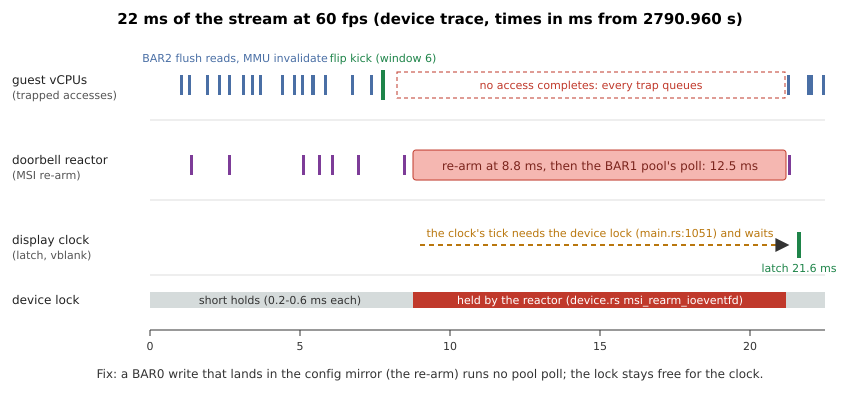

<!-- SPDX-License-Identifier: MIT -->
# The SotTR stage: Shadow of the Tomb Raider in a Leandro VFIO VM

Written 2026-09-24. This is roadmap item 2 ([roadmap.md](../history/caraxes-roadmap-2026-09-27.md)): the game workload is the
benchmark that decides. The stage gives the operator a VM with 3 GiB in which to start, play
and measure Shadow of the Tomb Raider, streamed to Moonlight on this host. The GPU run is the
operator's. What ran here is the plumbing test in pure emulation (section 6).

Scripts and evidence: [caraxes/runs/sottr-2026-09-24/](../../caraxes/runs/sottr-2026-09-24)
(its `README.md` is the operator's page).

## 1. What was prepared

| Piece | Where | What it does |
|---|---|---|
| Games disk in the launcher | `tools/caraxes-vm.sh:67-77` (header), `:152-156`, `:196`, `:201-204`, `:242-304` (`games_lock_file`, `games_users`, `games_prepare`), `:371-377` (`down`) | `CARAXES_GAMES_DISK=<base.qcow2>` attaches a thin overlay `$W/games.qcow2` as a third `--disk` (vdc). The overlay is made once and kept across up/down. `CARAXES_GAMES_DISK_RW=1` attaches the base for writing, but only when no running Cloud Hypervisor has it or an overlay on it and no other VM holds the writer lock |
| Stage environment | `caraxes/runs/sottr-2026-09-24/env.sh` | vm4 with the settings of section 5 |
| Start | `up.sh` | overlay and seed on the first start, the guest preparation, driver, display, GNOME, Sunshine; host watch, 1 Hz sampler, NAT |
| Stream | `stream.sh` | Sunshine up if needed, pairing only when needed, and a Moonlight window on the operator's desktop |
| Stop | `down.sh` | Moonlight quit, then only the recorded pid is ended; logs collected, VM down, NAT removed |
| Guest preparation | `guest/sottr-prepare.sh` | one-time steps, each with a marker in `/var/lib/caraxes-sottr` |
| Guest session | `guest/sottr-session.sh` | GNOME, Sunshine start/stop, status |
| Host sampler | `host-sampler.sh` | v1's sottr-4q columns at 1 Hz for one VM |

### The writer lock

The directory of the v1 base, `/mnt/vmstore/leandro/vm`, is read-only for Leandro VFIO, so the lock
cannot sit next to the base. It lives in the Leandro VFIO store:
`/mnt/vmstore/caraxes/locks/games-<hash>.writer`. The hash is the first 16 hex digits of the
sha256 of the base's real path. The file holds `<vm> <pid> <disk>`. `up` writes it with
noclobber and rewrites it with the Cloud Hypervisor pid (`tools/caraxes-vm.sh:201-204`). `down`
removes the VM's own lock. A lock whose pid is gone is stale and is removed at the next `up`.

The lock alone does not cover v1: v1's `--games-init` writes the base without it. The launcher
therefore also reads the disks of every running Cloud Hypervisor (`/proc/<pid>/cmdline`, then
`qemu-img info -U --backing-chain`). A writer start is refused if any running VM has the base
or an overlay on it. An overlay start is refused while any running VM has the base itself as a
disk. This is the rule of v1's `lea_games_writer_other_than`
(`../Leandro-Test/scripts/lib/rig.sh:837-857`) plus the lock. One caveat remains, as in v1: an
overlay made before the base was last written reads garbage afterwards. The writer path prints
a note when the VM has an old overlay (delete it).

## 2. The library on the v1 disk

`/mnt/vmstore/leandro/vm/games.qcow2` (read with `guestfish --ro`): ext4, label `LEAGAMES`,
200 GiB virtual. The top level holds `SteamLibrary/`, a second Steam library folder that the
operator added in v1 (`libraryfolder.vdf` with its own `contentid`), and `lost+found`. Under
`SteamLibrary/steamapps/`:

- appmanifests of 7 apps: Shadow of the Tomb Raider (750920, 37.96 GB, `StateFlags 4`, fully
  installed), 3DMark Demo (231350), Proton Experimental, Proton Hotfix and the Steam Linux
  Runtimes 4, sniper and soldier;
- `common/Shadow of the Tomb Raider/`: `ShadowOfTheTombRaider.sh`, `bin/ShadowOfTheTombRaider`
  (ELF 64-bit), `lib/`, `share/`, Feral's `CheckVulkanDriver` and crash reporter. **This is the
  native Feral Linux port (Vulkan), not the Windows build under Proton.** Properties >
  Compatibility must stay off. `compatdata/750920` also exists, left over from a Proton attempt
  in v1. The native game does not use it;
- the game binary resolves all its libraries in the guest except `libopenal.so.1`. Steam's own
  runtime supplies that library when Steam starts the game (plumbing `c2-steam-runtime.txt`).

## 3. The guest side

### 3.1 Image and one-time preparation

vm4 is an overlay on the 610.57.04 base image
(`guest-baked-20260801-610.57.04-20260820-105733.qcow2`). The 615.71.09 image is not usable
here: it lacks the 615 GL, EGL and Vulkan userspace (guest-driver-versions.md section 8).
Since 2026-09-25 it is, with the distribution packages installed on the overlay: section 8.
The base has no NVIDIA kernel modules and no GSP firmware (quickstart.md section 2).
`sottr-prepare.sh` therefore repeats what vm0 carries. vm0's overlay was read with
`guestfish --ro`:

- `modules`: the four-module build of `ogkm-610.57.04.tar.zst` (sha256 4e0f09ed...) against
  6.8.0-136, `modules_install`, `depmod`, as for vm0 (experiments.md "D0", display phases C/D).
  This takes about 10 minutes once;
- `firmware`: `gsp_tu10x.bin` 610.57.04 (sha256 d157e3b7...). The host now has only 615.71.09,
  so `up.sh` copies the firmware out of vm3's 610 overlay with `guestfish --ro` into
  `$W/gsp_tu10x-610.57.04.bin` and checks its sha256;
- `modprobe`: vm0's `/etc/modprobe.d/caraxes.conf` and `caraxes-display.conf`, verbatim;
- `display`: `gdm-wayland-setup.sh` and `nvidia-egl-setup.sh on` (display-e.md section 2), plus
  `multi-user.target` as the default target, as on vm0 (the base boots to `graphical.target`,
  and gdm3 is started by hand after the display modules are loaded); `kmsgrab` built;
- `sunshine`: vm0's uinput udev rule and the user in `input`. The Sunshine package already
  carries `cap_sys_admin,cap_sys_nice=p` (plumbing `prepare.txt`), so Sunshine runs as the
  desktop user with KMS capture inside the session, audio included;
- `games`: the v1 mount (`../Leandro-Test/scripts/lib/provision.sh:656-742`):
  `LABEL=LEAGAMES /games ext4 defaults,nofail,x-systemd.device-timeout=10 0 2` in fstab,
  mounted at boot by systemd's fstab generator. Unlike v1 there are no `steamapps -> /games`
  symlinks: the library is `/games/SteamLibrary`, a folder of its own;
- `steam`: see 3.2.

### 3.2 Steam

The Ubuntu launcher `/usr/games/steam` (steam-installer 1.0.0.79) uses
`~/.steam/debian-installation` as the root of a new installation. At the first start it asks
through zenity (the default button is Cancel), downloads `steam_1.0.0.79.tar.gz` from
repo.steampowered.com, unpacks the bootstrap, and then the client updates itself. Every step
after the dialog needs the internet, hence the NAT of `up.sh`. Tap networks have none by default
(caraxes/runs/guest-driver-2026-09-24/commands.txt line 23).

Steam adopts an existing library folder when that folder is listed in `libraryfolders.vdf` in
its root. `sottr-prepare.sh` writes `steamapps/libraryfolders.vdf` and `config/libraryfolders.vdf`
under `~/.steam/debian-installation`. Entry 0 is the root. Entry 1 is `/games/SteamLibrary`
with the `contentid` from the disk's `libraryfolder.vdf` and the app sizes of its manifests.
It also makes the launcher's control links `~/.steam/steam` and `~/.steam/root`, and adds
`~/.config/autostart/steam.desktop`, so that the streamed desktop opens with Steam. v1 started
Steam over ssh with the session's environment (provision.sh:1913-1931); autostart puts Steam
in the session without that. The operator's login stays the operator's: no account data is
prepared. If Steam still lists the game as not installed, the fallback is Settings > Storage >
Add Drive > `/games/SteamLibrary`.

Steam's pressure-vessel needs unprivileged user namespaces, so v1's
`kernel.apparmor_restrict_unprivileged_userns = 0` is set (provision.sh:1839-1848). The
library's sniper runtime ran a command inside its container in vm4 ("Steam Runtime 3 (sniper)",
plumbing `c2-steam-runtime.txt`).

## 4. The operator's steps

The commands are in the run folder's README. In short:

```
caraxes/runs/sottr-2026-09-24/up.sh       # refuses while vm0, vm2 or vm2-615 runs
caraxes/runs/sottr-2026-09-24/stream.sh   # pairs if needed, opens the Moonlight window
caraxes/runs/sottr-2026-09-24/down.sh
```

In the stream, click Install in the Steam installer, log in, check that the game shows as
installed, start it (native, no Proton), and run the in-game benchmark (Graphics > Run
Benchmark) at 1280x720 and at 1920x1080 with the same preset. Note the result screen.

Pairing (`stream.sh`, from `../Leandro-Test/scripts/bench.sh:1031-1042` with the retries of
`caraxes/runs/display-f-2026-09-24/stream.sh`): `moonlight list <ip>` succeeds when the host is
already paired, and then nothing happens. Otherwise `moonlight pair <ip> --pin 4321` runs in
the background, and the PIN is posted to `https://<ip>:47990/api/pin` with the web login
`lea`/`leastream` (v1's `config.sh:204-206`) until Sunshine answers `"status":true`. The window
is `moonlight stream <ip> Desktop --display-mode windowed` at 1920x1080, 60 fps, 20 Mbit/s,
detached with `setsid nohup`, in the operator's Wayland session (`WAYLAND_DISPLAY=wayland-1`,
`DISPLAY=:0`). Its pid is kept in `$W/moonlight.pid`. `down.sh` runs `moonlight quit <ip>`
first, which makes the client print its session summary, and then ends only that pid.

## 5. Settings

| Setting | Value | Source |
|---|---|---|
| VM, tap, IP, MAC | vm4, `caraxes3` (host 192.168.103.1), 192.168.103.24, 02:00:00:00:00:24 | `caraxes3` is vm3's tap (p20.sh:30); no running VM used it. caraxes0 is vm0, caraxes1 vm1, caraxes2 vm2, caraxes5 the v1 bench VM. `up.sh` refuses a tap in use, so vm3 must be down |
| Memory, vCPUs | 8 GiB, 8 | SotTR's minimum is 8 GB. v1's sottr-4q VMs had 8 GiB |
| Profile, slot | 3072 MiB (`Leandro VFIO RTX 2070-3G`), `CARAXES_RESERVE_SLOT=0` = the top 3 GiB | README D11 and P20. vm0 (2 GiB) and vm2 (2 GiB) overlap it and must be down. vm1 (1 GiB, slot 4 = top-5G..top-4G) does not |
| Host execution | `CARAXES_HOST_RM=1 CARAXES_HOST_EXEC=1 CARAXES_MIRROR_CHANNELS=1 CARAXES_MIRROR_GR_SHADOW=1 CARAXES_MIRROR_BARE_CE=1 CARAXES_RESERVE_VRAM=1 CARAXES_DMA=register CARAXES_BOOT_MODEL=1` | intr-page-2026-09-24/env.sh |
| Display | `CARAXES_DISPLAY=1 CARAXES_INTR_PAGE=1 CARAXES_DISPLAY_PAGE=1` | configuration C of display-page-2026-09-24 (display gate 11/11) |
| Doorbell | `CARAXES_DOORBELL_TOKENS=64 CARAXES_DOORBELL_POLL=hybrid CARAXES_DOORBELL_POLL_IDLE_US=200` | the same. The interrupt page needs the polling reactor (the device refuses otherwise, even in emulation) |
| BAR1 pool | off | not in the display series. bar1-pool.md: never run on a VM with the display |
| Device binary | `/mnt/vmstore/caraxes/vfio-user-nvgpu-main-3cb33af` (sha256 44a261bb...) | main 3cb33af: display page, interrupt page, the FB_FLUSH_GPU_CACHE fix for the 615 host, GSP E+A, LCE shim. The display series' frozen fepage binary predates the flush fix |
| Cloud Hypervisor | `/mnt/vmstore/caraxes/vm1/ch-0006-v.sh` (v53 + 0001-0006) | the token pool needs 0006 |
| Guest driver | 610.57.04 (the device's emulated ABI) | DRIVER_VERSION |
| Games disk | `CARAXES_GAMES_DISK=/mnt/vmstore/leandro/vm/games.qcow2` as overlay `/mnt/vmstore/caraxes/vm4/games.qcow2` | section 1 |
| Sunshine | `capture = kms`, `encoder = software` (libx264), web login `lea`/`leastream`, PIN 4321, app `Desktop` | display-e.md section 7. NVENC needs roadmap item 3 |
| Host watch | `bench-hostwatch.sh` every 5 s, `KILL=$W/gpu.pid SLOW=3` | a game must not slow the host desktop (the P20 lesson) |
| NAT | MASQUERADE 192.168.103.0/24 out of the uplink, FORWARD accept -s/-d, removed by `down.sh` | v1's `rig.sh net up` (rig.sh:355-392). `SOTTR_NAT=0` keeps the guest offline |

## 6. The plumbing test (pure emulation, 2026-09-24 18:32 to 18:55)

`SOTTR_EMULATION=1 CARAXES_MEM=6G` (6 GiB because vm0 and vm1 were running on the host), the
launcher of this branch. There was no host RM, no reservation and no NAT. Evidence is in
`caraxes/runs/sottr-2026-09-24/plumbing/`.

| Check | Result |
|---|---|
| Overlay, seed, games overlay | made; `games disk: new overlay /mnt/vmstore/caraxes/vm4/games.qcow2` (21.8 MiB after the test) |
| Boot, cloud-init | ssh up at 192.168.103.24, hostname `caraxes-vm4` |
| Preparation | all seven steps; five modules installed; firmware sha256 d157e3b7...; about 10 minutes in total |
| Driver | `RmInitAdapter succeeded!`, `modprobe rc=0`; the interrupt page, the display page and the token pool announced by the device |
| Games disk | `/dev/vdc` at `/games` (196G, 137G free), from fstab at the second boot; `Shadow of the Tomb Raider` in `common/` |
| Steam | launcher waiting at its installer dialog under Xvfb (offline, no download possible); `libraryfolders.vdf` with the 7 apps; sniper runtime container runs |
| Display, GNOME | **not in pure emulation**: nvidia-drm refuses with `Failed to allocate NvKmsKapiDevice`, so there is no card0, no KMS and no GNOME. The display needs the host RM, as in display phases C to E |
| Sunshine (stage config) | refuses correctly without gnome-shell |
| Pairing and Moonlight (`stream.sh`) | against a stand-in Sunshine (`capture = x11` on Xvfb, the same login and state directory): paired through the API at the first attempt; the Moonlight window opened on this desktop; 57.07 FPS incoming and decoded, host latency avg 18.7 ms, 0 % network drops |
| `down.sh` | `moonlight quit` printed the summary; the recorded pid was ended with SIGTERM (it did not exit within 10 s); VM stopped; 0 host Xid lines |
| Second boot with the main 3cb33af binary | `binary-check.txt`: the same flags accepted, `RmInitAdapter succeeded!`, `/games` mounted, default target `multi-user.target` |
| Launcher refusals | `games-refusals.txt`: a missing base is refused. An overlay start while another VM holds the writer lock is refused. No device was started |

vm4's overlay is left prepared, so the operator's first start skips the build. The host's
Moonlight is paired with vm4's Sunshine (its state is in the guest's `~/.config/sunshine`). The
display series' EGL mode is set per start by `up.sh` (`on` on the GPU).

Deviation during the test: one check command reached vm0 instead of vm4 (the environment was not
sourced): `systemctl get-default` and `sudo systemctl set-default multi-user.target`. vm0 was
already at `multi-user.target`, so nothing changed there.

## 7. What is measured, and the comparison with v1

Per session (`session-<time>/`, table in the run folder's README): host watch (host nvidia-smi
latency, host kernel log volume, Xid), a 1 Hz host CSV with v1's columns
(`../Leandro/docs/virtio/measurements/sottr-4q/sample.sh`: card memory used and free, utilisation,
clocks, temperature, power, encoder and decoder use, host RAM, plus the device process's VRAM
and the CPU seconds of the device and Cloud Hypervisor), the device's summary lines, Sunshine's
log, the guest's kernel log and journal, host Xid lines. The operator records the game's
benchmark screen and Moonlight's session summary.

v1's reference (`../Leandro/docs/virtio/measurements/sottr-4q/README.md`) is **two** `RTX2070-4Q`
guests of 3072 MiB running the benchmark at the same time. Both completed at 720p. At 1080p the
second scene failed to load: card peak 7771 MiB, 1 MiB free, per-guest charge up to 3184 MiB
(110 MiB over the profile), host RAM exhausted with two 8 GiB VMs. The first Leandro VFIO run is
**one** guest, so the comparison is:

- the per-guest numbers: VRAM held against the 3072 MiB profile (on Leandro VFIO the reservation is
  fixed at the profile size, and a guest cannot exceed it: the device's FB is the reservation),
  encoder use, stream frame rate and host latency (v1: NVENC on the host driver, Leandro VFIO: x264
  in the guest until roadmap item 3);
- whether the 1080p scene loads, with the reservation in place of v1's charge accounting;
- the benchmark's own FPS at 720p and 1080p. v1's README gives no FPS, so the first Leandro VFIO
  numbers are the reference for the second guest.

The concurrent run (two game VMs as in sottr-4q) needs two 3 GiB slots (slots 0 and 1 of a
3 GiB profile, the top 6 GiB). With the 1 GiB desktop floor that leaves nothing for vm1, so
all other VMs must be down. It is the next step after the single run.

## 8. The 615 variant: vm4-615 with the distribution's driver (2026-09-25)

The 610 image's hand-built stack (`/opt/nvrm`, `/opt/nvrm-gl`, the ld.so and ICD edits of
`sottr-prepare.sh` step `nvrmgl`) cost a morning of Steam, EGL and Vulkan surprises. The
operator's decision: the game VM runs the 615.71.09 driver as Ubuntu installs it. The weekend
goal follows from it (roadmap.md): the guest driver must not matter.

**Commands.** `up-615.sh`, `stream-615.sh`, `down-615.sh` (the stage's scripts with
`SOTTR_DRIVER=615`, which sources `env-615.sh`). Evidence goes to `session-615-<time>/`. vm4 and
vm4-615 share tap, address, MAC, profile and slot, so only one of them runs.

| Piece | vm4-615 |
|---|---|
| Overlay | on `guest-baked-2026-09-24-615.71.09.qcow2` (`CARAXES_DRIVER=615`: `check_base`, `--guest-abi 615`) |
| Device | `/mnt/vmstore/caraxes/vfio-user-nvgpu-v615-22d58534` (main; nothing in the device changed after it) |
| Memory, pool | 4 GiB (host RAM), BAR1 pool 64 MiB (the host desktop keeps its BAR1). Both are now the 610 defaults too |
| Offline, before the first boot (`up.sh`, guestfish on the overlay) | `/etc/modprobe.d/caraxes-615-display.conf`: `nvidia_modeset` and `nvidia_drm` load only while `caraxes_dma_range` is loaded, `nvidia_peermem` never, `options nvidia-drm modeset=1 fbdev=0`; `nvidia-persistenced` masked (it would load nvidia before the DMA table); default target `multi-user.target` |
| `packages615` | `apt-get install nvidia-driver-pinning-615.71.09`, then `nvidia-driver-open libnvidia-gl libnvidia-decode libnvidia-encode libnvidia-fbc1` at `615.71.09-2ubuntu1` from NVIDIA's CUDA repository and `linux-modules-extra-6.8.0-136-generic`; `libnvidia-gl:i386` for Steam's 32-bit parts. About 300 MB, through the stage's NAT, public repositories only |
| `modprobe615`, `display615` | the conf checked, persistenced masked; gdm: `WaylandEnable=true`, autologin, `61-gdm.rules` masked, session `ubuntu-wayland`. No Mesa pin, no `nvidia-egl-setup.sh` |
| shared steps | `sunshine`, `games`, `steam` (autostart), `cursor` (`MUTTER_DEBUG_DISABLE_HW_CURSORS=1` in `/etc/environment.d`) |
| Sunshine | `encoder = nvenc` (`SOTTR_SUN_ENCODER`, `software` on 610), `sw_preset = ultrafast`, `sw_tune = zerolatency` for the fallback; `sunshine-start` waits up to 180 s |

**What the packages settle** (`session-615-20260925-112443/prepare.txt`):

- `nvidia_icd.json`, `10_nvidia.json` (EGL vendor), `gbm/nvidia-drm_gbm.so` and the EGL
  platform files belong to `libnvidia-gl` and `libnvidia-egl-*`; the libraries are in the ld.so
  cache, 32- and 64-bit. The image's own unowned 610-era files were replaced; only
  `10_nvidia_wayland.json` is left unowned beside the packaged `09_nvidia_wayland2.json`.
- The packaged DKMS `nvidia-drm` loads: `drm_display_helper` comes from `linux-modules-extra`.
  The HDCP-less rebuild of [display-615.md](display-615.md) section 2.1 is not needed.

**First run, 2026-09-25 11:24** (`session-615-20260925-112443/`):

- `RmInitAdapter succeeded`, `modprobe rc=0`, DP-1 connected at 1920x1080; `nvidia-smi` rc 0;
  `vulkaninfo --summary`: "Leandro VFIO RTX 2070-3G", driver NVIDIA 615.71.09, beside llvmpipe.
- One GNOME start: Wayland session, "Created gbm renderer for '/dev/dri/card0'", 0 page-flip
  failures, the CRTC scans out 1920x1080. Steam autostarted, `/games` mounted.
- Steam's sniper container (`run-in-sniper -- steam-runtime-system-info`, runtime
  3.0.20260805): the NVIDIA Vulkan ICD and the NVIDIA EGL vendor imported, no issues anywhere
  (`sniper-system-info-extract.txt`). The 610 VM needed the ld.so and ICD edits for this.
- vkcube did not run: vulkan-tools 1.3.275 has no `--wsi` option (fixed in the script, not rerun
  while the operator played).
- Sunshine (`sunshine-encoder.txt`): `h264_nvenc` loads NVENC 13.1, then
  `OpenEncodeSessionEx failed: unsupported device` (no NVENC mirror yet); `h264_vulkan` fails
  four times with `VK_ERROR_INITIALIZATION_FAILED` (about 15 s each); vaapi skips the NVIDIA
  card; **libx264 [software]** is chosen. The probe took about 70 s.
- Moonlight re-paired (a fresh Sunshine) through the API; the stream runs with libx264 in the
  guest and FFmpeg decoding on the host.
- Host Xid: 11:30:18 Xid 31 NVENC0 `FAULT_PTE` names pid 142502, vm2's device (another agent's
  VM), not this session's. 11:32:26 Xid 31 CE0 `FAULT_PDE` read names pid 126268, **this
  session's device**, while the operator was in the stream; the device log has one
  `HOST RC EVENT on a mirrored engine ... exceptType 0x1f` and 25 `bar1 pool: ... remap refused
  (the guest maps it twice)` lines. The VM and the stream kept running.

**Lesson.** The stock packages are the way. Everything the 610 stage needed by hand (the
four-module build, the GL copy, the ld.so entry, the absolute ICD path, the EGL and GBM links)
is what `nvidia-driver-open` and `linux-modules-extra` install. What remains Leandro VFIO-specific in
the guest is below.

### 8.1 What the device still needs from the guest

For the weekend goal (a plain Ubuntu VM with `apt install nvidia-driver-*` works):

- **The three registry keys** in `/etc/modprobe.d/caraxes.conf`,
  `NVreg_RegistryDwords="RmDisableGlobalCeUtils=1;RMDisableScrubOnFree=1;RmRcWatchdog=0"`
  ([leandro.md](../leandro.md) "The registry", costume-ladder.md section 2.1: without them the
  TU106 does not reach `RmInitAdapter succeeded`):
  - `RmDisableGlobalCeUtils=1`: the kernel RM's CeUtils self-test channel on a copy engine
    whose VA space the device never learns;
  - `RMDisableScrubOnFree=1`: the scrubber's copy-engine memsets on every free;
  - `RmRcWatchdog=0`: the watchdog GR channel.
  The device has to serve (or safely absorb) these channels so the stock defaults work.
- **Module options and load order that are the rig's, not the driver's:** `GpuInitOnProbe=1`,
  `ResmanDebugLevel=0`, `uvm_disable_hmm=1`, `blacklist nvidia`, the display modules gated on
  `caraxes_dma_range`, persistenced masked. They exist because the guest DMA table
  (`caraxes_dma_range`, D18) must be in place before nvidia binds; D18's sparse registration
  removes that need.
- **The GSP firmware and ABI** come from the package (`nvidia-firmware`); the device picks the
  guest ABI from `CARAXES_DRIVER` today. The weekend goal wants it chosen from what the guest
  sends (the version in `GSP_INIT`), so no switch is needed per driver.

## 9. Open points

- The stream uses libx264 on the guest's vCPUs (display-e.md section 7 measured 26 FPS with
  2.09 cores for the desktop). A game at 1080p60 competes with x264 for the 8 vCPUs, so the
  measured game FPS includes that. NVENC (roadmap item 3) removes it.
- The Steam client (its UI, the 32-bit parts) runs on GNOME's Xwayland. Whether its UI renders
  on the NVIDIA GLX or falls back to software rendering is not known yet.
- Audio through Sunshine: Sunshine runs in the user's session, but the guest has no sound card;
  Sunshine's own virtual sink is what Moonlight plays.
- The Xid 31 at one GNOME start (display-e.md section 9) may show up here too; `down.sh` records
  host Xid lines.

## 10. Mouse and input (2026-09-25)

Findings from the operator's tests on vm4-615 (plain configuration, then the reactor paths without
the pool).

- **What the absolute mouse is.** Moonlight's remote-desktop mode sends absolute positions;
  Sunshine injects them through a uinput pointer device with `EV_ABS` (grid 19200 x 12000, scaled
  to the display), which libinput and Mutter list as "Mouse passthrough (absolute)".
- **Packets stop at the window edge.** Moonlight sends only while the host pointer is inside its
  window. With a lagging stream the guest pointer trails the host pointer, the host pointer slips
  over the edge, and the guest sees nothing: Sunshine's log showed a gap of one minute between
  bursts of 50 to 180 packets per second.
- **Where the lag came from.**
  - Plain configuration: every MSI re-arm (about 1000 per second) and every clock read (about 500
    per second) trapped; the guest's interrupt path stalls on each trap.
  - Host load 17 on 16 threads (three agent builds plus the software decoder): Mutter logged
    "event processing lagging behind by 26ms, your system is too slow".
  - The software cursor: every pointer motion is a compositor repaint, so a cursor move costs the
    whole capture, encode, network and decode pipeline.
- **Next.** The game runs Moonlight in relative mode (`SOTTR_MOUSE=--no-absolute-mouse`); the
  desktop keeps the absolute mode. Measure again with the pool fix (`bar1-pool.md` section 10)
  and the reactor paths, with no builds on the host. Pinning the guest's interrupt vCPU on the
  host is the next lever (`intr-page.md`, the Weston late-vblank finding).

## 11. The capture and the compositor (2026-09-25)

Record: vm4-615, GNOME Wayland, Sunshine `capture = kms`, `encoder = software`. Evidence in
`/mnt/vmstore/caraxes/evidence-2026-09-25/`: `trace-stream60-13s.txt`,
`trace-stream30-vkcube.txt`, `trace-nostream-vkcube-16s.txt` (the first 7 s still with the
capture, seconds 8 to 12 without). Code at dae79b11 unless a line says otherwise.



**Symptom.**
- Display kicks (`W bar0 0x696000`, window 6): 1 to 8 per second with the stream, 49 to 59
  without; the latches fall on multiples of 16.7 ms (33, 50, 66 ms apart): whole vblanks missed.
- With the capture every kind of trap gets rarer (TIME reads, doorbells, invalidates), not only
  the compositor's: the guest waits on something shared.

**Mechanism.**
- The guest's MSI re-arm (`NV_XVE_CYA_2`, 573 per second in the 60 fps trace) arrives through
  its ioeventfd. The doorbell reactor takes the device lock (device.rs:192) and runs
  `msi_rearm_ioeventfd`. That logs the `msi re-arm` line first, then the steps of a trapped
  BAR0 write (device.rs:539), including the BAR1 pool's poll (device.rs:1131,
  `bar1pool::poll_model`).
- The poll merges every replica (bar1pool.rs:912, two page reads each through the device's two
  32 MiB BAR1 windows). With refused remaps pending, it also retries them every 1 ms
  (bar1pool.rs:966), and each retry waits for the shadow worker (bar1pool.rs:653) and reads the
  mirrored channels' USERDs.
- While the poll runs, nothing else can take the lock: the vfio-user thread (every vCPU's trap),
  the other doorbells, and the display clock, whose tick latches flips and raises the vblank
  under the same lock (main.rs:1051).

**Evidence.**
- Silences of more than 2 ms that start right after an `msi re-arm` line:

| Trace | Silences | Time | Of |
|---|---|---|---|
| stream 60 fps | 777 | 2.49 s | 13.0 s |
| stream 30 fps with vkcube | 1561 | 5.27 s | 13.5 s |
| no stream, capture still on (0-7 s) | 760 | 2.70 s | 7.0 s |
| no stream, capture off (8-12 s) | 122 | 0.41 s | 5.0 s |

- Each ends with a burst 15 to 60 us after the release: queued re-arms, TIME reads of other
  vCPUs, BAR2 flush reads, and display latches. The lock was held; the guest was not idle.
  Example in the figure: kick 7652 at 2790.9679 s, re-arm at 2790.9688 s, 12.5 ms of nothing,
  then the latch of that flip at 2790.9816 s. The longest silence was 50.5 ms.
- The trace does not show which part of the poll is slow. The frozen binary traces every poll
  over 2 ms (`bar1 pool: the poll after a BAR0 write held the device N us`).

**What it is not.**
- (a) The doorbell hold. Sunshine's root 0x129be5000 has an untrapped USERD, so its
  invalidates are held until the worker applies them (untrapped.rs `must_hold`). They cost
  about 250 us more than the unshadowed root's: p50 672 against 435 us, 0.68 s in 13 s.
  This is real but secondary; it is unchanged.
- (b) Host preempts on unmap. The pool summary counts 4 TSG preempts in the whole session.
- (c) The display kick path. `W 0x696000` takes 195 us at p50.
- (d) The shadow sync. 9834 syncs, sum 1.01 s. Back-to-back BAR2 flush reads cost at least
  210 us each, with or without the stream.
- (e) Notifier latency. The event thread raises MSIs without the device lock; only its trace
  notes wait for the next trap.

**Fix** (device, commit 356dd4e4; binary
`/mnt/vmstore/caraxes/vfio-user-nvgpu-v615-capture-356dd4e4`, v615 release):
- A BAR0 write that lands in the config-space mirror is no sync point
  (`Device::after_bar0_write(sync_point)`, device.rs:1159). This covers the trapped re-arm and
  the ioeventfd one. No P21 check and no pool poll follow such a write. The guest orders its
  BAR1 changes with the BAR2 flush read and the MMU invalidate, which stay sync points
  (bar1-pool.md §10).
- Refused remaps back off. The retry interval doubles after each retry that moved nothing, up
  to 64 ms (`RETRY_MAX`, bar1pool.rs:59, `pace_retry` :1429). It drops back to 1 ms at the
  first move. A new mapping is still walked at the next poll.
- Replicas merge in home-page order (`merge_order`, bar1pool.rs:910), so a sync point maps each
  BAR1 window region once at most.
- Counters: `bar0 config-mirror writes: N ..., K pool poll(s) held the device over 2 ms` in the
  exit summary; `R retry poll(s), B of them moved nothing (interval now X ms)` in the pool line.
- Tests: `device::tests::a_config_mirror_write_does_not_poll_the_bar1_pool`,
  `bar1pool::tests::a_fruitless_retry_backs_off_and_a_move_resets_it`,
  `bar1pool::tests::replicas_merge_in_home_order`.

**Sunshine's share.**
- `display_ram_t::snapshot` (kmsgrab.cpp:1304-1315) imports the scanout buffer again on every
  frame: `drmModeGetFB2`, `drmPrimeHandleToFD`, `egl::import_source`, a blit, a readback, and
  the import is destroyed.
- In the guest that is a map and an unmap of the 8.3 MB buffer in Sunshine's VA per frame. That
  makes 2 MMU invalidates, each held by (a), and 5 host RM map or unmap calls in the worker.
- The smallest Sunshine change is a cache of the imported `egl::rgb_t` in `display_ram_t`:
  - keyed by the plane's `fb_id` plus the modifier, pitch and offset of `drmModeGetFB2`;
  - it keeps the dma-buf fds open;
  - at most 4 entries (Mutter flips between 3 surfaces: 0x12b000000, 0x129c00000 and 0x12a600000
    in the trace);
  - cleared on `reinit`.
  `display_vram_t` passes descriptors on to the encoder instead of importing per frame. The
  cache removes the per-frame maps; the device fix does not depend on it.

**GPU check (not run here).** vm4-615 with the frozen binary, vkcube in the guest, the stream
at 60 fps:
- The display kick rate returns to about 60 per second.
- The trace shows no silence over 2 ms after an `msi re-arm` line.
- `pool poll(s) held the device over 2 ms` stays small. Each such event names a remaining slow
  sync point: the BAR2 flush read or the invalidate.
