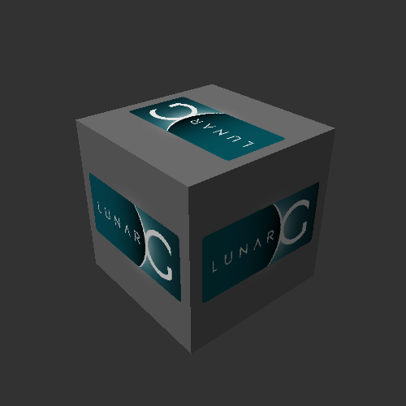

<!-- SPDX-License-Identifier: MIT -->
# Demonstration

Use the [manual quickstart](quickstart.md) to start two Ubuntu desktops on one GPU.
It covers host setup, guest installation, Cloud Hypervisor and two Moonlight windows.
The same guide includes two NixOS compute guests.

## Check the result

- In each desktop, `glxinfo -B` must name NVIDIA; `llvmpipe` means software rendering.
- Run `glxgears` in both desktops and check that both streamed windows change.
- `nvidia-smi` checks device access, not rendering or CUDA execution.
- Run a compute workload with a checked result before claiming compute works.
- Stop guest applications, shut down the VMs, then stop remaining backends.

## Recorded output

A Leandro VirtIO guest (Ubuntu 24.04, kernel 6.8.0-136-generic, driver 615.71.09) on 2026-09-30.
It has no PCI GPU: the driver's calls reach the host through `virtio_nvrm` and `nvrm_nodes`,
and `nvidia-smi` shows the host card under the name Leandro gives it.



vkcube, one frame of the guest's swapchain (2026-08-15).

`nvidia-smi`:

```text
Wed Sep 30 10:53:42 2026
+-----------------------------------------------------------------------------------------+
| NVIDIA-SMI 615.71.09              KMD Version: 615.71.09     CUDA UMD Version: 13.4     |
+-----------------------------------------+------------------------+----------------------+
| GPU  Name                 Persistence-M | Bus-Id          Disp.A | Volatile Uncorr. ECC |
| Fan  Temp   Perf          Pwr:Usage/Cap |           Memory-Usage | GPU-Util  Compute M. |
|                                         |                        |               MIG M. |
|=========================================+========================+======================|
|   0  Leandro VirtIO RTX 2070-4G     Off |   00000000:2D:00.0  On |                  N/A |
| 78%   59C    P8             31W /  175W |       0MiB /   4096MiB |      1%      Default |
|                                         |                        |                  N/A |
+-----------------------------------------+------------------------+----------------------+

+-----------------------------------------------------------------------------------------+
| Processes:                                                                              |
|  GPU   GI   CI              PID   Type   Process name                        GPU Memory |
|        ID   ID                                                               Usage      |
|=========================================================================================|
|    0   N/A  N/A           11452  M+C+G   /opt/nvrm/bin/nvidia-smi                  0MiB |
+-----------------------------------------------------------------------------------------+
```

`lspci -nnk`: only virtio devices; `1af4:107c` is the NVRM transport.

```text
00:01.0 Mass storage controller [0180]: Red Hat, Inc. Virtio 1.0 block device [1af4:1042] (rev 01)
	Subsystem: Red Hat, Inc. Virtio 1.0 block device [1af4:1042]
	Kernel driver in use: virtio-pci
00:02.0 Mass storage controller [0180]: Red Hat, Inc. Virtio 1.0 block device [1af4:1042] (rev 01)
	Subsystem: Red Hat, Inc. Virtio 1.0 block device [1af4:1042]
	Kernel driver in use: virtio-pci
00:03.0 Ethernet controller [0200]: Red Hat, Inc. Virtio 1.0 network device [1af4:1041] (rev 01)
	Subsystem: Red Hat, Inc. Virtio 1.0 network device [1af4:1041]
	Kernel driver in use: virtio-pci
00:04.0 Unassigned class [ffff]: Red Hat, Inc. Virtio 1.0 RNG [1af4:1044] (rev 01)
	Subsystem: Red Hat, Inc. Virtio 1.0 RNG [1af4:1044]
	Kernel driver in use: virtio-pci
00:05.0 Unassigned class [ffff]: Red Hat, Inc. Device [1af4:107c] (rev 01)
	Subsystem: Red Hat, Inc. Device [1af4:107c]
	Kernel driver in use: virtio-pci
```

`nvidia-smi -q | head -40` (serials, UUID and part numbers redacted):

```text
==============NVSMI LOG==============

Timestamp                                              : Wed Sep 30 10:53:42 2026
Driver Version                                         : 615.71.09 [Deprecated; will be removed in CUDA 14.0. Use KMD Version instead]
CUDA Version                                           : 13.4 [Deprecated; will be removed in CUDA 14.0. Use CUDA UMD Version instead]
KMD Version                                            : 615.71.09
CUDA UMD Version                                       : 13.4

Attached GPUs                                          : 1
GPU 00000000:2D:00.0
    Product Name                                       : Leandro VirtIO RTX 2070-4G
    Product Brand                                      : GeForce
    Product Architecture                               : Turing
    Display Mode                                       : Requested functionality has been deprecated
    Display Attached                                   : Yes
    Display Active                                     : Enabled
    Persistence Mode                                   : Disabled
    Addressing Mode                                    : HMM
    MIG Mode
        Current                                        : N/A
        Pending                                        : N/A
    Accounting Mode                                    : Disabled
    Accounting Mode Buffer Size                        : 4000
    Driver Model
        Current                                        : N/A
        Pending                                        : N/A
    Serial Number                                      : (redacted)
    GPU UUID                                           : (redacted)
    GPU PDI                                            : 0x79f23fe1be1523a4
    Minor Number                                       : 0
    VBIOS Version                                      : 90.06.3D.00.76
    MultiGPU Board                                     : No
    Board ID                                           : 0x2d00
    Board Part Number                                  : (redacted)
    GPU Part Number                                    : (redacted)
    FRU Part Number                                    : N/A
    Platform Info
        Chassis Serial Number                          : (redacted)
        Slot Number                                    : N/A
```

## Scope

- The manual recipe has not yet been validated from fresh guest images.
- Automated provisioning, games disks, benchmarks and acceptance commands belong
  to the optional private Leandro-Test repository.
- Recorded functional results: [Testing](testing.md).
- Display configuration and known failures: [Display](display.md).
- Per-VM limits do not establish hostile-tenant isolation: [Security](security.md).
